# L1-1《AI大模型初识》学习笔记

> 本笔记由课件《L1-1_AI大模型初识》整理，配套图片见 `images/` 文件夹。

---

## 一、这节课要学什么

三条主线目标：

1. **建立大模型系统性认知** —— 掌握基本概念、核心原理，理解技术本质和能力边界。
2. **掌握 AI 应用开发技术** —— 掌握大模型四大核心能力（**Prompt / RAG / Agent / 微调**），理解行业应用。
3. **明确职业方向** —— 找到个人在 AI 时代的机会与发展方向。

> 一句话：**从"会用 AI"到"会做 AI 应用"。**

---

## 二、为什么现在必须学 AI

- 几乎所有行业都在用大模型：

| 行业 | 典型应用 |
|---|---|
| 教育 | 个性化辅助、智能出题、作文批改 |
| 医疗 | 辅助诊断、医学文献分析、健康咨询 |
| 金融 | 智能投顾、风险评估、合规审查 |
| 法律 | 合同审查、案例检索、法律咨询 |
| 制造 | 产品设计、质量检测、供应链优化 |
| 营销 | 内容创作、用户画像、广告投放 |

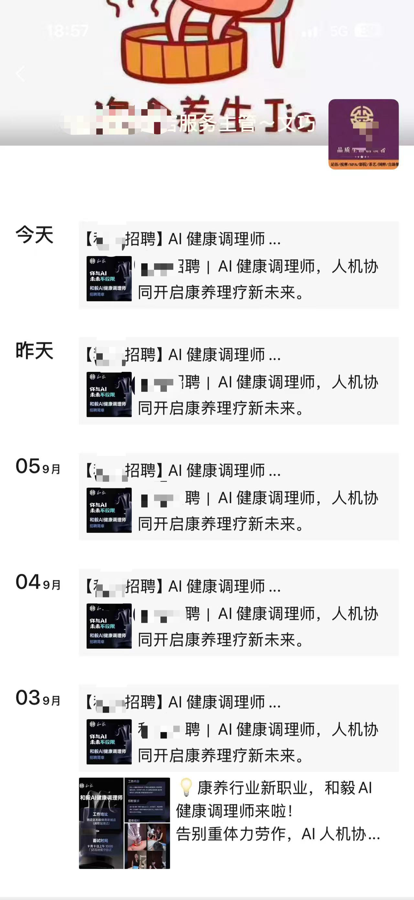

- **核心判断：AI 不会取代人类，但"会 AI 的人"会取代"不会 AI 的人"。**

### 职业机会与技能要求

| 方向 | 岗位举例 | 能力要求 |
|---|---|---|
| AI 产品经理 | 设计 AI 产品与应用 | 懂业务 + 懂 AI 能力边界 |
| AI 应用开发 / Agent 工程师 | 开发 AI 应用与智能体 | 编程 + AI 框架技能 |

**核心技能**：技术基础（大模型原理、API 使用、数据处理）、应用实践（Prompt/RAG/Agent/微调）、**工程化思维**（稳定、可控、可评估、可迭代）、创造力。

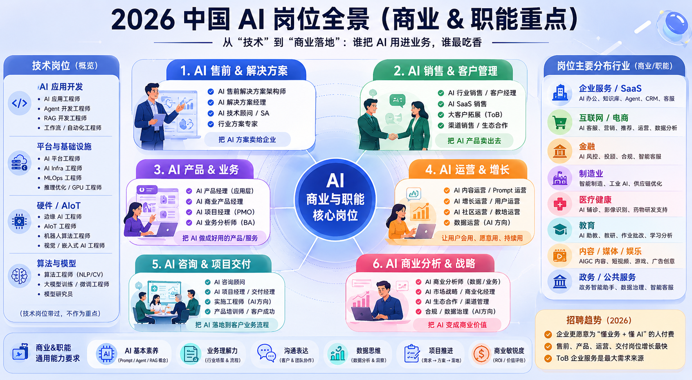

真实的 AI Agent 招聘岗位（BOSS 直聘）：

<table>
  <tr>
    <td align="center">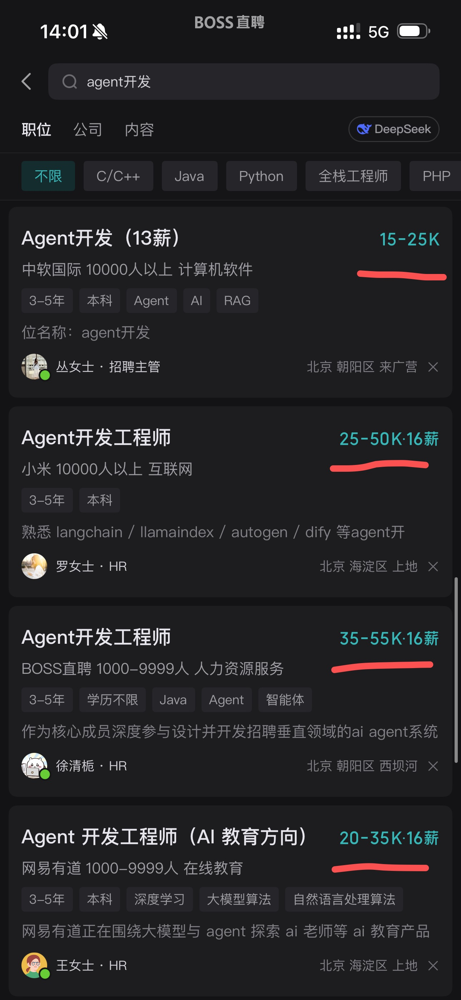</td>
    <td align="center">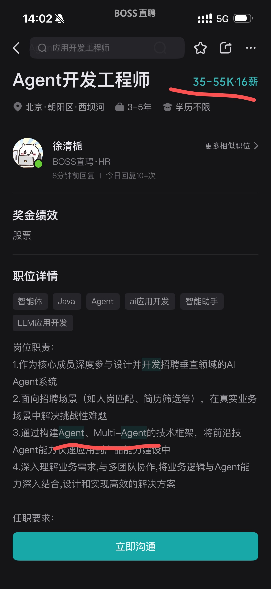</td>
    <td align="center">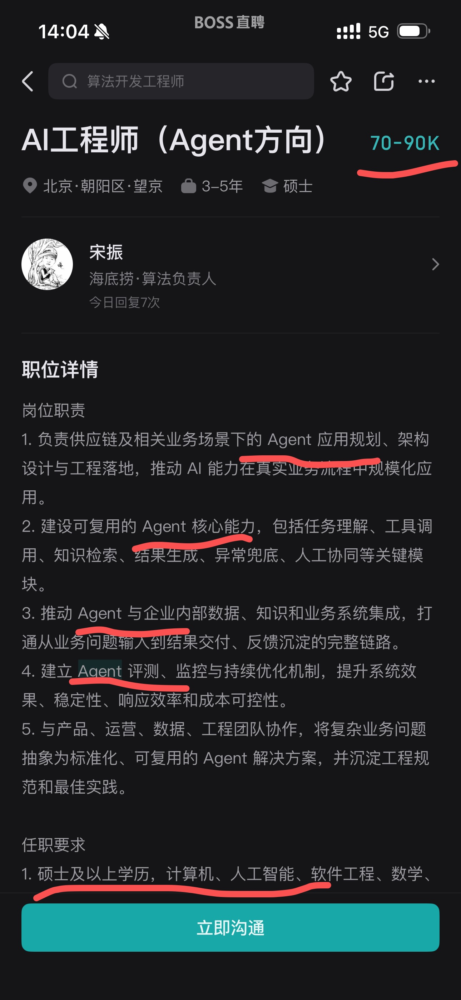</td>
    <td align="center">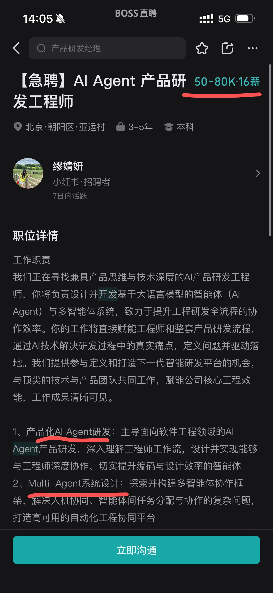</td>
  </tr>
  <tr>
    <td align="center">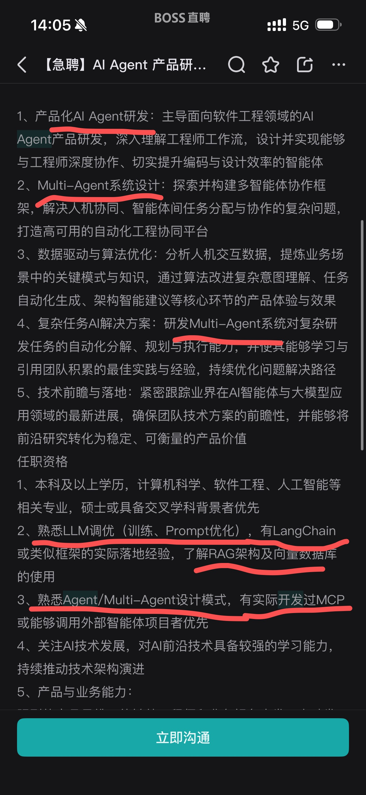</td>
    <td align="center">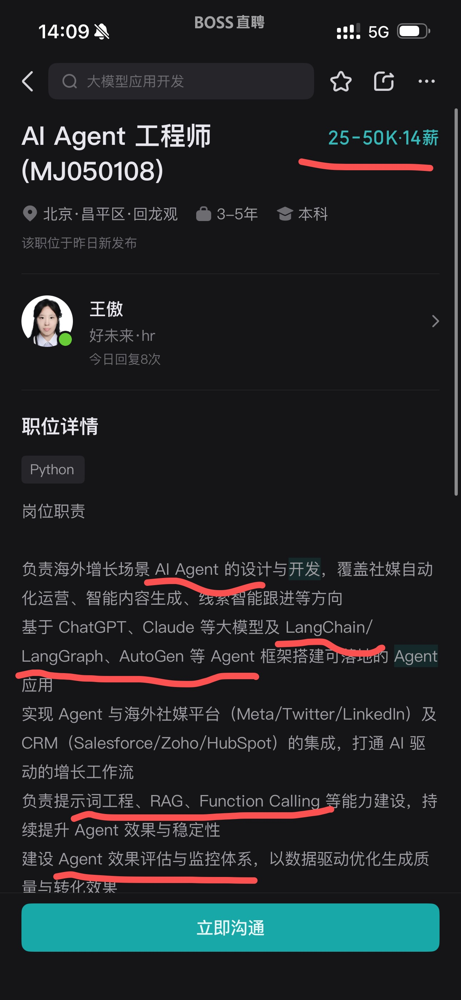</td>
    <td align="center"></td>
    <td></td>
  </tr>
</table>

---

## 三、学习方法（重点，值得反复看）

- **学习途径**：直播课（跟进度、看回放）｜录播课（补知识、扩技术面）｜答疑课（解疑难）。
- **学习心法**：
  1. 理论指导实践，在实践中理解、深化理论。
  2. 温故而知新，学习的本质在于**极致的重复**。
  3. 学无先后，达者为师，善用**费曼学习法**（讲给别人听）。
  4. 基础不牢，地动天摇；盲目追新，疲于奔命。
- **心态：对技术"去魅"** —— 拒绝炒作噪音、看清落地本质；告别 AI 羞耻、拥抱能力放大。

---

## 四、课程体系概览

| 阶段 | 名称 | 阶段成果 |
|---|---|---|
| **L1** | 基础认知破局 | 大模型核心原理、Transformer 架构、提示词工程、WorkBuddy、Vibe Coding |
| **L2** | RAG 引擎构建 | 企业级私有知识库：Naive RAG、向量数据库、Embedding、语义检索、Top-K、LangChain、Advanced RAG、RAG 评估、RAGFlow、GraphRAG |
| **L3** | Agent 架构设计 | 自主决策 AI 助手：Function Calling、MCP、Skills、多 Agent、AutoGen、CrewAI、LangGraph、LangSmith、Dify、Coze |
| **L4** | 模型微调与部署 | 专属大模型服务：训练基础、微调、LoRA/QLoRA、量化、蒸馏、Mopass 平台、评估、部署运维、多模态 |
| **实战** | 商业实战篇 | Copilot、DeepResearch、HR 智能体、AI Coding 项目 |

### L1 阶段章节
1. 预习课：大语言模型的基础认知（录播）
2. 第一章：**AI 大模型初识** ← 本课
3. 第二章：WorkBuddy 应用实践 —— AI 学习助手搭建
4. 第三章：提示工程和 Prompt 调优技巧
5. 第四章：提示工程特训与项目实战

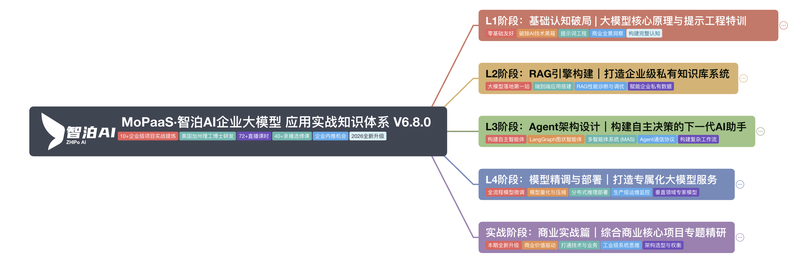

> 课程前置：计算机通识、Python 基础、PyCharm 基本使用、Vibe Coding 工具基本使用。

---

## 五、大模型是什么

- **AI（人工智能）**：由计算机系统模拟人类智能的技术（形象地说，"抄袭人类"），能完成学习、推理、决策、语言理解等任务。
- **大模型（大语言模型 LLM）**：参数量巨大（数十亿甚至万亿级）、用海量数据训练出的 AI 模型，**基于 Transformer 架构**。
  - 例如：DeepSeek-V4-Pro 参数量达到 **1.6T（1.6 万亿）**。

> 关键关系：**大模型是 AI 的子集，AI 大模型是当前实现 AI 的最前沿技术。**

### 主流大模型与智能体产品

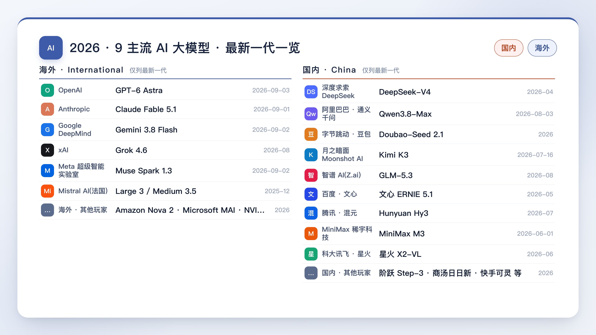

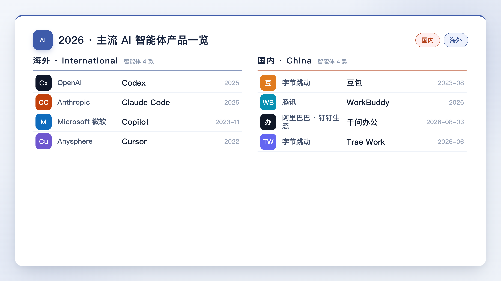

---

## 六、大模型的能力从哪来 / 能力边界

大模型的能力来自 **训练 + 推理**，本质是一个 **概率模型**：

| 概念 | 含义 |
|---|---|
| **训练** | 让大模型掌握语言中字词、句法、语义的复杂规律 |
| **推理** | 根据输入上下文，不断推出下一个字 / 词（专业术语叫 **token**） |
| **概率模型** | 下一个字按概率选出，同一个模型、同一个问题，结果可能不同 |

### 能力边界：大模型会"犯错"

- 因为是概率模型，就可能给出错误结果，这种"一本正经地胡说八道"叫 **幻觉（Hallucination）**。
- 态度：人都会犯错，也要允许模型犯错；我们要做的是**提高回答准确率**。
- 提高准确率的手段：**Prompt、RAG、Agent、微调**。

---

## 七、AI 大模型的四大主要技术应用

| 技术 | 一句话理解 | 典型场景 |
|---|---|---|
| **提示词 Prompt** | 用精心设计的输入指令，引导模型产出想要的输出 | 写文章、媒体文案、广告创意 |
| **检索增强生成 RAG** | 结合"检索外部知识库"+"生成"，提升准确性和专业性 | 智能客服、聊天机器人、专业问答、企业知识库 |
| **智能体 AI Agent** | 能自主执行任务的 AI 系统，可协同多个子代理完成复杂流程 | 制造自动检测、医疗自动化、保险审批、订单核对 |
| **模型微调 Fine-Tuning** | 在预训练模型上用领域数据调参，适应特定任务 | 医疗、法律、金融、汽车、电商等行业专用模型 |

> 记忆口诀：**Prompt 会提问、RAG 会查资料、Agent 会干活、微调会专精。**

### 1. 提示词 Prompt

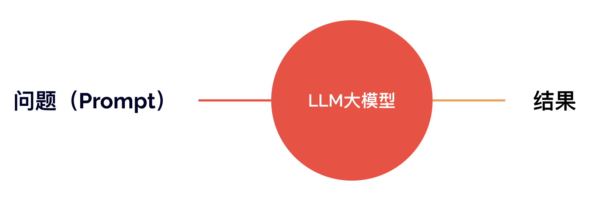

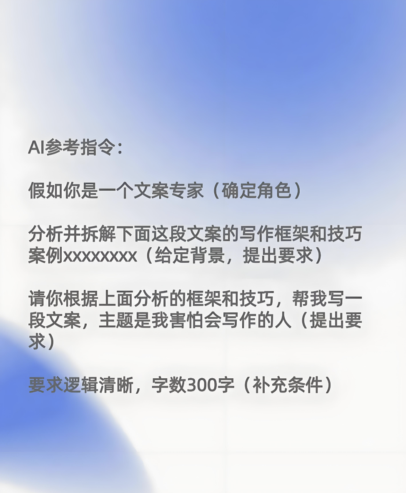

### 2. 检索增强生成 RAG

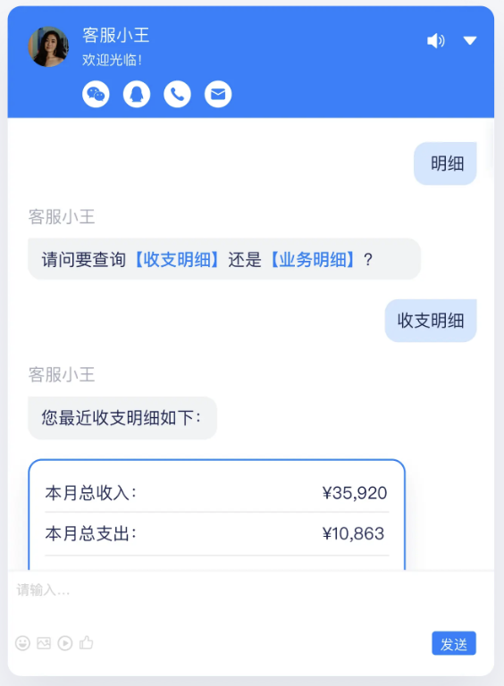

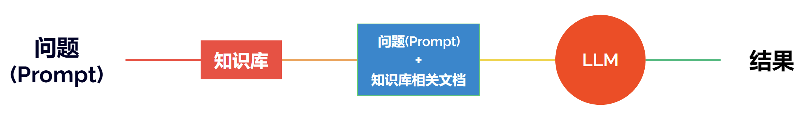

### 3. 智能体 AI Agent

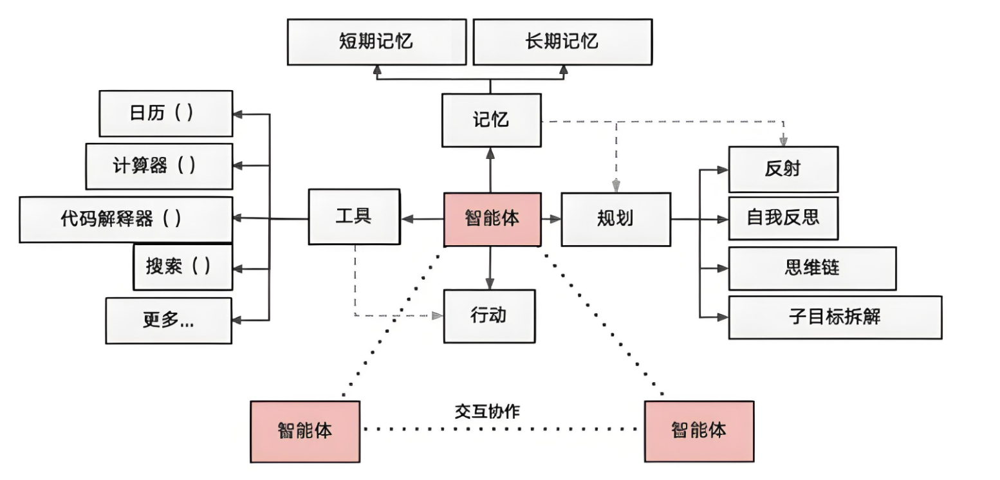

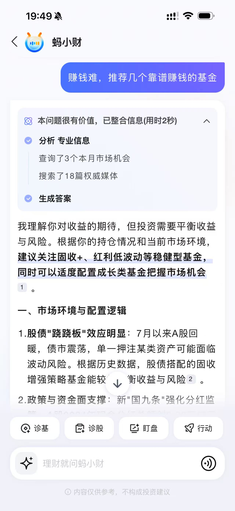

### 4. 模型微调 Fine-Tuning

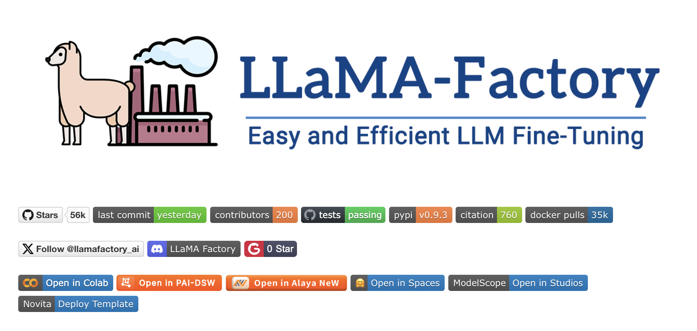

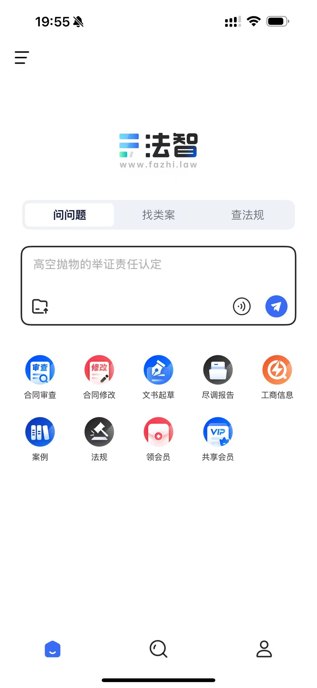

---

## 八、今日总结

1. 确定学习目标 & 形成自己的学习方法并合理安排学习时间。
2. 熟悉课程大纲内容和阶段学习目标。
3. 掌握大模型的定义和**能力边界**。
4. 熟悉 AI 大模型的**主要技术应用**。

---

## 九、今日作业

1. 掌握今日课程内容，对 AI 大模型建立基础认知。
2. 完成 **DeepSeek** 大模型注册与 API Key 配置。
3. 完成 **Qwen（阿里千问）** 大模型注册与 API Key 配置。

### DeepSeek 获取 API Key

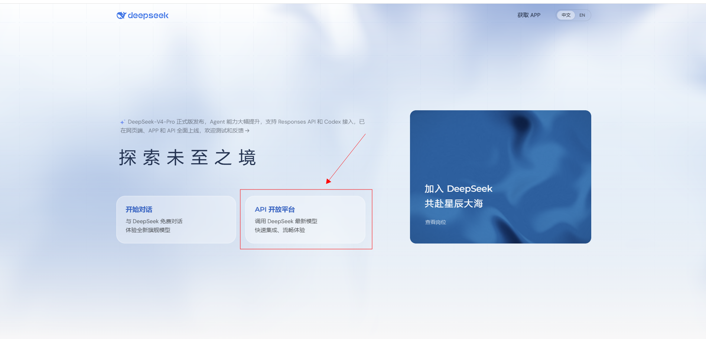

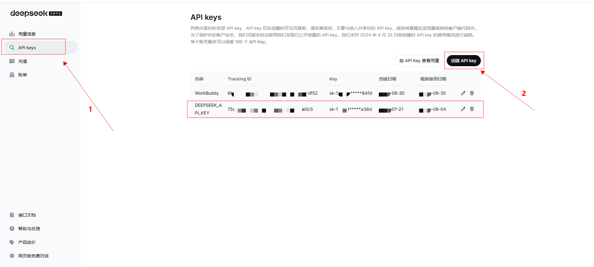

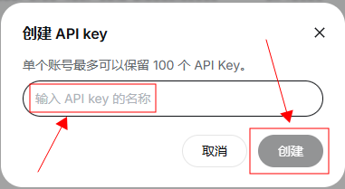

### Qwen（阿里云百炼）获取 API Key

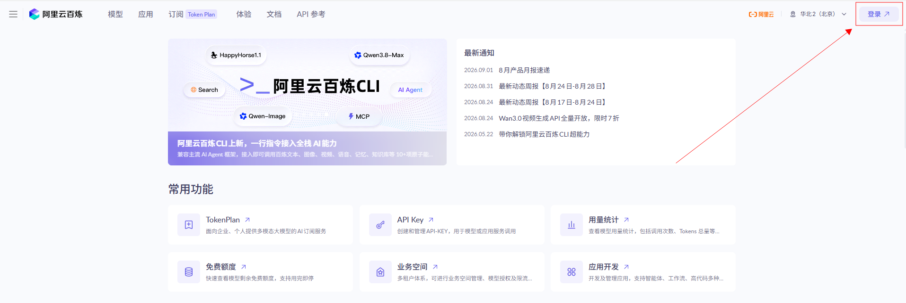

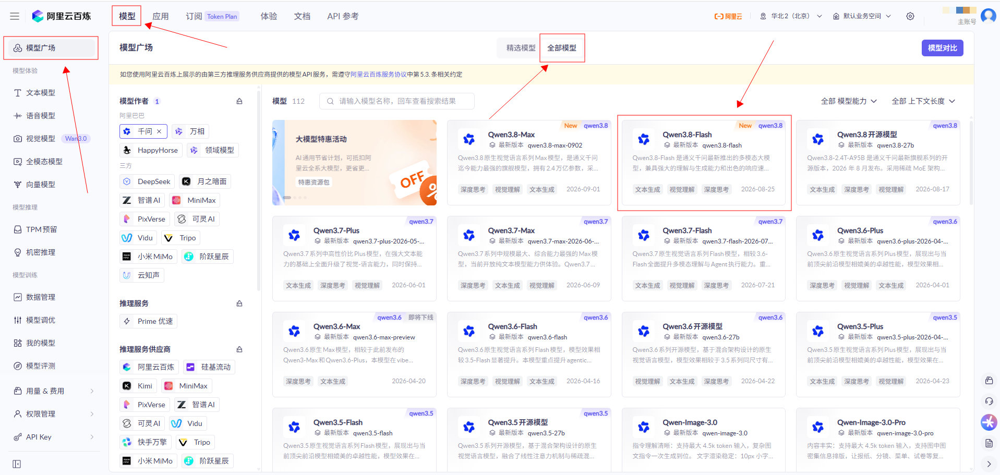

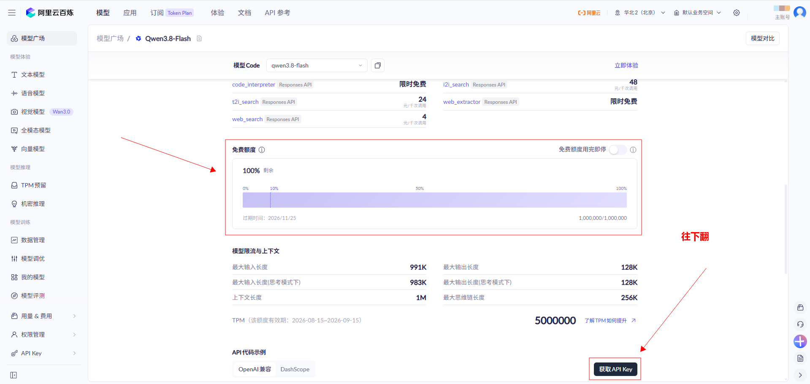

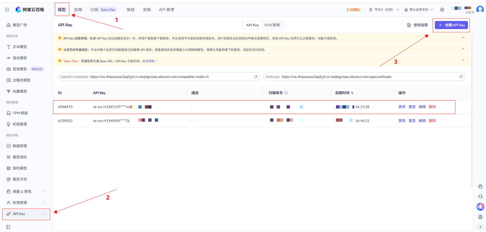

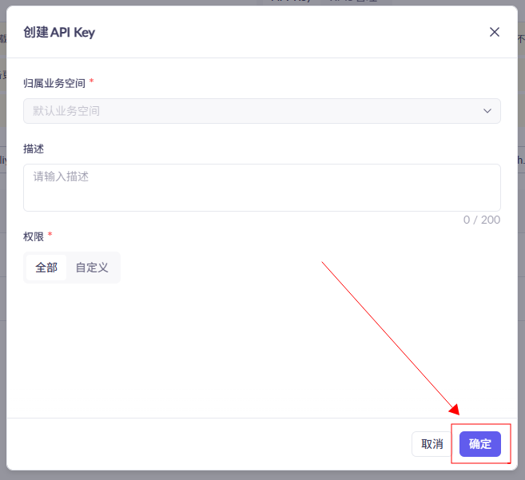

> ⚠️ **安全提醒**：务必保存好自己的 API Key，不要泄露，也不要明文写入代码中。

---

## 十、自测小问题

1. AI 和大模型是什么关系？
2. 大模型为什么会产生"幻觉"？如何降低？
3. 说出 AI 大模型的四大技术应用，并各举一个应用场景。
4. 用自己的话解释"训练"和"推理"的区别。
5. 你打算用哪三种方式安排自己的学习？
