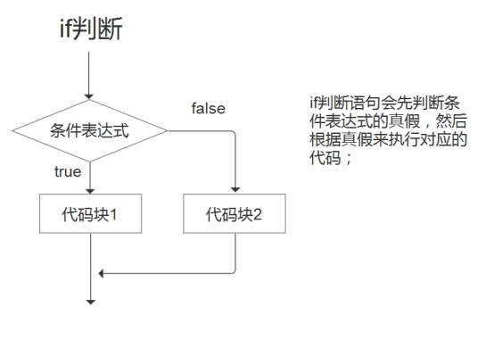

# L1-3.1《Python 基础解答课》学习笔记

> 本笔记由课件《L1-3.1_python基础解答课》整理，配套图片见 `images/` 文件夹。

---

## 一、学习心态与目标

1. **学习心态很重要，不要有畏难情绪。**
2. 我们已经**告别"古法编程"**了。
3. **Python 很重要**，我们的学习目标要**分层**。

---

## 二、本课内容概览

- `print` 输出函数和变量的基本使用
- 数据类型的概念
- 常用的运算符
- 循环和分支结构
- 函数的基本概念
- 类和对象的概念

---

## 三、print 输出函数

- `print()` 是一个**内置函数**，用于将文本和变量输出到控制台或标准输出设备。
- 它接受**任意数量**的参数，可以是字符串、数字或其他数据。
- 基本格式：`print(*objects)`，其中 `*objects` 指**零个或多个**要打印的数据。

---

## 四、变量的基本使用

- **什么是变量**：在编程语言中，变量是用于**存储和表示数据值的名称**。
- **变量的作用**：保存程序运行时需要使用的各种值（数据），如数字、字符串、布尔值等。
- **定义格式**：`变量名 = 值`，例如 `x = 10`。

---

## 五、数据类型

### 1. 概念

- 数据是指在程序中使用：

的各种信息，包括数字、文本、图像、音频、视频、布尔值、数组、列表等；可以存储在变量、常量、数组或其他数据结构中，并在程序中处理和操作。
- 数据可根据类型分类：**整数、浮点数、字符串、布尔值**等等。程序员需要了解不同类型的数据及特点，才能正确使用和处理。
- **常用数据类型**：整数、浮点数、字符串、布尔值、列表、元组、字典。

### 2. 基本类型

| 类型 | 说明 | 示例 |
| --- | --- | --- |
| **整数（int）** | 没有小数部分的数字，可为正数、负数或零 | 1、2、100、123、-21 |
| **浮点数（float）** | 带有小数部分的数字，可为正数、负数或零 | 1.1、3.14、10.5、-9.9 |
| **布尔型（bool）** | 只有两个值 `True` 和 `False`，常用于流程控制的**条件判断** | True、False |

### 3. 字符串（str）

- 字符串是**一系列字符（characters）**，可以是字母、数字或其他任意字符，例如 `my_string = "Hello World!"`。
- **必须用引号括起来**，单引号 `' '`、双引号 `" "`、三引号 `''' '''` / `""" """` 均可。

```python
name1 = '张三'
name2 = "李四"
name3 = """王五"""
```

- **三引号一般表示多行字符串**，用于字符串跨行：

```python
text1 = """
好好学习，
天天向上。
"""
```

### 4. 列表（list）

- 列表是能够**存储多个元素的序列**，符号为 `[ ]`。元素是列表中每个单独的数据项。

```python
list1 = [85, 77, 59, 81, 98, 63]
print(list1[0])   # 85，索引 0 代表第一个元素
print(list1[1])   # 77，第二个元素
print(list1[5])   # 63，索引为 5 的元素
list1[3] = 90     # 列表可以被修改
```

- **索引（下标）从 0 开始**。

### 5. 元组（tuple）

- 与列表类似，也能存储多个元素，用 `( )`，**区别是不可被修改**。

```python
tuple2 = (85, 77, 59, 81, 98, 63)
print(tuple2[0])  # 85
print(tuple2[3])  # 81
# tuple2[4] = 100  # 错误：元组不可被修改
```

### 6. 字典（dict）

- 字典用于保存**多组键值对**，符号为 `{键: 值, 键: 值}`，**可以被修改**。

```python
dict3 = {'name': '小明', 'gender': '男', 'age': 35}
print(dict3['name'])   # 小明
print(dict3['age'])    # 35
dict3['age'] = 36      # 值可以被修改
```

- **值可以被修改，但键不可被修改。**

---

## 六、常用运算符

> 以下算术运算符以 `a = 10, b = 20` 为例。

### 1. 算术运算符

| 运算符 | 描述 | 实例 |
| --- | --- | --- |
| `+` | 加 | 两个对象相加 `a + b` 结果 30 |
| `-` | 减 | 得到一个数减去另一个数 `a - b` 结果 -10 |
| `*` | 乘 | 两个数相乘或返回被重复若干次的字符串 `a * b` 结果 200 |
| `/` | 除 | `b / a` 结果 2 |
| `//` | 向下取整 | 返回商的整数部分，`9 // 2` 结果 4，`9.0 // 2.0` 结果 4.0 |
| `%` | 取模（余） | 返回除法的余数，`b % a` 结果 0 |
| `**` | 幂 | 返回 x 的 y 次幂，`a ** b` 为 10 的 20 次方 |

### 2. 比较运算符

| 运算符 | 描述 |
| --- | --- |
| `==` | 比较两个对象的值是否**相同**（与 `is` 区别开，`==` 不识别 ID） |
| `!=` | 比较两个对象值是否**不相同** |
| `>` | 大于 |
| `<` | 小于 |
| `>=` | 大于等于 |
| `<=` | 小于等于 |

### 3. 逻辑运算符

| 运算符 | 逻辑表达式 | 描述 |
| --- | --- | --- |
| `and` | `x and y` | 同时满足 x 和 y 两个条件返回 `True`，否则返回 `False` |
| `or` | `x or y` | 只需满足 x 或 y 任意一个条件就返回 `True`，都不满足时返回 `False` |
| `not` | `not x` | 满足条件 x 时返回 `False`，不满足时返回 `True` |

---

## 七、循环与分支

### 1. if 分支结构

`if`、`elif`、`else` 是条件语句，用于基于不同情况执行不同的代码块。

**if 判断流程**：先判断**条件表达式**的真假，再根据真假执行对应代码。



**if 单分支**：检查条件是否为 `True`，为 `True` 则执行 if 块。

```python
x = 5
if x > 0:
    print("x是正数")
```

**if 双分支 / 多分支**：`elif` 用于检查多个条件，`else` 处理其余情况。

```python
x = 5
if x < 0:
    print('x是负数')
elif x == 0:
    print('x等于0')
else:
    print('x是正数')
```

### 2. for 循环结构

`for` 循环可以重复执行一段代码，直到序列中所有元素被遍历完。

```python
for 变量 in 序列:
    # 代码块
```

- **变量**：循环变量，每次循环从序列中取出一个元素赋值给它。
- **序列**：需要遍历的数据，可以是列表、元组、字符串等。

```python
fruits = ["apple", "banana", "cherry"]
for fruit in fruits:
    print(fruit)
# 输出：
# apple
# banana
# cherry
```

---

## 八、函数

### 1. 概念与优势

- 函数是一种**可重用的代码块**，用于执行特定任务。把代码封装在函数中，能让程序更**模块化、易于维护和扩展**。
- **优势**：
  1. 提高代码的**可读性和可维护性**（把复杂任务分解成小块并命名）；
  2. **节省时间、减少出错**（避免重复编写相同代码）；
  3. 使程序更**模块化**，代码更清晰、易于组织。

### 2. 函数的定义

```python
def 函数名(参数1, 参数2, ...):
    函数体
    return 返回值
```

- `def` 是定义函数的**关键字**，函数名需符合命名规则；
- **参数**是传递给函数的零个或多个数据，用逗号分隔；
- **函数体**是实现具体功能的代码；
- `return` 返回函数结果（可不写 return，或直接 return 无返回值）。

### 3. 函数的调用

```python
def add(x, y):
    result = x + y
    return result

s = add(3, 4)   # 调用函数：s = 7
```

### 4. 函数的参数

函数调用时传递给函数的数据称为**函数参数**，用于从函数外部向内部传递数据。

```python
def zhouchang(x):
    print(f"边长为{x}的正方形，其周长为{x * 4}。")

zhouchang(5)    # 20
zhouchang(12)   # 48
```

### 5. 函数的返回值

返回值就是函数的运行结果。如果结果需要在其他函数中使用，就应定义为**带返回值**的函数，用 `return` 返回。

```python
def Sum(a, b):   # 有参数也有返回值
    s = a + b
    return s

result = Sum(10, 20)
print(result)    # 30
```

---

## 九、类和对象

- **类（Class）**：把一类对象的**公共属性和行为封装**起来形成一个概念。可以理解为"分类/类别/类型"，是程序语言中的一种**自定义数据类型（构造数据类型）**。
- **对象（Object）**：类的**实例化**，即具体的"事物"，每个对象都有自己的数据和方法。

**类的定义**：使用 `class` 关键字。

```python
class ClassName:
    # 类体
```

- `ClassName` 为类名，需符合标识符命名规则；
- **类体**用于描述类的**属性（数据）**和**行为（函数）**。

---

## 十、自测小问题

1. 变量的定义格式是什么？
2. Python 常见的数据类型有哪些？各有什么特点？
3. 列表和元组有什么区别？字典的键和值哪个能改？
4. 算术、比较、逻辑运算符分别有哪些？
5. `if` / `elif` / `else` 的执行流程是怎样的？
6. `for` 循环的作用是什么？
7. 如何定义和调用一个函数？参数和返回值分别是什么？
8. 什么是类？什么是对象？
