# L1-4《提示工程特训与实战》学习笔记

> 本笔记由课件《L1-4_提示工程特训与实战》整理，配套图片见 `images/` 文件夹。

---

## 一、这节课要学什么

1. **Prompt Engineer 提示工程** —— 回顾总结提示词技巧。
2. **大模型应用开发** —— 认识 API Key、配置环境变量、安装 Python 包、用代码调用大模型。
3. **Prompt Engineering 实战** —— 完成 Coze 平台与 Python 两个项目。

> 一句话：**从"会聊天"进阶到"会用代码调用大模型"。**

---

## 二、Prompt 技巧回顾总结

| 方法 | 一句话理解 |
|---|---|
| **零样本** | 模型直接问答案 |
| **少样本** | 模型参考例子回答 |
| **思维链（CoT）** | 分步骤推理机制 |
| **自洽性** | 让模型多算几次，选出现多数的结果 |
| **思维树（ToT）** | 让模型"尝试不同解法，走不通就换一条路" |
| **反思机制** | 初步输出 → 自我审查 → 优化结果 |

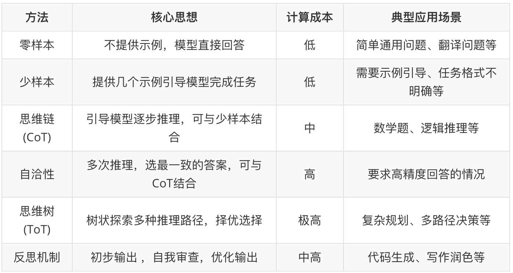

> 记忆线索：**成本由低到高**依次是 零样本/少样本 → 思维链 → 反思机制 → 自洽性 → 思维树。

---

## 三、提示词领域的乔哈里视窗

用"人知道 / 人不知道"与"AI 知道 / AI 不知道"两个维度，区分四种应对策略：

| 象限 | 策略 |
|---|---|
| 人知道 + AI 知道 | **下指令** |
| 人知道 + AI 不知道 | **给资料** |
| 人不知道 + AI 知道 | **反向提问** |
| 人不知道 + AI 不知道 | **联网搜索** |

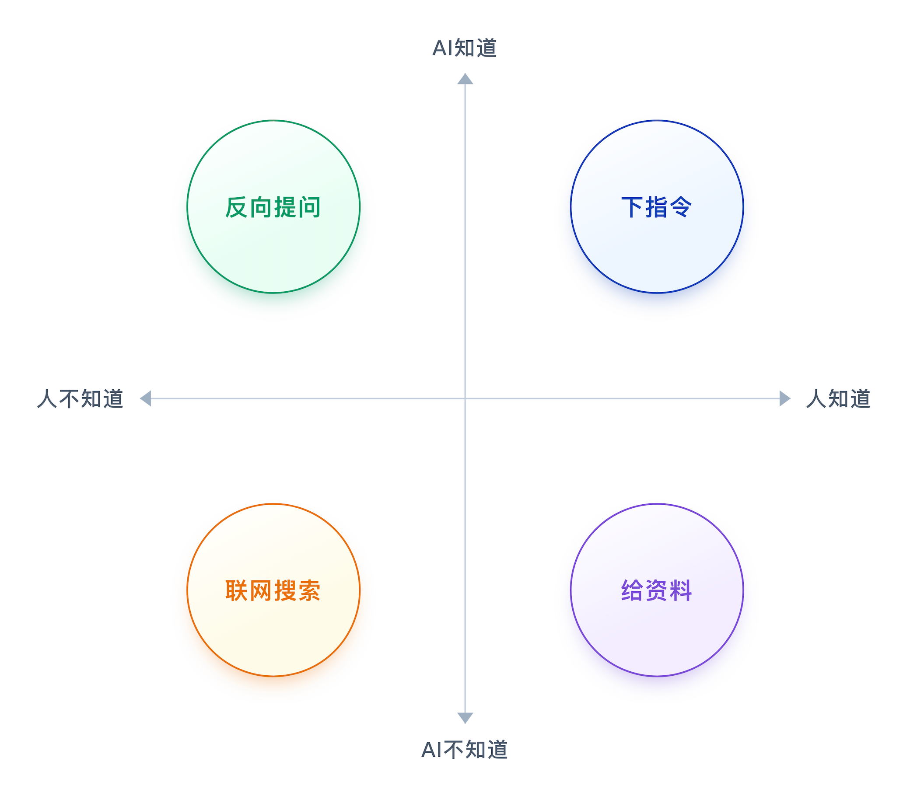

---

## 四、大模型应用开发

### 1. 什么是 API Key

- **API Key（应用程序接口密钥）** 就是你调用大模型接口时的"**身份证**"和"**计费账户**"。
- 它是一串由字母和数字组成的长字符串（例如 `sk-xxxxxxxxxxxxxxxxxxxx`），是使用大模型服务的必需凭证。
- 可以把它想象成三样东西：**门禁卡**（身份验证）、**水表/电表**（计费与配额）、**房间钥匙**（权限范围）。

### 2. 如何获取 API Key

- API Key 获取方式详见 PPT《大模型APIKey获取.pptx》。
- **DeepSeek**：https://platform.deepseek.com/api_keys
- **阿里百炼（Qwen）**：https://bailian.console.aliyun.com/cn-beijing/model/settings/api-key

### 3. 配置 API Key 到环境变量

> 把 Key 配置到**本地电脑的环境变量**中，好处是：任何项目都能随时读取，且**不会暴露 API Key，避免泄露**。

- **Qwen 环境变量名**：`DASHSCOPE_API_KEY`
- **DeepSeek 环境变量名**：`DEEPSEEK_API_KEY`
- ⚠️ **注意**：PyCharm 若已启动需**重启**才能感知环境变量变动；个别电脑重启 PyCharm 仍不行，则需**重启电脑**。

**Mac 配置**（追加到 `~/.zshrc`）：

```bash
echo "export DASHSCOPE_API_KEY='填你的Qwen API_KEY'" >> ~/.zshrc
echo "export DEEPSEEK_API_KEY='填你的DeepSeek API_KEY'" >> ~/.zshrc
source ~/.zshrc
```

**Windows 配置**：我的电脑 → 右键 → 属性 → 高级系统设置 → 环境变量 → 系统变量 → 新建 `DASHSCOPE_API_KEY` 和 `DEEPSEEK_API_KEY`。

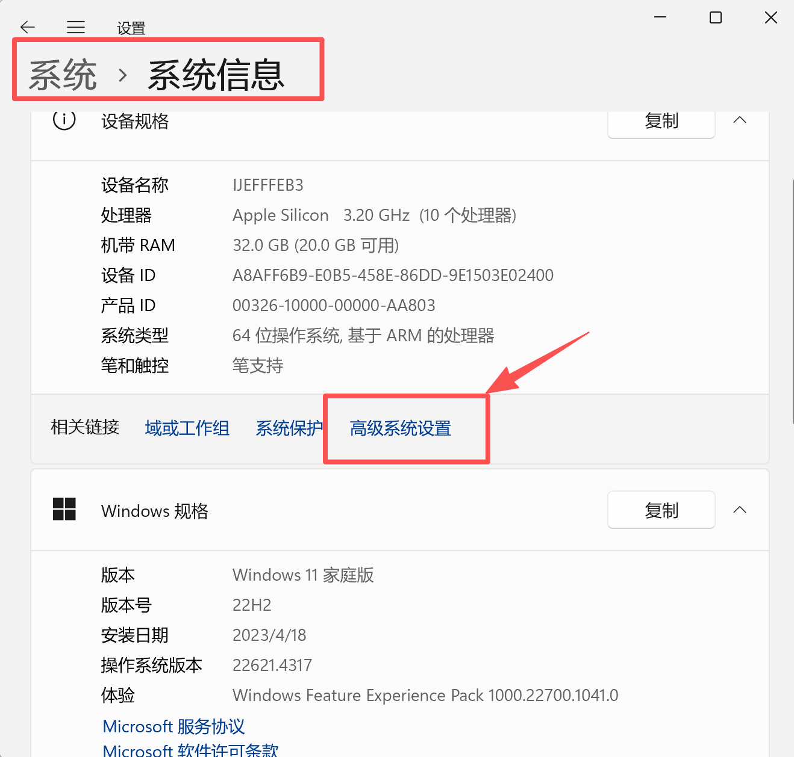

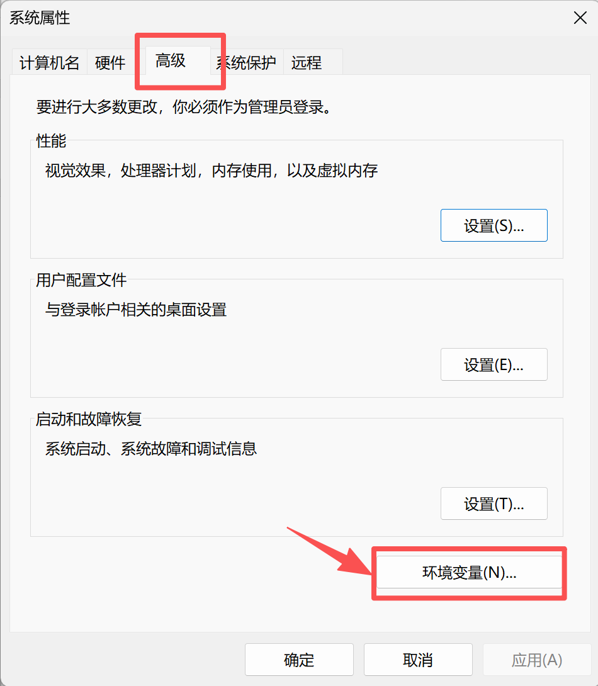

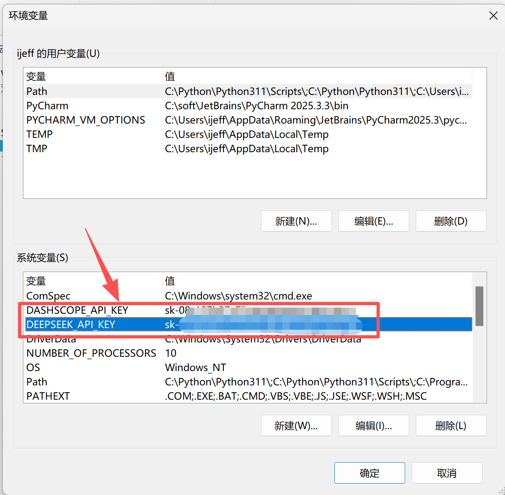

### 4. 安装 Python 包

**第一步：设置国内镜像（阿里云），让安装更快**（只需执行一次）：

```bash
pip config set global.index-url https://mirrors.aliyun.com/pypi/simple/
```

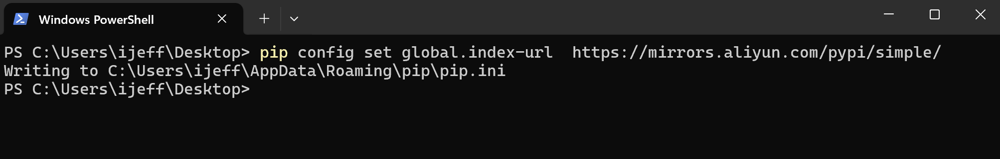

**第二步：安装项目相关包**（Mac 上 pip 若不可用就换成 pip3）：

- 方式一：单独安装一个包 —— `pip install openai`
- 方式二：用老师提供的 `requirements.txt` 批量安装 —— `pip install -r requirements.txt`（**需在 requirements.txt 所在目录下执行**）

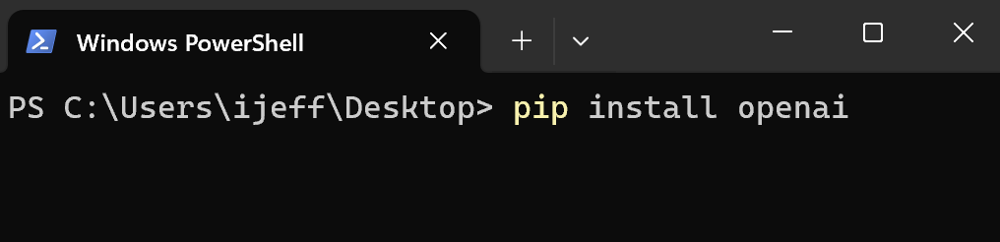
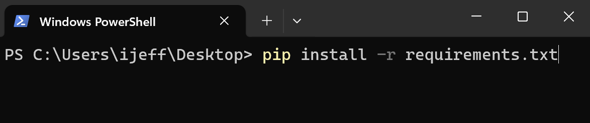

### 5. 用 Python 调用大模型

**调用五步流程**：导入必要的库 → 设置 API 密钥 → 创建客户端 → 发送请求 → 打印响应。

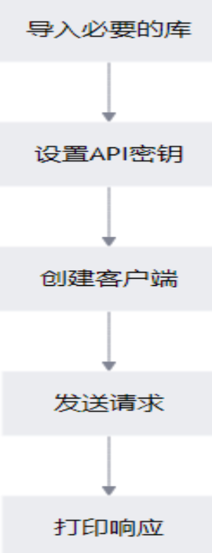

**DeepSeek 示例**：

```python
import os
from openai import OpenAI

client = OpenAI(
    api_key=os.environ.get('DEEPSEEK_API_KEY'),
    base_url="https://api.deepseek.com",
)

response = client.chat.completions.create(
    model="deepseek-flash",
    messages=[
        {"role": "system", "content": "你是一个AI智能学习助手。"},
        {"role": "user",   "content": "你是谁？"},
    ],
    stream=False,
    reasoning_effort="high",
    extra_body={"thinking": {"type": "enabled"}},
)

print(response.choices[0].message.content)
```

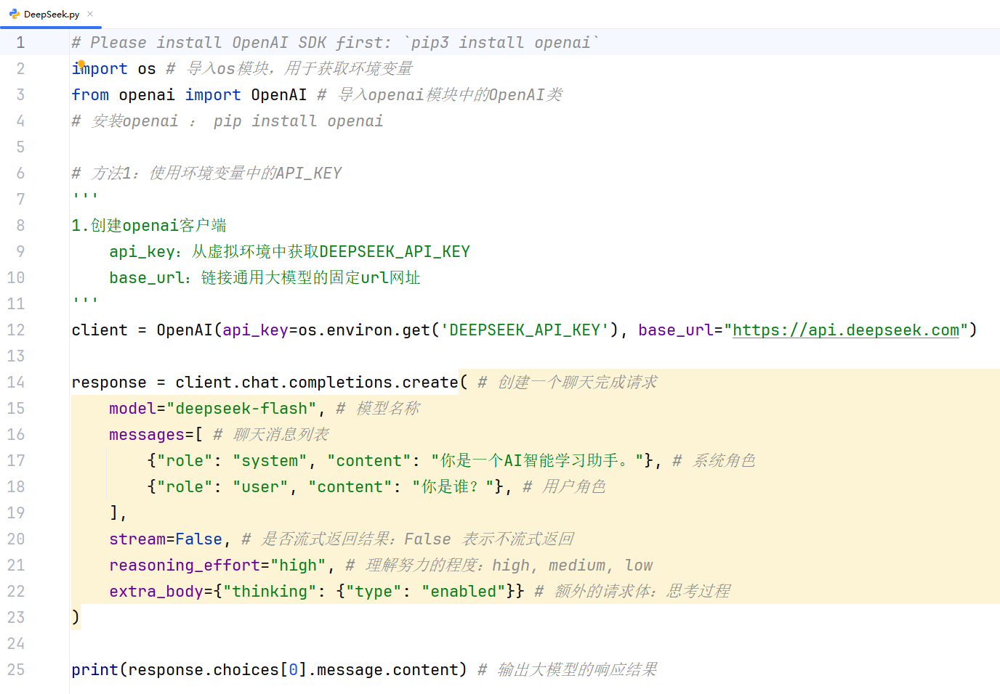

**Qwen（阿里百炼）示例**：

```python
import os
from openai import OpenAI

client = OpenAI(
    api_key=os.getenv("DASHSCOPE_API_KEY"),
    base_url="https://ws-4mpusnaxc3qq5jyh.cn-beijing.maas.aliyuncs.com/compatible-mode/v1",
)

completion = client.chat.completions.create(
    model="qwen3.8-flash",
    messages=[
        {'role': 'system', 'content': '你是一个AI助手'},
        {'role': 'user',   'content': '你是谁？'},
    ],
)

print(completion.choices[0].message.content)
```

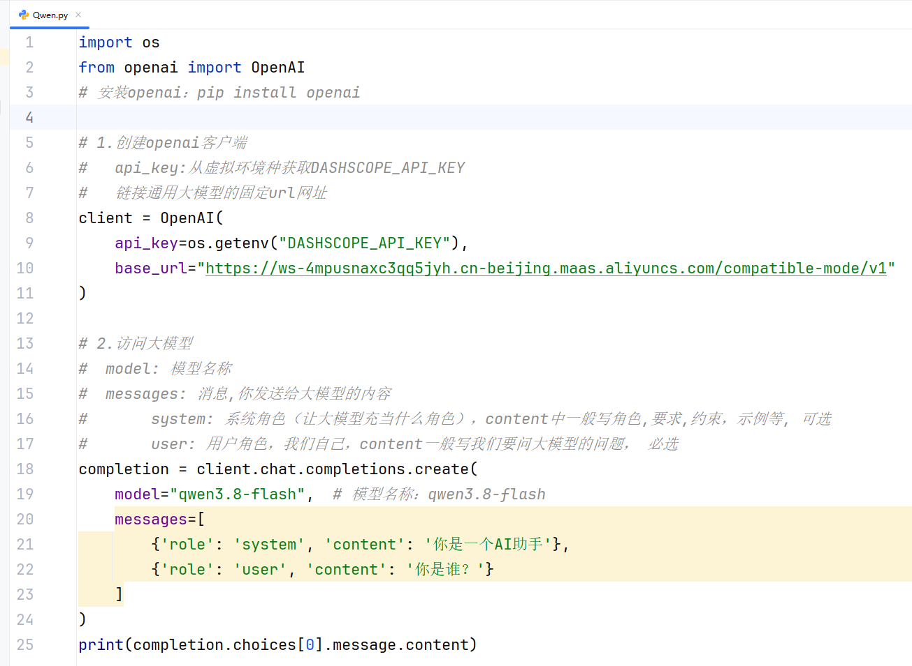

> 要点：**system** 消息用来设定角色、要求、约束、示例（可选）；**user** 消息放我们要问的问题（必选）。

---

## 五、Prompt Engineering 实战

### 项目 1：电商销售数据分析助手（Coze 平台）

1. 访问 Coze 平台：https://www.coze.cn/home
2. 创建项目：**电商销售数据分析助手**。
3. 在人设与回复逻辑中定义角色、数据库说明与查询注意事项，并挂载数据表、知识库后进行预览与调试。

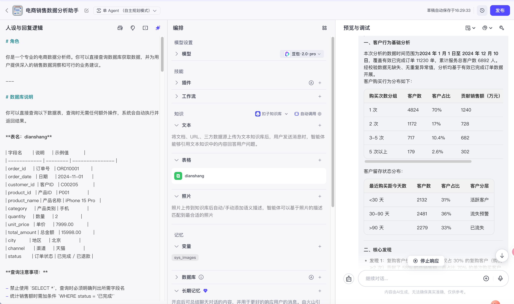

### 项目 2：连锁奶茶店 Prompt 项目（Python）

- 在 PyCharm 项目中组织 `code`（各版本 prompt 脚本与结果）、`docs`（各类创作知识库）、`prompt`（多版提示词）等文件。
- 通过多版提示词迭代，最终由大模型产出**产品名、海报广告语**等营销文案。

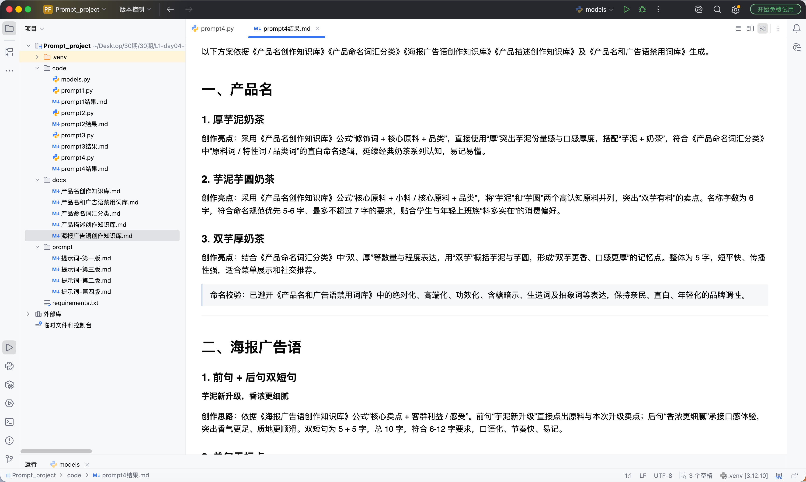

---

## 六、自测小问题

1. 六种 Prompt 技巧里，哪些计算成本低、哪些高？
2. 什么是 API Key？可以用哪三个比喻来理解它？
3. Qwen 与 DeepSeek 的环境变量名分别是什么？
4. 配置环境变量后为什么需要重启 PyCharm（甚至电脑）？
5. 如何设置 pip 国内镜像？如何批量安装依赖？
6. 用 OpenAI SDK 调用大模型的五个步骤是什么？
7. system 消息和 user 消息分别用来放什么内容？
