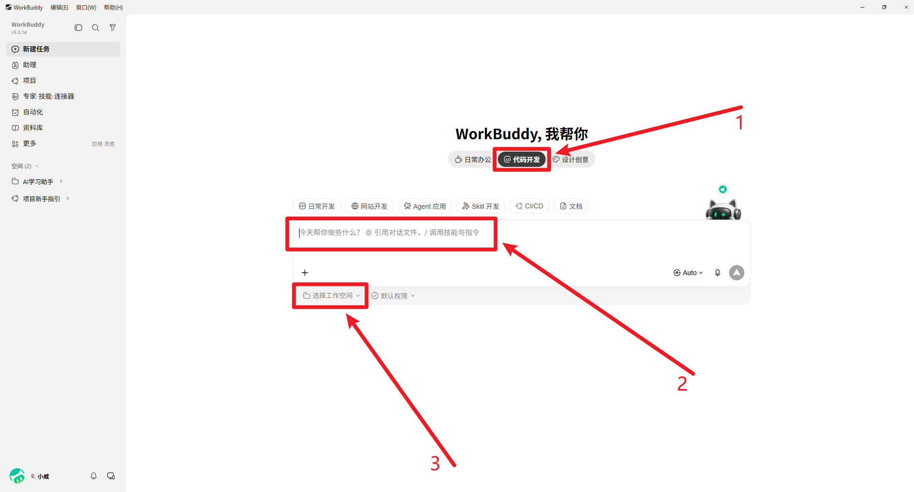
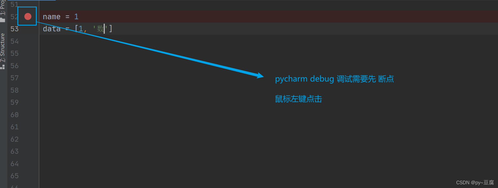
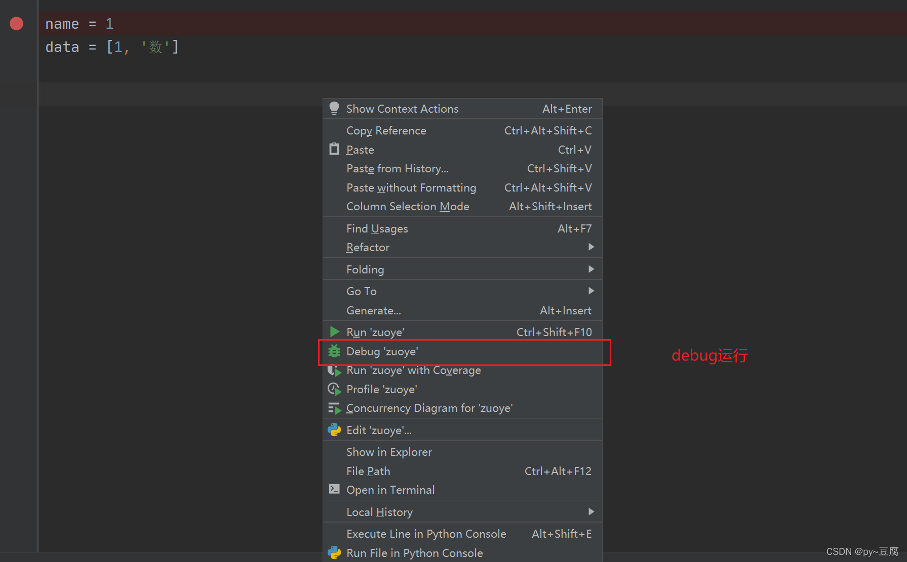
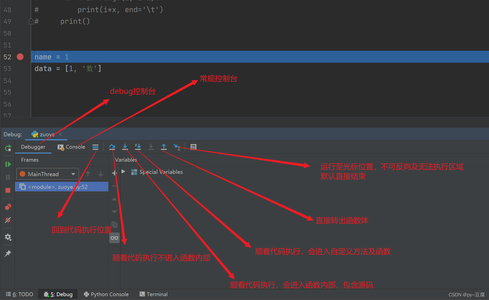
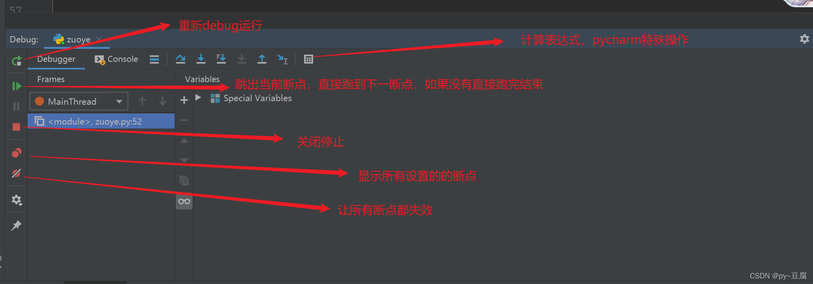
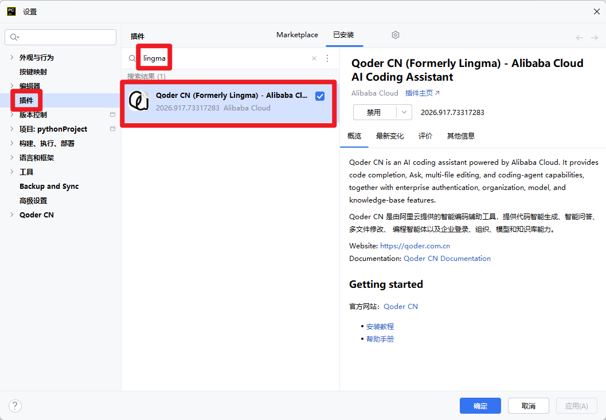

# L1-5《如何利用 AI 工具辅助编程》学习笔记

> 本笔记由课件《L1-5_如何利用AI工具辅助编程》整理，配套图片见 `images/` 文件夹。

---

## 一、这节课要学什么

1. **使用 WorkBuddy 进行代码生成和解析** —— 用 AI 生成、分析、优化代码。
2. **Python 代码的 Debug 调试** —— 学会断点与 PyCharm 调试功能。
3. **在 PyCharm 中安装和使用通义灵码** —— 引入 AI 编程助手插件。

> 一句话：**让 AI 帮你写代码，也要学会自己调试代码。**

---

## 二、使用 WorkBuddy 进行代码生成和解析

- 使用 **WorkBuddy 中的"代码开发"模式**来生成代码、分析代码和优化代码。
- 操作三步：
  1. 切换到 **代码开发**（功能场景）；
  2. 在对话框输入需求（生成 / 分析 / 优化代码）；
  3. 点击 **选择工作空间**，指定代码文件所在目录。

---

## 三、Python 代码的 Debug 调试

### 1. 什么是 Debug

- **Debug 就是调试**：在 PyCharm 中给代码**打断点**，再用 Debug 功能**逐语句或逐过程**执行代码，能更清晰地看到代码的执行流程。

### 2. 断点

- 用鼠标在代码前方的**行号处点击**，出现一个**红色圆点**即为断点。
- 调试模式下，程序执行到断点处会**暂停**，由程序员控制是否继续往下执行。

> ⚠️ **注意**：断点需要打在**可执行代码之前**，且位置必须是代码运行过程中**会执行到的语句之前**，否则断点不会起作用。

### 3. Debug 运行

- 在代码编辑区**右键**，选择 **Debug '文件名'** 即可进入调试模式。

### 4. 调试功能解读

**调试面板与执行控制**：

- **Debug 控制台 / 常规控制台**：分别查看调试输出与常规输出。
- **运行至光标位置**：不可反向，无法执行区域会默认直接结束。
- **单步跳过**（顺着代码执行，不进入函数内部）。
- **单步进入**（顺着代码执行，会进入自定义方法及函数）。
- **强制单步进入**（进入函数内部，包含源码）。
- **直接转出函数体**（跳出当前函数）。
- **回到代码执行位置**（重新定位到当前执行行）。

**断点控制与更多操作**：

- **重新 Debug 运行**。
- **计算表达式**（PyCharm 特殊操作）：在调试中实时求值。
- **跳到下一断点**（跳出当前断点，直接跑到下一断点，若没有则直接跑完结束）。
- **关闭/停止**、**显示所有已设置的断点**、**让所有断点失效**。

---

## 四、在 PyCharm 中安装和使用通义灵码（Lingma）

- 在 PyCharm 的 **设置 → 插件（Plugins）** 中搜索 **lingma**，找到 **Qoder CN（Formerly Lingma）- Alibaba Cloud AI Coding Assistant**，安装后即可使用阿里云提供的智能编码助手（代码智能生成、智能问答、多文件修改、编程智能体等）。

---

## 五、自测小问题

1. WorkBuddy 的"代码开发"模式能对代码做哪三件事？
2. 什么是 Debug？它和直接运行有什么区别？
3. 断点如何设置？什么样的断点不会起作用？
4. "单步跳过"和"单步进入"有什么区别？
5. 如何在 PyCharm 中安装通义灵码插件？
