# L1-6《通俗易懂大模型的核心原理》学习笔记

> 本笔记由课件《L1-6_通俗易懂大模型的核心原理》整理，配套图片见 `images/` 文件夹。

---

## 一、这节课要学什么

1. **大模型的工作原理** —— GPT 与 Transformer 基础。
2. **大模型训练流程** —— 预训练、SFT、RLHF 三大阶段。

---

## 二、GPT 与 ChatGPT

### 1. GPT 三个字母的含义

- **G = Generative（生成式）**：模型能**生成文本**。根据给定的起始词或句子，**预测文字出现的先后概率**，生成一段连续的文本，最终形成输出。
- **P = Pre-trained（预训练）**：在模型用于特定任务之前，先通过**大规模文本数据**进行预训练，学习语言的**基础知识**，如语法、拼写以及一些常识。
- **T = Transformer**：一种**特定的深度学习模型结构**，通过引入"**自注意力（Self-Attention）**"机制，使得模型在处理文本时能够理解更复杂的句子结构和语义。

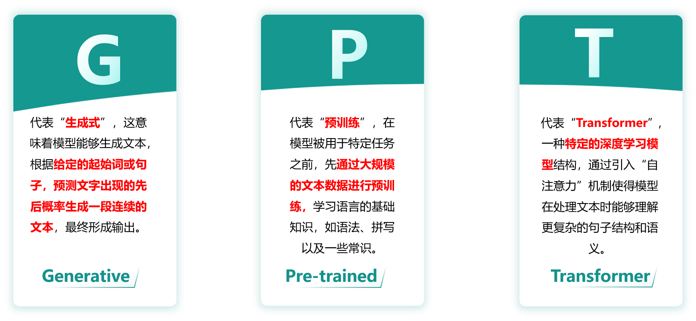

### 2. 生成式（Generative）是什么

> 模型能够生成文本：根据给定的起始词或句子，**预测文字出现的先后概率**，生成一段连续的文本，最终形成输出。

例如在豆包中输入"**从前有个国王，他有个女儿**"，模型就能不断续写出一个完整的故事：

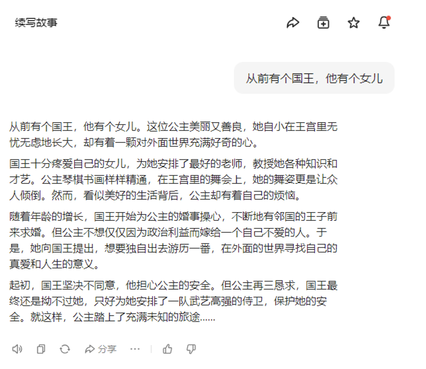

### 3. 模型发展历程

| 时间 | 模型 | 关键点 |
| --- | --- | --- |
| 2017 | Transformer 论文 | 架构诞生 |
| 2018 | BERT、GPT-1 | GPT-1 首次融合 Transformer 与无监督预训练 |
| 2019.2 | GPT-2 | 15 亿参数，文本生成能力瞩目 |
| 2020.6 | GPT-3 | 1750 亿参数，大幅提升理解与生成 |
| 2022.11.30 | GPT-3.5 / ChatGPT | 能进行自然语言交流、解答各种问题 |
| 2023.3 | GPT-4 | 约 1.8 万亿参数，采用**混合专家模型（MoE）**，支持图像输入，多模态 |
| 2024.5.14 | GPT-4o | 支持文本、音频和图像输入，交互更自然 |
| 2025.2.27 | GPT-4.5 | 知识更广、情商更高，写作与编程更优，幻觉更少 |
| 2025.8 | GPT-5.0 | 在性能、可靠性、实用性上显著飞跃 |
| 2026.3 | GPT-5.4 | 整合推理、编程、深度网页搜索，支持**智能体**执行复杂任务 |

> ChatGPT 是 OpenAI 于 2022 年 11 月 30 日发布的聊天机器人，背后的 **GPT（Generative Pre-trained Transformer）** 就是基于 **Transformer 架构**。

---

## 三、从神经网络到 Transformer

### 1. 神经网络与深度学习

- **神经网络（ANN，人工神经网络）**：模仿人类大脑神经网络系统启发而设计的**计算模型**，由大量相互连接的**节点（神经元）**组成。
- **深度学习（Deep Learning）**：机器学习中特指**基于深层神经网络**的方法。

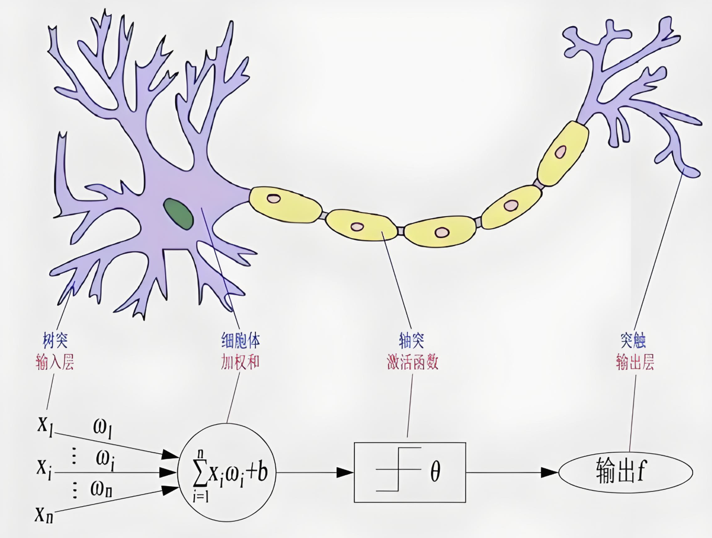

从单个神经元，到单隐层、多层，再到**深层神经网络**：

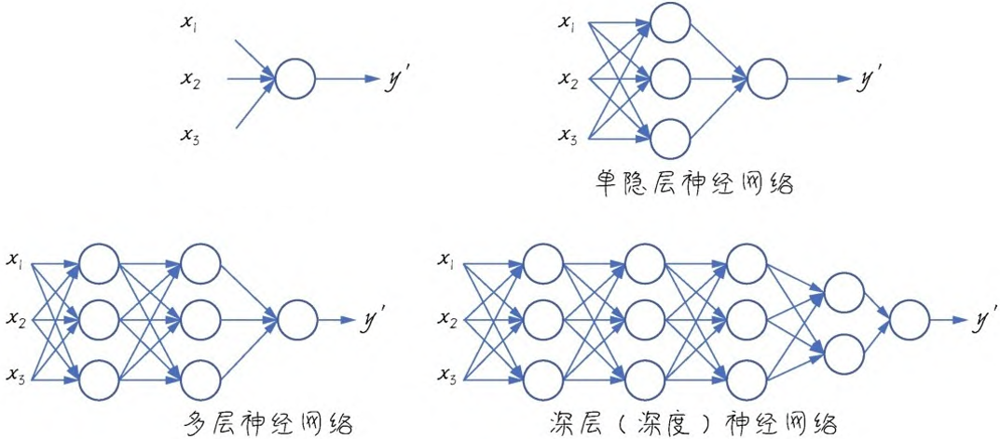

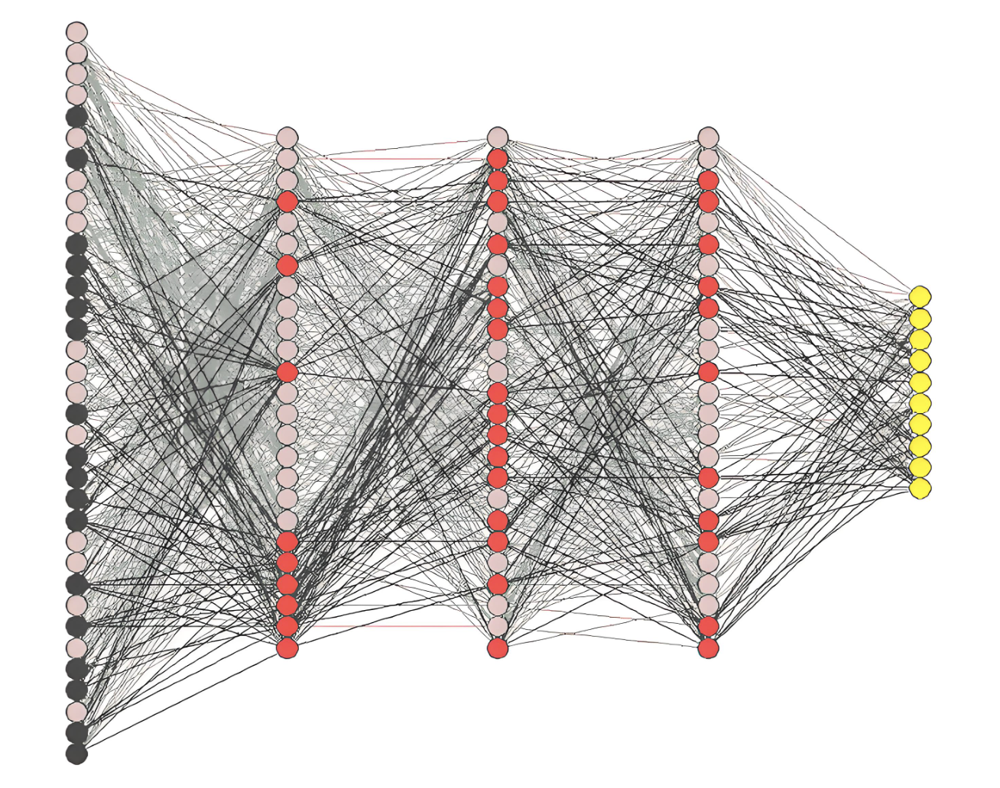

### 2. 三类经典网络

1. **卷积神经网络（CNN）**：特别适合处理**图像**，广泛用于计算机视觉。
2. **循环神经网络（RNN）**：处理**序列数据**，引入隐状态 `h`（hidden state）来记住过去的信息并用于当前处理；但**序列不能太长，否则会遗忘**。
3. **长短时记忆网络（LSTM）**：RNN 的改进版，能更好地**捕捉长距离依赖**（语言、视频、股票价格等）；但**计算效率低，并行能力不足**，对非常长的序列仍有限。

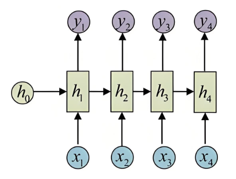

### 3. Transformer

- **Transformer 架构**最初在 **2017 年**提出，是一种**深度学习模型架构**，内部基于**注意力机制**，用于处理**序列到序列**的任务（机器翻译、语言建模等）。
- 它属于深度学习/深度神经网络的一种，**目前几乎所有先进的大模型（GPT、DeepSeek 等）都基于 Transformer 架构**。

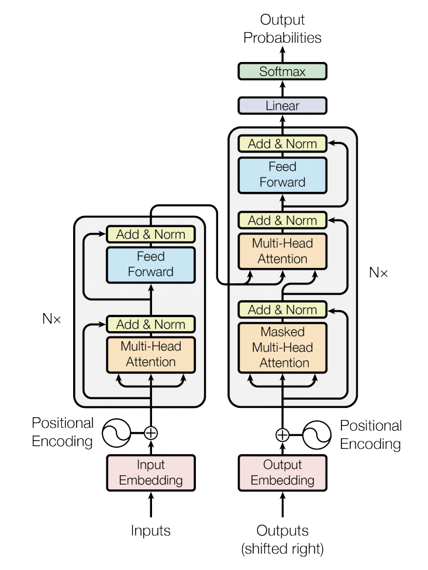

> 例如做翻译时，模型会先把输入编码（Encoders），再由解码器（Decoders）输出结果：

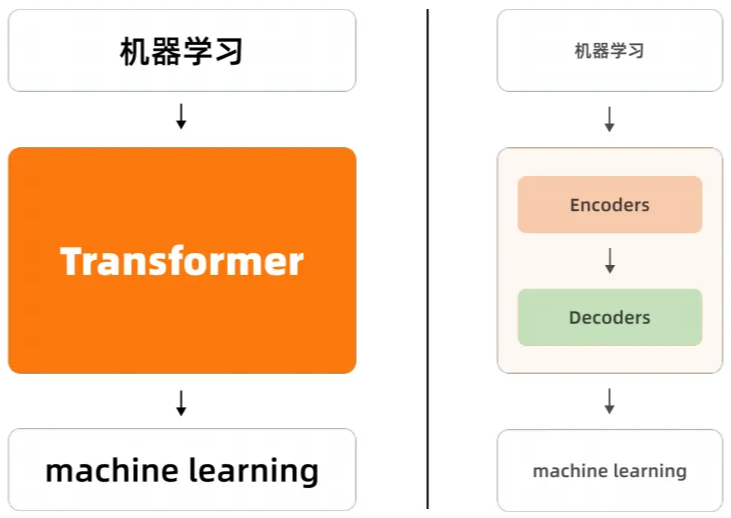

### 4. Transformer 的四大优势

1. **并行计算**：充分利用现代计算硬件并行计算，**大幅提高训练速度**。
2. **捕捉长距离依赖**：**自注意力机制**让每个位置都能与序列中其他所有位置交互。
3. **可扩展性**：更容易扩展到更大的模型和更多的数据。
4. **灵活性和效果**：在机器翻译、文本生成、语义理解等多种 NLP 任务中都表现出色。

---

## 四、大模型的工作原理（四个步骤）

> 大模型的工作原理可以分为 **4 个步骤**：

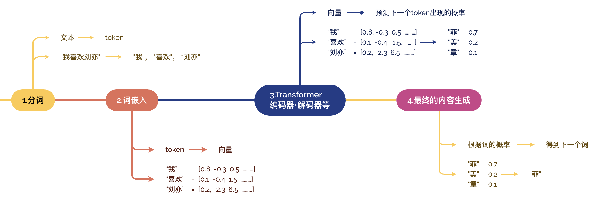

### 1. 分词（Tokenization）

- 大模型处理前，先把语句拆解成一个个**基础单元 Token**。之所以要分词，是因为**计算机不能直接处理文字，只能处理数字**。
- `token` 是模型输入/输出的**最小语义单位**（不一定是"字"或"词"，也可能是子词、符号、空格），每个 token 对应一个**唯一的整数 ID**。

| 原文 | 分词结果 |
| --- | --- |
| 我喜欢刘亦 | 我 / 喜欢 / 刘亦 |
| 长沙的雨 | 长沙 / 的 / 雨（3 个 Token） |
| Rain in Changsha | Rain / in / Changsha（3 个 Token） |
| 长沙明天暴雨，记得带伞 | 长沙 / 明天 / 暴雨 / 记得 / 带伞 |

> 通常 1 个中文词语、1 个英文单词、1 个数字或 1 个符号计为 1 个 token；**不同模型的 token 规则不同**。

**案例**：`国王他有个女儿` → 国王 | 他 | 有个 | 女儿

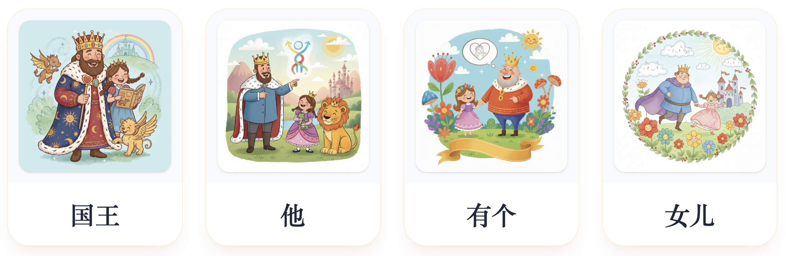

### 2. 词嵌入（Word Embedding）与词向量（Word Vector）

- **词嵌入**：把 token 映射为**蕴含语义的词向量**的技术。语义相近的单词，在向量空间中的**距离也相近**。
- **词向量**：某个词在向量空间中的**具体数值表示**，是既有**方向**又有**大小**的量。
- 每个 token 会被换成由很多数字（几百~几千、上万）组成的列表，例如 `"长沙" = [0.8, -0.3, 0.5 …]`。

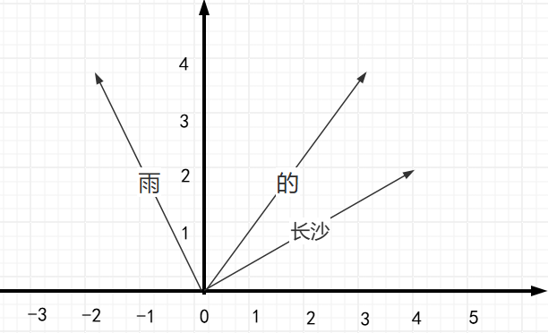

查表过程：**token → 索引（INDEX）→ 查 Embedding Matrix → 得到高维词向量**（如 3072 维）。

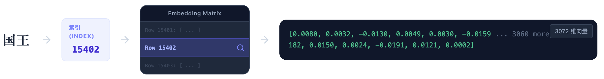

成千上万个 token 及其词向量，就组成了一张巨大的**大词表（Vocabulary）与词向量矩阵**：

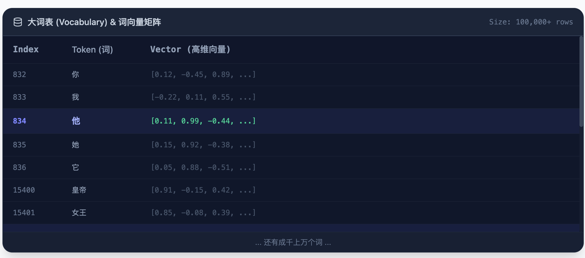

> 以后自己做向量化，会直接使用已经训练好的**向量模型/嵌入模型**。例如在阿里云百炼的**模型广场**中选择 **Qwen-Embedding（text-embedding-v4）** 这类文本向量模型：

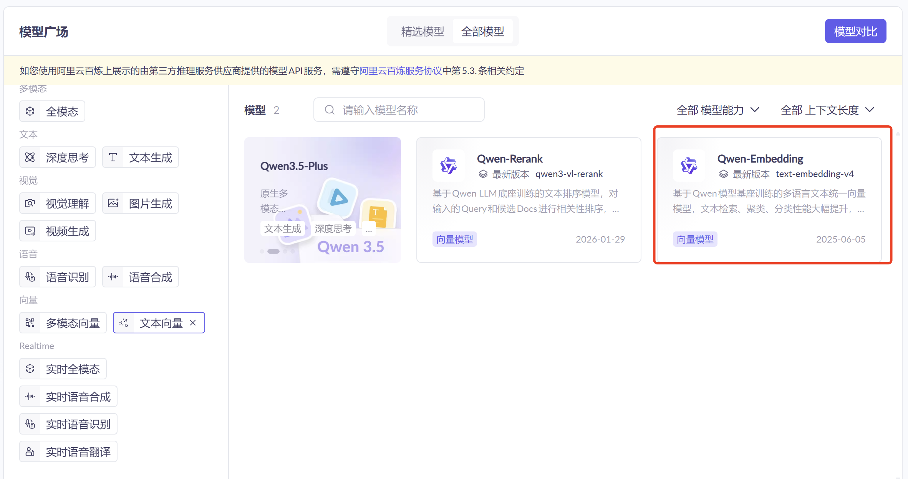

### 3. 注意力机制（Attention）

- 词与词之间存在**远近亲疏**关系；同一个字/词，周围出现的词不同时，含义可能不同。模型需要**捕捉每个词在上下文中的关联**，这就是**注意力机制**的作用。
- 经典论文 **《Attention Is All You Need》**（2017，Google）提出了这一核心机制：

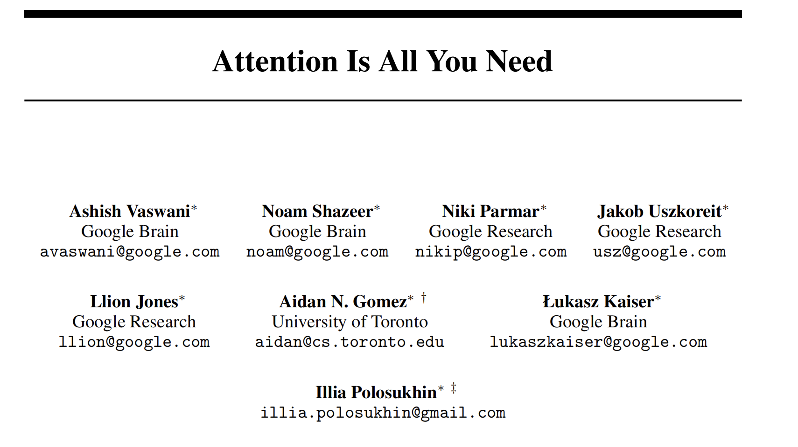

- 以"**国王他有个女儿**"为例：`女儿` 与 `国王` 的关联度是 **0.684**，与 `有个` 的关联度是 **0.646**：

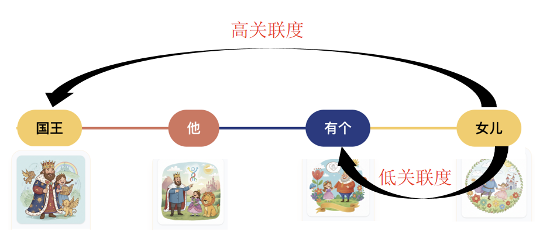

所有词两两之间的关联度，可以表示成一个**注意力权重矩阵**：

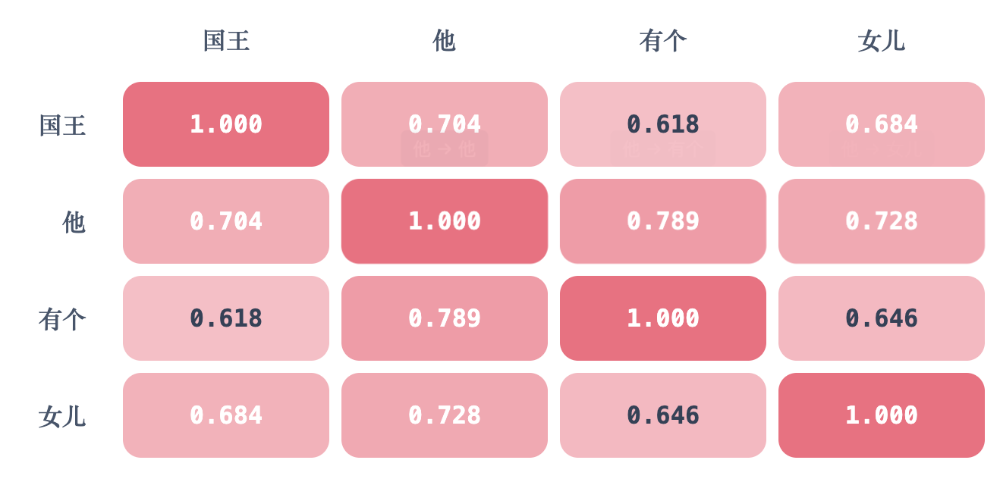

- **自注意力机制**（Self-Attention）通过 `Q(查询)、K(键)、V(值)` 计算：

$$ \text{Attention}(Q, K, V) = \text{softmax}\left(\frac{QK^T}{\sqrt{d_k}}\right)V $$

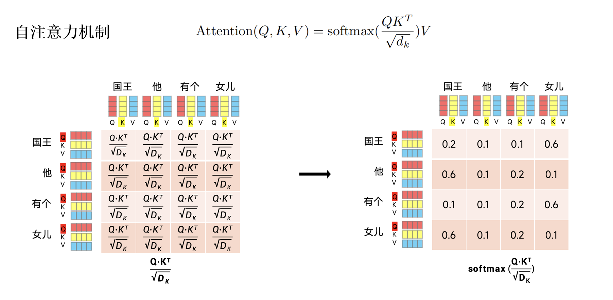

### 4. 生成内容（概率预测与续写）

- 经过注意力计算后，模型会**不断计算下一个词的概率**，选择概率最高的词加入上下文，再把新句子作为输入预测下一个词。
- 例如"国王他有个女儿，这位公主美丽又" → 下个词概率：**善良 30%、温柔 20%、邪恶 5%** …，于是续写出：

> 国王他有个女儿，这位公主美丽又**善良** …

这种"每步都基于前面所有词预测下一个词"的方式，就是 **自回归生成（Autoregressive Generation）**——本质是一个**"接话机器"**：

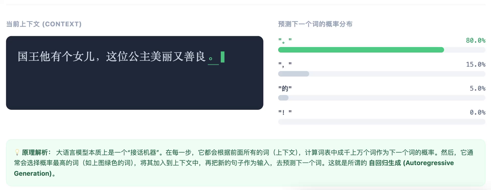

### 5. 四步总结

| 步骤 | 名称 | 作用 |
| --- | --- | --- |
| ① | **分词（Token 化）** | 把文本拆成 Token，如 `国王 / 他 / 有个 / 女儿` |
| ② | **词嵌入 / 词向量** | 每个 Token 查表（Embedding Matrix）变成高维向量 |
| ③ | **注意力机制（Transformer）** | 分析词之间的关联度，精准理解上下文 |
| ④ | **不断生成内容** | 像玩文字无限接龙，循环预测并生成下一个词 |

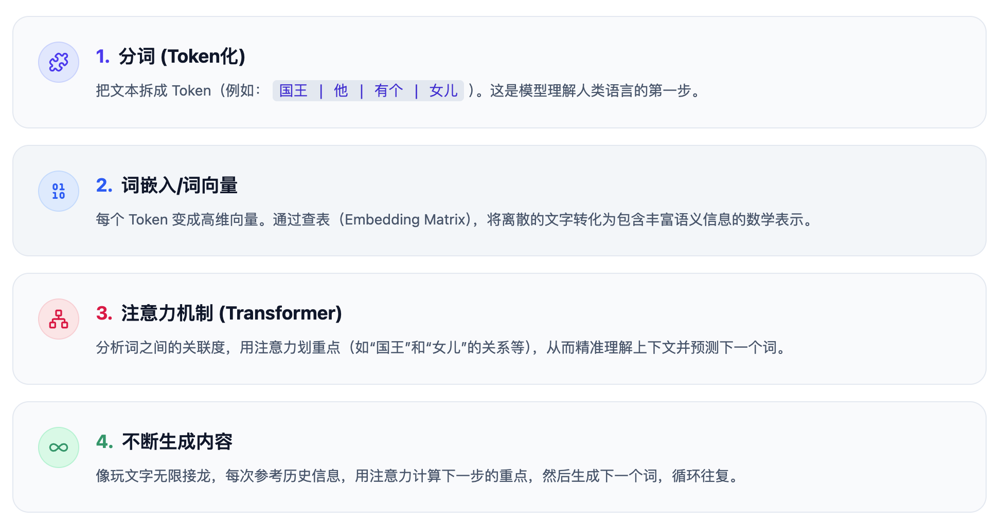

---

## 五、模型训练前置知识：机器学习

### 1. 什么是机器学习

机器学习（Machine Learning）的基本流程：

1. 提供**历史数据**；
2. 创建**模型**，用历史数据**训练**；
3. 输入**新数据**，模型**预测**结果。

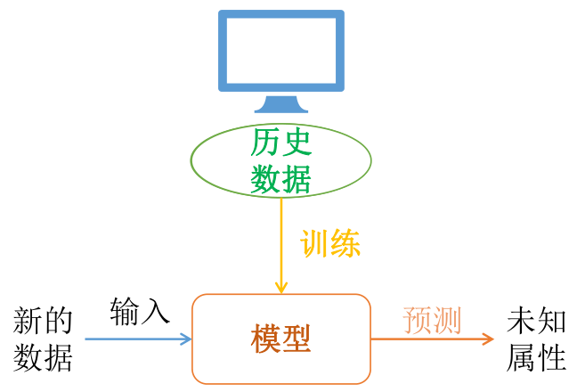

### 2. 机器学习分类

**监督学习、无监督学习、自监督学习、强化学习** 等，且与**深度学习、生成式 AI、LLM** 层层包含：

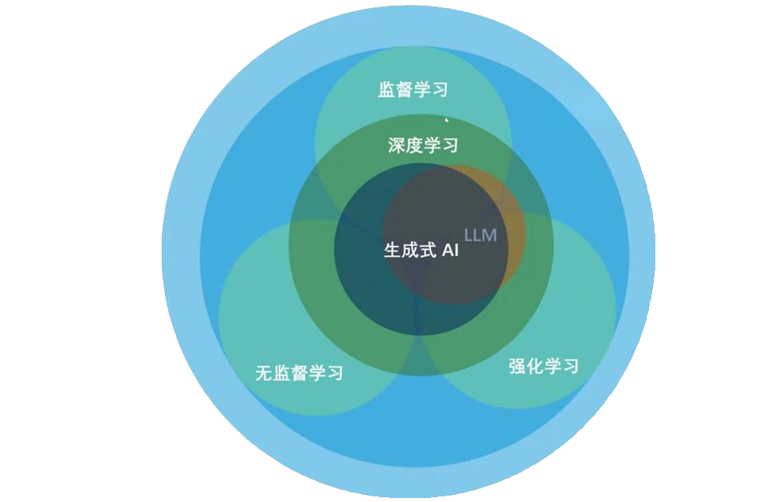

| 类型 | 数据特点 |
| --- | --- |
| **监督学习（Supervised Learning）** | 给机器一大堆**标记好**的数据（既有特征 X，也有标签 y） |
| **无监督学习（Unsupervised Learning）** | 给机器一大堆**没有分类标记**的数据（只有特征 X） |

<table>
<tr>
<td>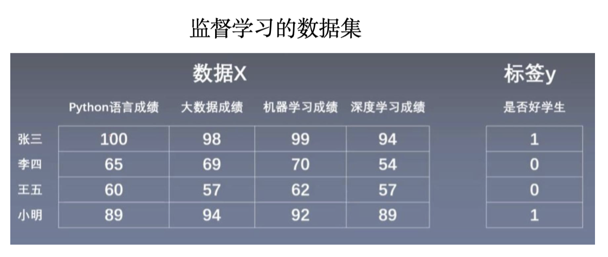</td>
<td>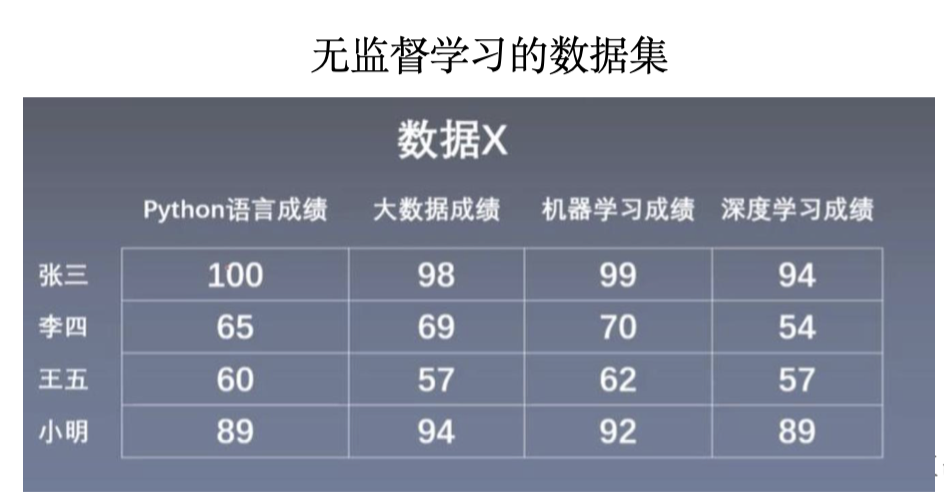</td>
</tr>
</table>

### 3. 自监督学习（Self-Supervised Learning）

- 一种**无需人工标注**数据的学习方法：利用**数据本身的结构**来生成"标签"，再用这些标签训练模型。
- 它是一种**特殊的无监督学习**，也可以理解成**介于监督学习和无监督学习之间**。
- 就像一张**无答案的试卷**：通过对试卷的学习和推理，**自己去找答案**。

### 4. 强化学习（Reinforcement Learning, RL）

- 让 AI 通过**不断尝试、与环境互动**来学习如何做出最优决策：根据得到的**反馈**调整行为策略，逐渐学会哪些行动能带来**更多奖励**、哪些会受到**惩罚**。
- 典型例子：**AlphaGo**。

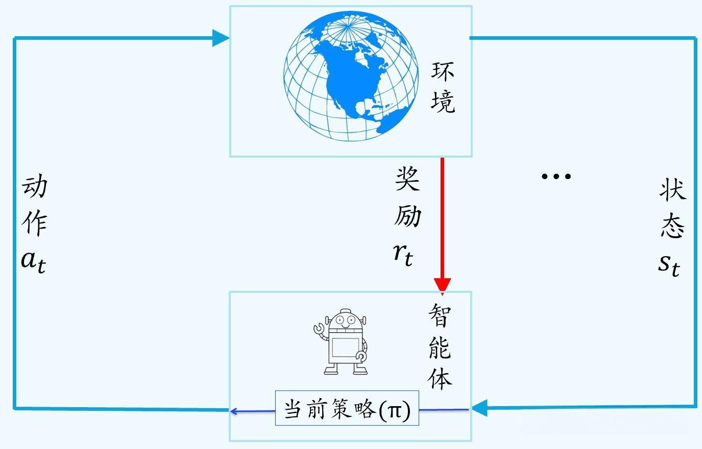

---

## 六、大模型训练流程（三大阶段）

> 大型语言模型（如 DeepSeek、GPT 等）的训练通常包括 **3 大阶段**：

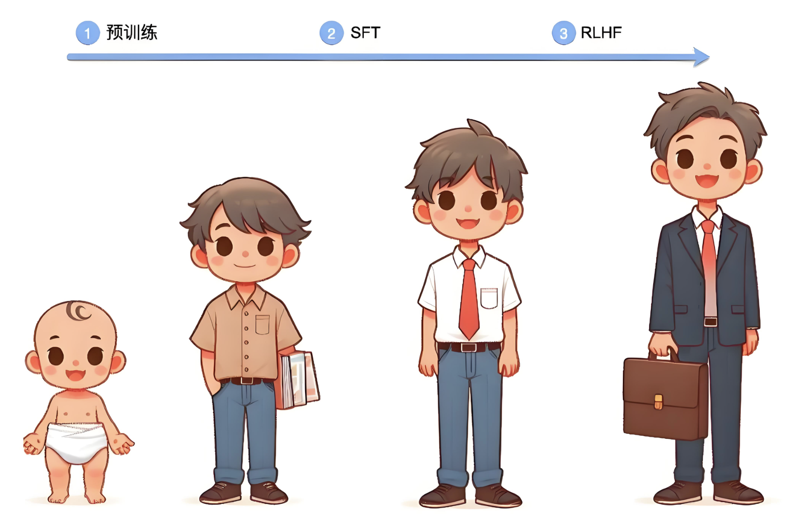

| 阶段 | 英文 | 通俗比喻 | 做什么 |
| --- | --- | --- | --- |
| ① **预训练** | PreTraining | 婴儿 → 中学生 | 用海量**无标注**文本（书籍、网页、代码等），通过**自监督学习**学习通用知识 |
| ② **监督微调** | SFT | 中学生 → 大学生 | 对**基座模型**微调，使其适用特定任务，得到有偏好的模型 |
| ③ **强化学习** | RL / RLHF | 大学生 → 步入职场 | 引入**人类反馈**（或奖励模型）进一步优化生成质量，更符合用户期望与人类价值观 |

### 1. 预训练 Pre-training —— "修内功"积累"知识"

- 让模型学习**通用知识**：使用海量**无标注**文本（书籍、网页、代码等），通过**自监督学习**训练模型。
- 预训练往往需要大量算力，通过**多机分布式训练**来完成：

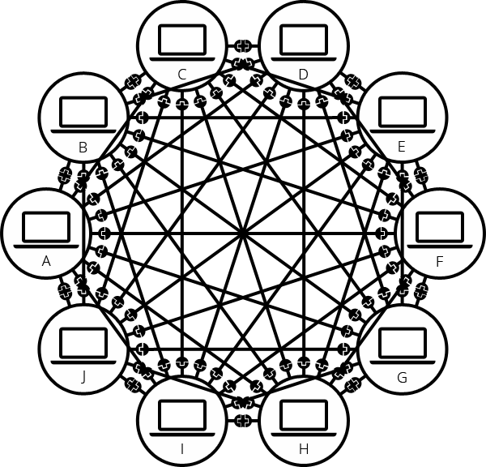

### 2. 监督微调 SFT —— "大佬教教我"

- **微调（Fine-tuning）**：在预训练模型（Pre-train，如 Meta 开源的 **LLaMA** 系列）基础上，用特定任务的数据继续训练，得到**微调后的大模型**。
- 效果对比示例：

| 预训练模型 | 微调后的"旅游模型" |
| --- | --- |
| 问：翻译你是谁？ 答：Who are you? | 问：翻译你来自哪里？ 答：Where are you from |
| | 问：哪些地方适合带孩子游玩？ 答：动物园和水族馆… |
| | 问：只有一天时间够吗？ 答：以下是一些适合一天游玩的建议… |

> 参考：Hugging Face 官网 https://huggingface.co/ ；Meta LLaMA3 https://huggingface.co/collections/meta-llama/meta-llama-3-66214712577ca38149ebb2b6

### 3. RLHF —— "接受审判"

- **基于人类反馈的强化学习（Reinforcement Learning from Human Feedback, RLHF）**：通过**人类的评价反馈**（如点赞/点踩、哪个回答更好）来训练**奖励模型**，再用强化学习优化大模型，使其回答更符合人类偏好。

> 例如不同模型给出的回答，人类可以通过"**更好 / 更糟 / 相同**"进行反馈打分，这些反馈就是 RLHF 的训练信号：

<table>
<tr>
<td>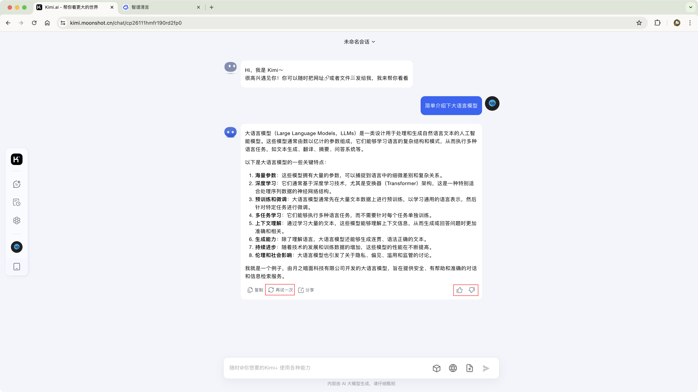</td>
<td>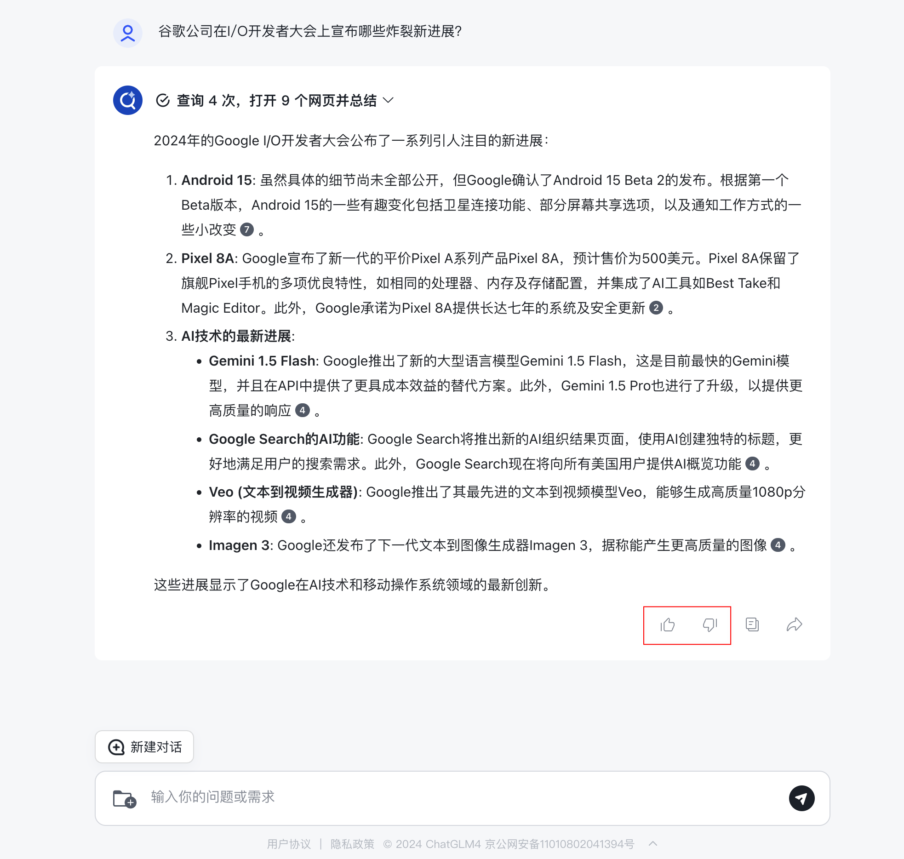</td>
</tr>
</table>

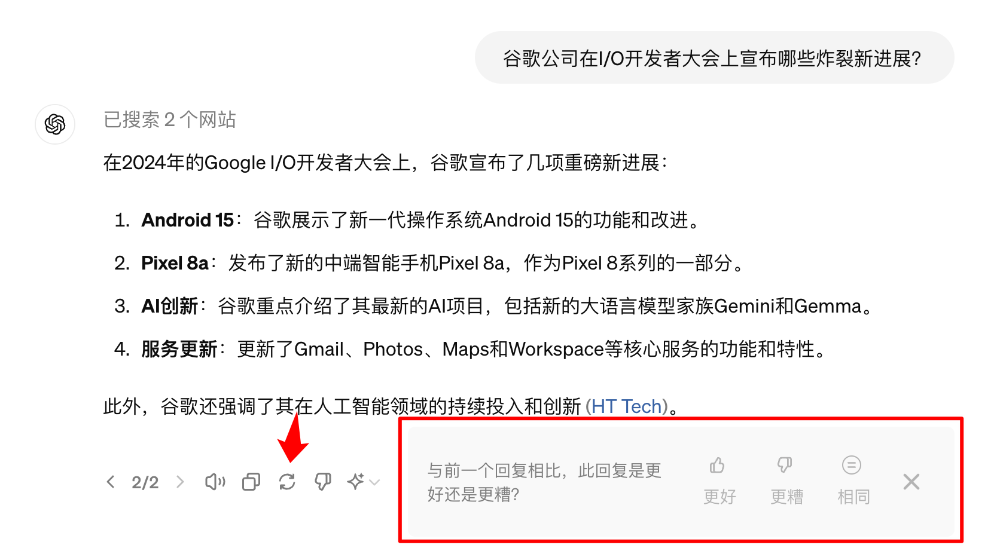

### 4. 模型成长之路

| 阶段 | 学习方式 | 比喻 |
| --- | --- | --- |
| 预训练 | **自监督学习** | 婴儿 → 中学生，海量文本自学 |
| 监督微调 | **监督学习** | 中学生 → 大学生，跟着"老师"学 |
| RLHF | **基于人类反馈的强化学习** | 大学生 → 职场，在反馈中不断打磨 |

---

## 七、自测小问题

1. GPT 三个字母分别代表什么？
2. 什么是生成式？它是如何"预测"下一个词的？
3. RNN、LSTM 各自有什么优缺点？
4. Transformer 相比 RNN/LSTM 有哪些优势？
5. 大模型工作分为哪四个步骤？
6. token、词嵌入、词向量分别是什么？
7. 注意力机制解决的是什么问题？
8. 什么是自回归生成？
9. 监督学习、无监督学习、自监督学习有什么区别？
10. 大模型训练的三大阶段是什么？各自做什么？
