# L1-7《Transformer 架构解析（扩展）》学习笔记

> 本笔记由课件《L1-7_Transformer架构解析（扩展）》整理，配套图片见 `images/` 文件夹。
> **提示：本次课为扩展内容，不影响后面课程的学习，可先了解大致思路。**

---

## 一、Transformer 整体架构

Transformer 由**编码器（Encoder）**和**解码器（Decoder）**两部分组成，数据从左到右、由下往上流转：

- 输入侧：**用户输入内容 → 分词 → 词嵌入（把 token 变成向量）→ 位置编码（给向量加入位置信息）→ 编码器**。
- 编码器内部：**多头注意力（MHA）→ 残差连接 + 层归一化 → 前馈神经网络（FFN）**，可堆叠 `N×` 层。
- 输出侧：**解码器 → 输出层（Linear + Softmax）**。
- 解码器内部关键结构：**带掩码的注意力机制（Masked MHA）→ 交叉注意力机制 → 前馈神经网络**。

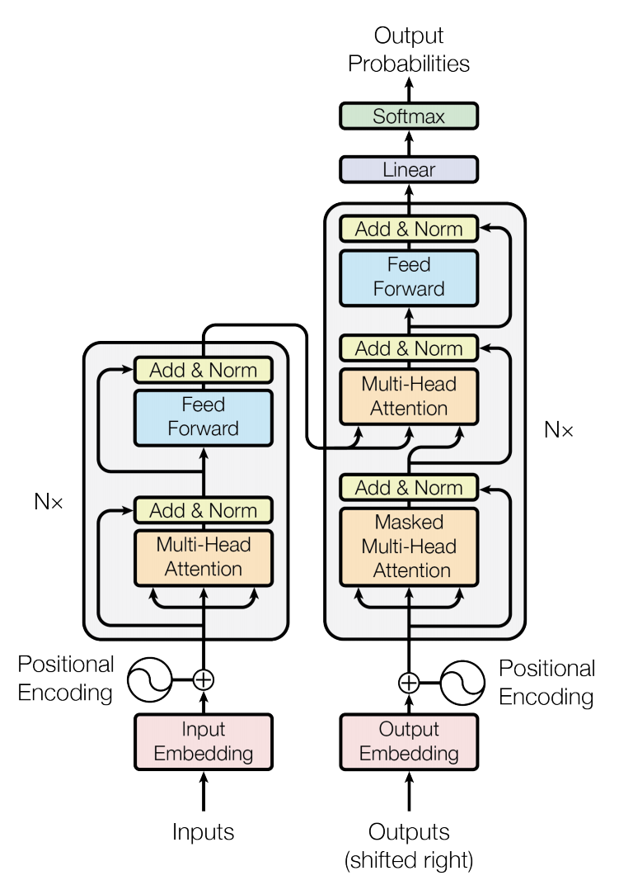

> 可视化理解工具： https://bbycroft.net/llm 、 https://poloclub.github.io/transformer-explainer/

---

## 二、输入处理：分词 → 词嵌入 → 位置编码

以"**国王他有个女儿**"为例：

**第 1 步 分词**：假设分词后得到 4 个 token —— `国王 / 他 / 有个 / 女儿`。

**第 2 步 词嵌入**：把每个 token 变成一个**固定长度（如 512）的词向量**：

| token | 词向量（示例，长度 512） |
| --- | --- |
| 国王 | [3.1, 0.9, …] |
| 他 | [0.1, 0.3, …] |
| 有个 | [2.1, 4.0, …] |
| 女儿 | [4.1, 0.8, …] |

**第 3 步 位置编码（Positional Encoding）**：给向量**加入位置信息**。
**偶数维度（2i）用正弦函数，奇数维度（2i+1）用余弦函数**：

$$ PE_{(pos,2i)} = \sin\!\left(pos / 10000^{2i/d_{model}}\right) $$
$$ PE_{(pos,2i+1)} = \cos\!\left(pos / 10000^{2i/d_{model}}\right) $$

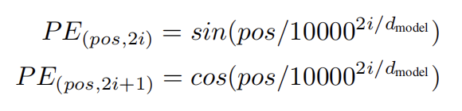

**第 4 步 嵌入层**：`嵌入层 = 词嵌入 + 位置编码`，得到进入编码器的矩阵 **X（4×512）**：4 个 token，每个长度 512。

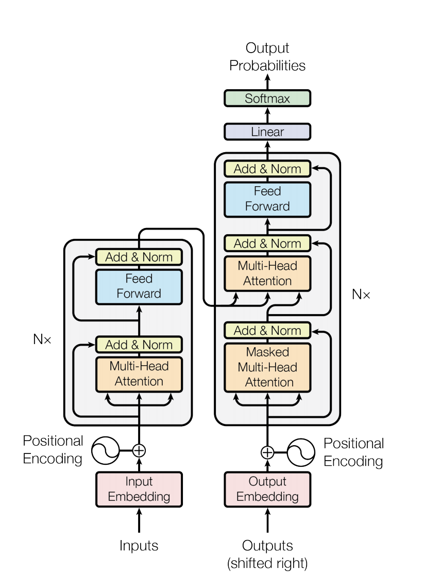

---

## 三、自注意力机制（Self-Attention）

### 1. 为什么需要注意力

**注意力机制（Attention Mechanism）**是深度学习中的一种重要技术：它让模型在处理信息时**聚焦于最重要的部分**，忽略不太相关的信息，模仿人类"选择性注意"的过程，从而提高模型的性能和效率。

### 2. Q / K / V 三个概念

| 符号 | 名称 | 含义 |
| --- | --- | --- |
| **Q** | Query（查询） | 当前**要关注**的信息 —— "我应该关注输入的哪个部分？" |
| **K** | Key（键） | 所有可能被关注信息的"**标识 / 索引**" —— "这个输入部分是什么？" |
| **V** | Value（值） | 每个位置的**实际内容信息** —— "如果我关注这个部分，应该提取什么信息？" |

> 通俗理解：用你的问题（**Query**）去和文章中每句话的标签（**Key**）匹配，哪个 Key 匹配度高，就说明它对应的信息（**Value**）更重要，给它更高的**权重**，最后把重要信息整合起来，形成答案。

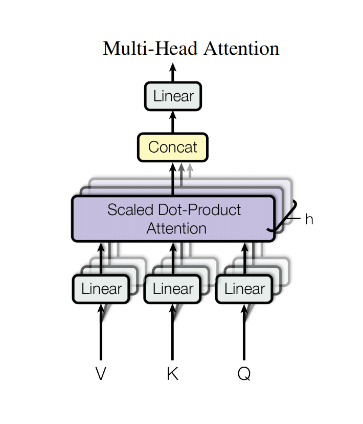

### 3. QKV 的计算

在 `h = 8` 个头的情况下，每个头维度 `64 = 512 / 8`：

$$ Q = X \cdot W_q \qquad K = X \cdot W_k \qquad V = X \cdot W_v $$

其中 `Wq、Wk、Wv` 是**预训练阶段提前学习好的参数**；X 为 4×512，Q/K/V 均为 4×64。

### 4. 缩放点积注意力

$$ \text{Attention}(Q, K, V) = \text{softmax}\!\left(\frac{QK^{T}}{\sqrt{d_k}}\right)V $$

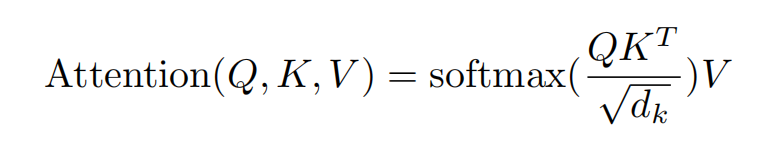

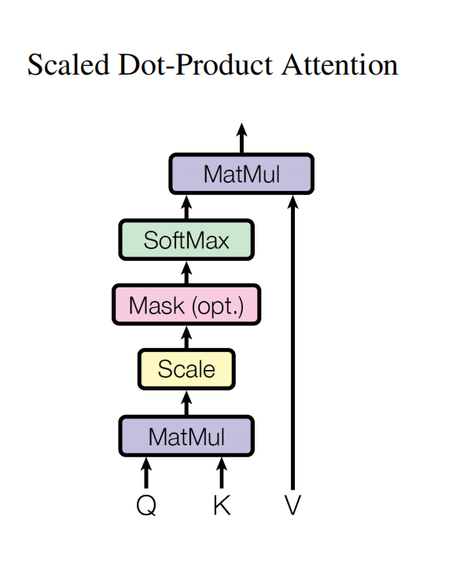

各符号含义：

| 符号 | 含义 |
| --- | --- |
| **QK^T** | Query 和 Key 的点积，用于计算**相似度** |
| **d_k** | Key 的维度（每个 Key 向量的长度），用于缩放点积 |
| **QK^T / √d_k** | 对点积**缩放**，防止梯度消失或爆炸 |
| **softmax** | 将点积结果转换为**概率分布（权重）** |
| **输出** | **加权后的 Value** —— 根据 Query 对不同位置的 Value 加权组合的结果 |

### 5. 注意力权重矩阵

`Q·K^T / √D_k` 计算完成后，得到一张**相似度矩阵**（每个词对其他词的关注程度）：

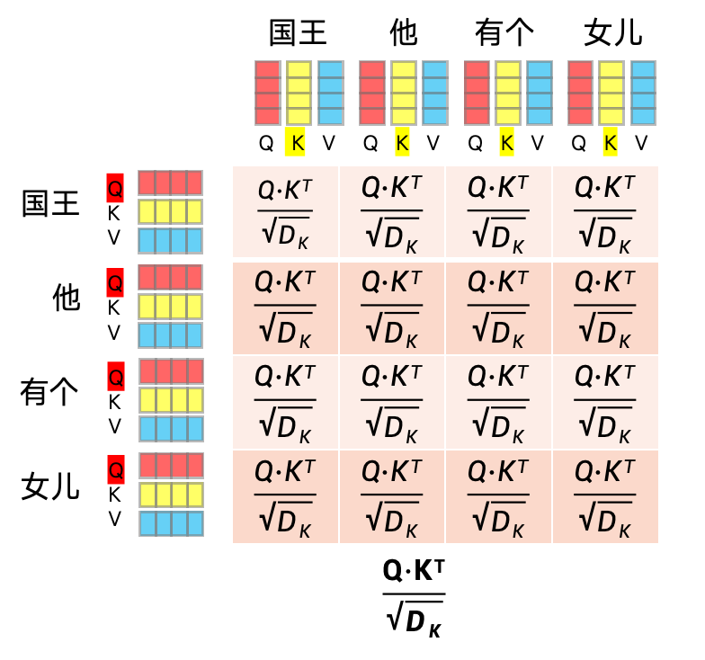

再经过 **softmax** 归一化为**权重矩阵**（每行之和为 1）：

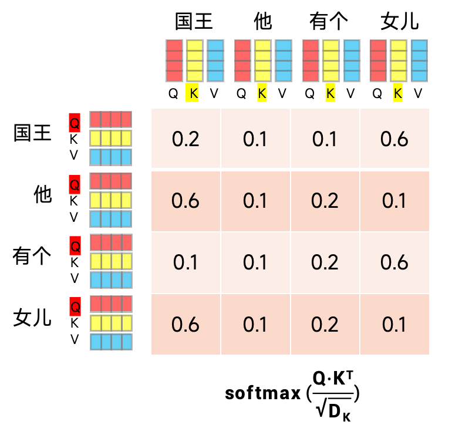

### 6. Mask 掩码注意力

- **Mask 掩码**：对**还没预测出来的下一个词**用 **−∞** 表示，经过 **softmax 后会变成 0**，从而保证模型**只能看到前面的词**，不能"偷看"未来。

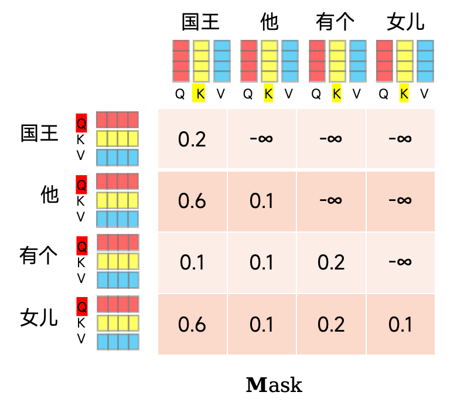

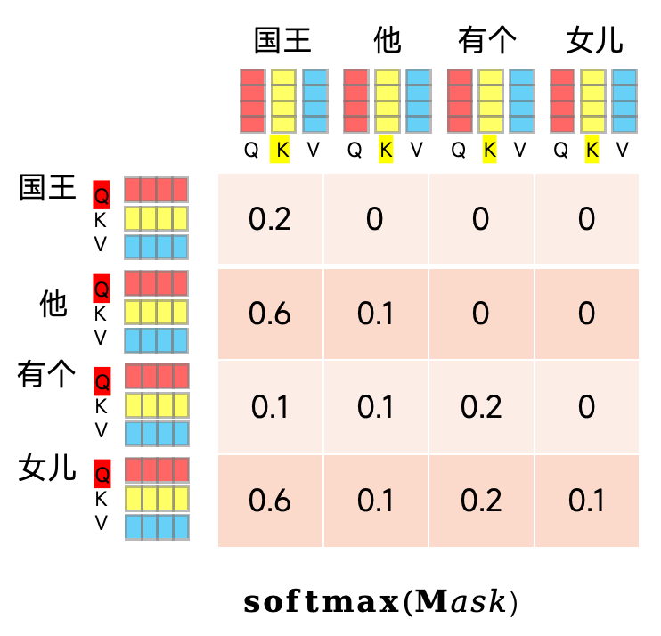

### 7. 多头注意力（Multi-Head Attention）

多个头并行计算后再拼接：

$$ \text{MultiHead}(Q, K, V) = \text{Concat}(\text{head}_1, \dots, \text{head}_h)W^O $$
$$ \text{where } \text{head}_i = \text{Attention}(QW_i^{Q}, KW_i^{K}, VW_i^{V}) $$

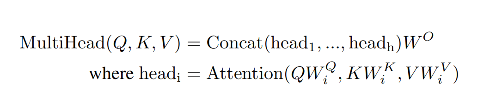

每个头输出 4×64，`h=8` 个头拼接后恢复到 4×512：

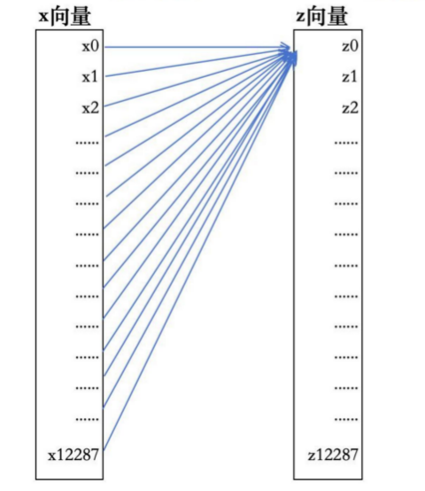

---

## 四、残差连接 + 层归一化

1. **残差连接（Residual）**：把**多头注意力计算后的结果 + 计算前的向量**相加。
   - 目的：解决深层网络训练中的**梯度消失**问题，同时保留原始输入信息，提高训练的稳定性和表达能力。
2. **层归一化（Layer Norm）**：对每一层（每个样本）进行**标准化处理（均值为 0、方差为 1）**。
   - 目的：**加速训练**并提升模型**泛化能力**。

$$ x_{\text{norm}} = \gamma \cdot \frac{x - \mu}{\sqrt{\sigma^2 + \epsilon}} + \beta $$

（其中 γ 和 β 为**可学习参数**）

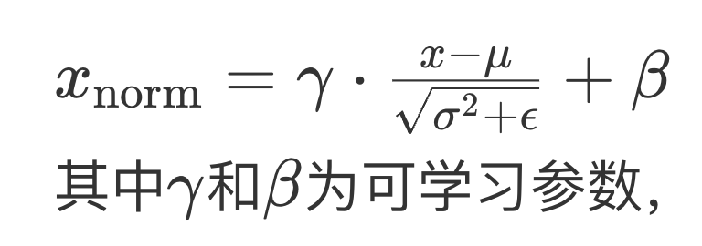

---

## 五、前馈神经网络 FFN

**FFN（前馈神经网络）**位于注意力之后：先把向量**放大 4 倍**（512 → 2048），再提取重要特征后还原回 512。

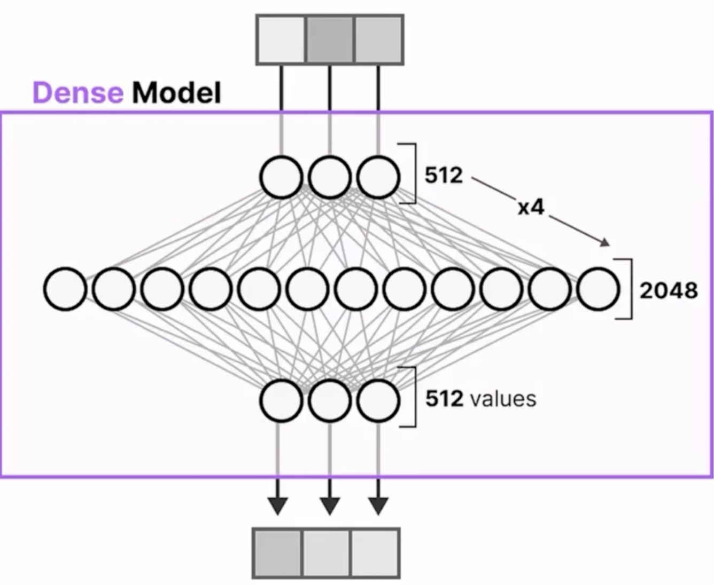

$$ \text{FFN}(x) = \max(0,\ xW_1 + b_1)W_2 + b_2 $$

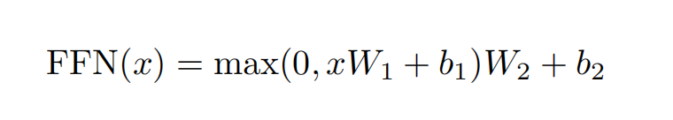

---

## 六、解码器与自回归生成

解码器**只有掩码多头注意力、交叉注意力、FFN** 三块（没有普通多头注意力），自回归地一个个生成词：

- `<bos>` 表示**开始的第一个字符**，生成到 **`<eos>`（结束符）**为止。
- 每一步：**Linear 层**把 512 长度映射到**词表长度** → **softmax** 得到词表中每个词的概率（下个词的概率）。

| 步 | 解码器输入（Q） | 编码器提供（K、V） | 预测下个词（示例） |
| --- | --- | --- | --- |
| 1 | `<bos>` (1×512) | 4×512 | 美丽 0.5 |
| 2 | `<bos>美丽` (2×512) | 4×512 | 又 0.6 |
| 3 | `<bos>美丽又` (3×512) | 4×512 | 善良 0.5 |
| 4 | `<bos>美丽又善良` (4×512) | 4×512 | … 直到 `<eos>` |

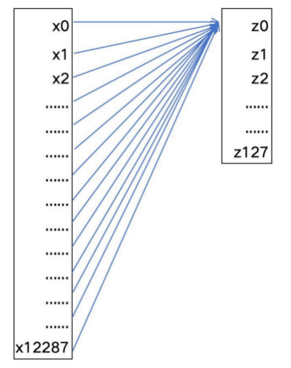

> 回顾"国王女儿"案例：`国王 | 他 | 有个 | 女儿` → 词嵌入 → 注意力计算关联度（如"女儿"和"国王"关联度 90%、和"他"只有 10%）→ 不断续写出"国王他有个女儿，这位公主美丽又善良…"。

---

## 七、三种架构变体

| 架构 | 结构 | 说明 |
| --- | --- | --- |
| **Encoder-Decoder** | 编码器 + 解码器 | 最初的完整 Transformer |
| **Decoder-only** | 只保留解码器 | **主流架构**（如 GPT 系列） |
| **Encoder-only** | 只保留编码器 | 如 BERT |

可视化网址：
- https://bbycroft.net/llm
- https://poloclub.github.io/transformer-explainer/

---

## 八、Transformer 可视化（Transformer Explainer）

在 **Transformer Explainer** 中可以直观看到：输入 → **Embedding → Multi-head Self Attention（Q/K/V）→ MLP** → 输出概率分布 的完整过程。

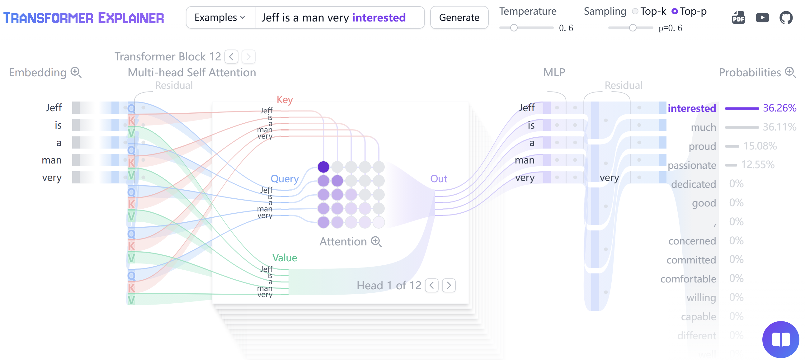

---

## 九、总结

1. **分词（Token 化）**：把文本拆成 Token（`国王 | 他 | 有个 | 女儿`）。
2. **词嵌入 / 词向量**：每个 Token 变成向量（再加位置编码）。
3. **注意力机制（Transformer）**：
   - **编码器**：分析问题，用注意力"划重点"（如"国王"和"女儿"的关系）；
   - **解码器**：边生成边查表，用注意力确保连贯，生成内容。
4. **不断生成内容**：**自回归机制**，在解码器不断"文字接龙"，每次参考所有历史信息，用注意力决定下一步重点。

---

## 十、自测小问题

1. Transformer 由哪两部分组成？各自的内部结构有哪些模块？
2. 分词、词嵌入、位置编码各自的作用是什么？
3. 为什么需要位置编码？正弦/余弦分别用于哪些维度？
4. Q、K、V 分别代表什么？
5. 注意力公式中 `√d_k` 的作用是什么？
6. Mask 掩码机制解决什么问题？
7. 多头注意力相比单头有什么好处？
8. 残差连接和层归一化各自的作用是什么？
9. FFN 中"放大 4 倍"指的是什么？
10. Encoder-Decoder、Decoder-only、Encoder-only 有什么区别？
