# L2-day01《Naive RAG 构建流程与应用实践-1》学习笔记

> 本笔记由课件《L2-day01_NaiveRAG构建流程与应用实践-1》整理，配套图片见 `images/` 文件夹。

---

## 一、本阶段课程安排

| 章节 | 章节名称 |
| --- | --- |
| 1 | Naive RAG 构建流程与应用实践 |
| 2 | LangChain V1.x 框架从入门到精通 |
| 3 | RAG 痛点分析与优化方案实践 / Advanced RAG |
| 4 | 掌握 RAG 应用评估技能和工具 |
| 5 | RAG 开源项目综合应用 |
| 6 | 实战项目：金融助手商业化实战 |

- **课程前置**：计算机通识、Python 语言基础知识、PyCharm 基本使用、L1 阶段学习内容等。
- ⚠️ 以上是**章节安排，不是课时安排**：一章若一次课没讲完会顺延，一次课也可能讲多个章节。

---

## 二、这节课要学什么

- RAG —— 检索增强生成
- Naive RAG **文档解析**
- Naive RAG **文档分块**
- Naive RAG **嵌入模型与文档向量化**

---

## 三、RAG —— 检索增强生成

### 1. 大语言模型本身存在的局限性

1. **时效性**：训练数据存在**时间截止点**，参数中的知识不会自动更新，截止点之后发生的事无从知晓。
2. **知识覆盖度**：训练语料以**公开数据**为主，对**私有数据、垂直专业细节和长尾知识**覆盖不足。
3. **AI 幻觉**：模型在缺乏相应知识时，仍流畅、自信地生成**看似合理但事实错误或无依据**的内容 —— "大模型一本正经地胡说八道"。

> 例如问模型一个未来才发生的事件，它只能回答"赛事尚未举行"；问它私有/企业内部的数据（如律师行业内部资料），它也无从得知：

<table>
<tr>
<td>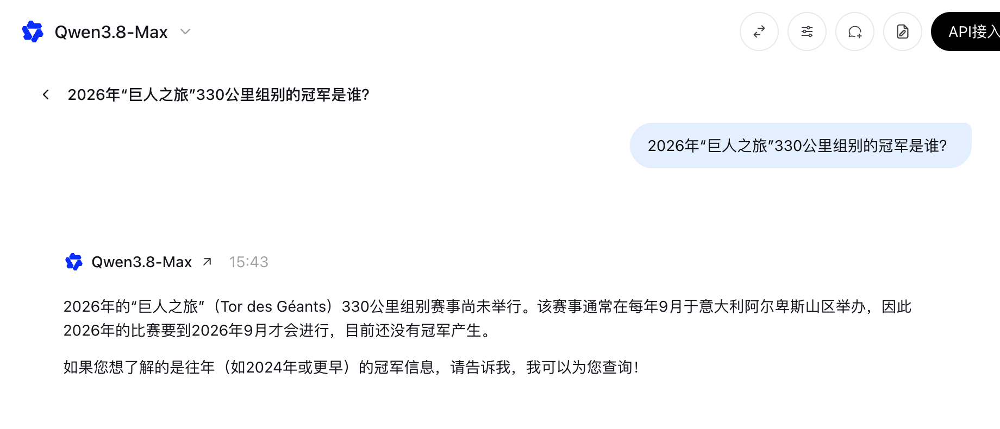</td>
<td>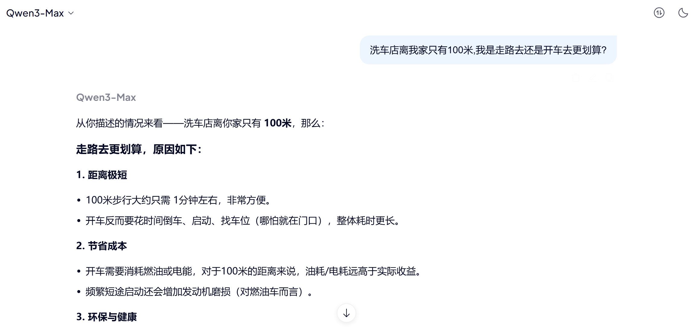</td>
</tr>
</table>

**解决方案：RAG（检索增强生成）**。

### 2. 什么是 RAG

- **RAG（Retrieval Augmented Generation / 检索增强生成）** 是一种**结合了检索和生成**两种方法的技术。
- 通过**先检索相关文档**，用检索出来的信息对**提示词进行增强**，再使用**大模型生成答案**。
- RAG 的本质：**RAG = 大模型 + 外部数据**。

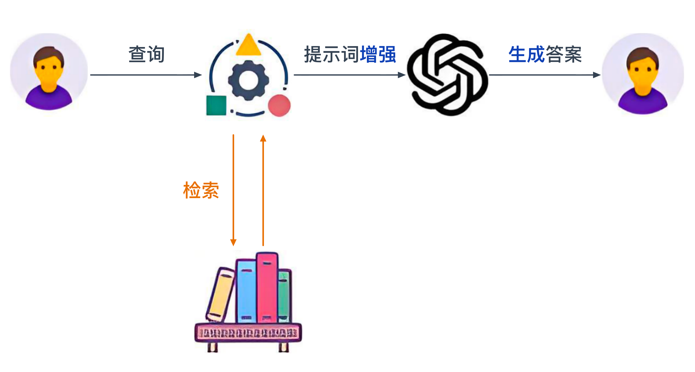

### 3. RAG 系统工作流程

RAG 系统分为**两个阶段**：

- **阶段一 · 知识库构建（离线）** —— 索引阶段，**文档入库时跑一次**：
  `原始文档 → 文档解析 → 文档分块 → 向量化 → 向量数据库`
- **阶段二 · 检索生成（在线）** —— 智能问答，**每次提问跑一遍**：
  `用户提问 → 问题向量化 → 检索文档块(Top-K) → 拼成提示词 → 大模型生成 → 最终答案`
- ⚠️ 两个阶段必须使用**同一个嵌入模型**，否则向量不在同一空间、检索会失效。

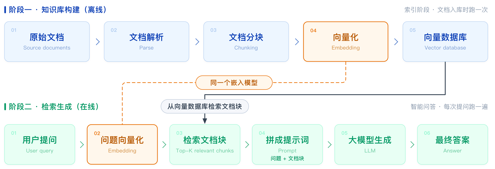

---

## 四、Naive RAG —— 文档解析

**文档解析**：把文档中的内容**准确提取出来**。

### 1. 解析流程

`接收文件 → 格式识别 → 分路解析 → 归一化 → 清洗输出`

- 分别处理四类文档：**txt/md 文本、Word 文档、PDF 文档、Excel 表格**。

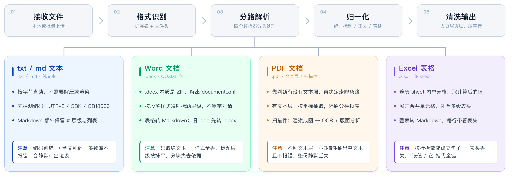

> **解析的目标不是把文件读成字符串，而是把版式还原成结构**：标题层级、表格行列、页码页眉，都要变成可用的元数据。
> 四类里 **PDF 最不可控** —— 扫描件必须先过 OCR 与版面分析；**Excel 则相反**，必须整表保留，拆成句子就废了。

### 2. 解析的两种实现方式

| 方式一：写代码调用开源库 | 方式二：使用现成工具或服务 |
| --- | --- |
| 编写代码 → 调用解析库 → 自定义处理 → 输出结果 | 上传文档 → 自动解析 → 下载结果 |
| **工具**：Unstructured、pdfplumber、PyMuPDF | **工具**：MinerU、PaddleOCR、Marker |
| **优势**：灵活可控、方便定制、易于系统集成 | **优势**：上手快、操作简单、适合快速验证 |
| **权衡**：需要开发能力，存在维护成本 | **权衡**：复杂文档仍需检查，注意费用和隐私 |
| **适合**：有开发资源、需要深度定制 | **适合**：快速验证、开发资源有限 |

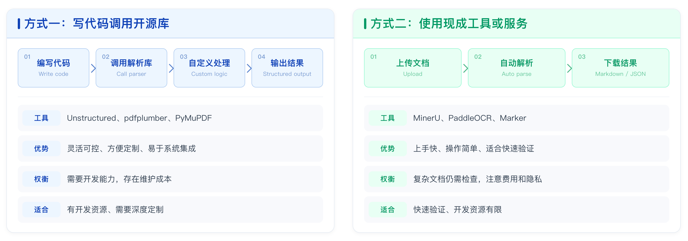

> **怎么选**：要**定制、要集成** → 选**方式一**；要**省力、要快速** → 选**方式二**。

> MinerU 官网： https://mineru.net/ ；配套文档解析代码：`doc_parse_project`。

### 3. 文档解析工具对比

| 工具 / 产品 | 支持格式 | 核心能力 / 优势 | 是否开源 | 适合场景 |
| --- | --- | --- | --- | --- |
| **MinerU** | PDF、扫描图像等 | 高精度 PDF 转 Markdown/JSON，支持复杂排版还原及多模态元素提取（公式转 LaTeX、表格、图片提取），内置强大 OCR | ✅ | 学术论文提取、RAG 知识库构建、大模型训练数据准备 |
| **PaddleOCR** | PDF、各类图片格式 | 基于视觉大模型提供超高精度 OCR，支持 100+ 种语言，擅长复杂图表、公式、非结构化版面 | ✅ | 扫描件文字识别、版面分析、端侧部署与信息抽取 |
| **Marker** | PDF、IMG、PPTX、DOCX、XLSX 等 | 快速高精度转为 Markdown/JSON/HTML，自动格式化表格与数学公式，提取并保存图片，自动去页眉页脚，支持 90+ 语言 | ✅ | 批量转换电子书/论文、RAG 预处理、多语言复杂文档 |
| **Unstructured** | PDF、HTML、MD、TXT 等 | 支持多格式结构提取、拆 chunk | ✅ | 通用英文文档预处理，开源项目首选 |
| **pdfplumber / PyMuPDF** | PDF | 适合纯文本 PDF 提取、快速预览 | ✅ | 报告、年报、论文等结构简单的 PDF |

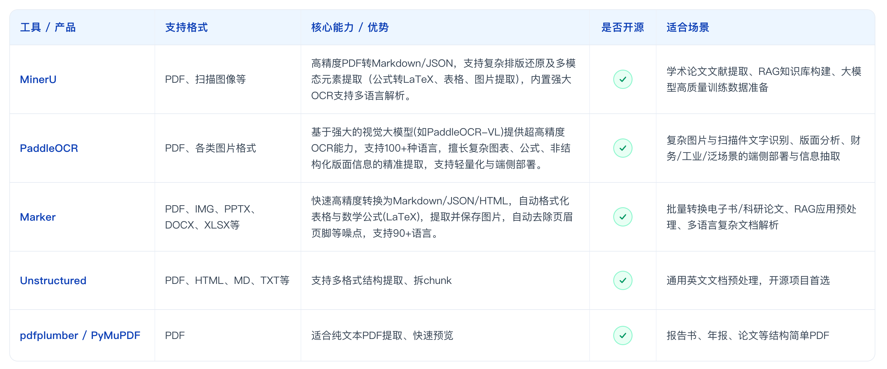

> **结论**：五款工具均开源；**PDF 是唯一被全部支持的格式** —— 选型先看**文档类型**，再看是否需要**端侧部署**。

---

## 五、Naive RAG —— 文档分块

RAG 文档分块方法详解：六种方法分成三档 —— **规则档、结构档、语义档**。

| 档位 | 方法 | 切分依据 | 是否需要模型 |
| --- | --- | --- | --- |
| **规则档**<br>RULE-BASED | 定长切分 | 固定长度 | 否 |
| | 分隔符切分 | 指定分隔符 | 否 |
| | 递归切分 | 分隔符优先级 + 长度上限 | 否 |
| **结构档**<br>STRUCTURE | 结构切分 | 文档自身的层级结构 | 否（需解析器） |
| **语义档**<br>SEMANTIC | 语义切分 | 相邻句向量的距离 | 是（embedding） |
| | 模型切分 | LLM 判定的边界或改写 | 是（LLM） |

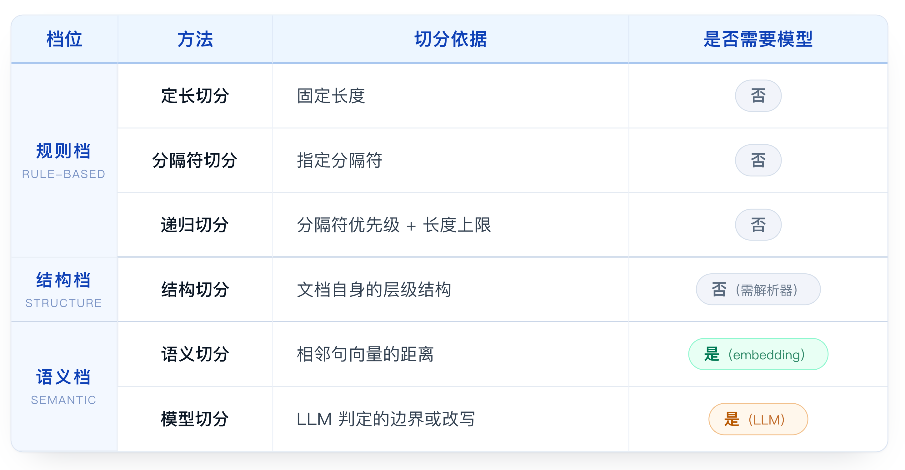

**成本与效果**：成本与效果呈**同步连续增长**。

- **规律**：越往**语义档**，切分质量越高，但**索引阶段的一次性成本涨得更快**。
- 多数场景的**性价比拐点**落在**递归切分与结构切分之间**（**递归切分**常作为默认起点）。

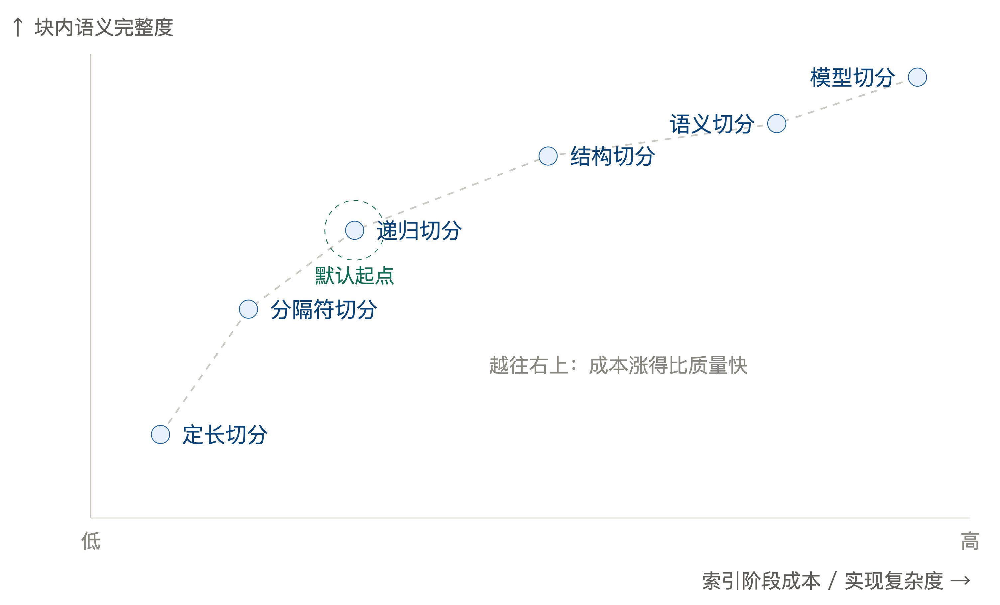

---

## 六、Naive RAG —— 嵌入模型与文档向量化

### 1. 向量与嵌入模型

- **向量**：简单来说，就是**文本的数学表示**。在 RAG 流程中，文档被切分成块后，每一个文本块都会被转化成一个对应的**向量**。
- **向量模型 / 嵌入模型**：用来实现**文本向量化**的模型，接收文本，输出一个能表征其语义的**文本块向量（句向量）**。
- **为什么要用嵌入模型做文档向量化？** 想知道文本与文本之间的**语义关系**，就需要转成向量，通过计算**向量相似度**来对应语义相关性 —— **向量越相似，语义越相关**。

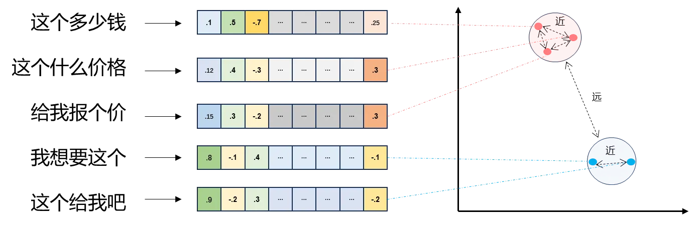

> ⚠️ **注意**：不同的嵌入模型即使使用**相同的文本**，得到的向量一般也不一样（语料不一样或向量维度不一样）。

### 2. 企业常用嵌入模型三大阵营

<table>
<tr>
<td>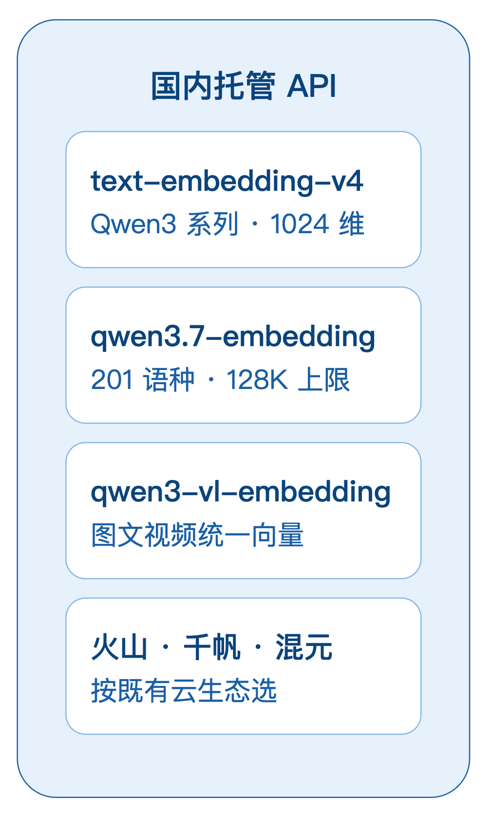</td>
<td>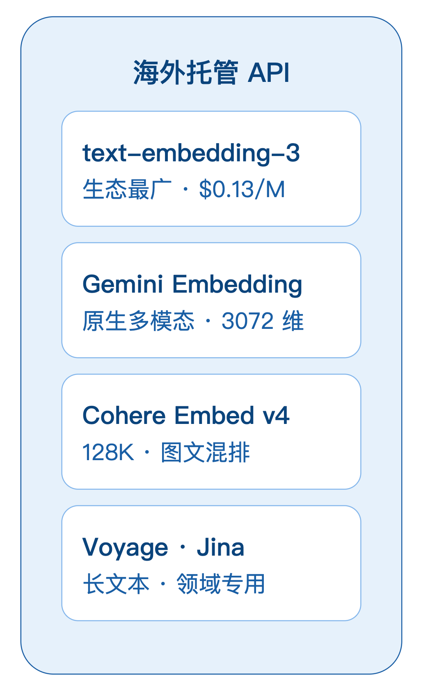</td>
<td>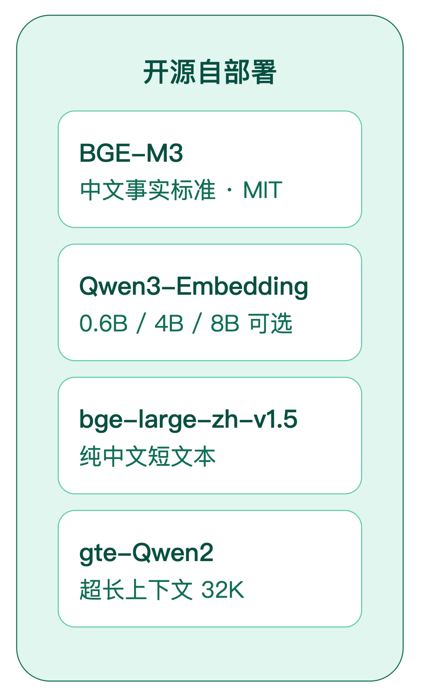</td>
</tr>
</table>

### 3. 企业常用嵌入模型对比

| 模型 | 阵营 | 关键规格 | 价格参考 | 企业选它的理由 |
| --- | --- | --- | --- | --- |
| **BGE-M3**（智源 BAAI） | 开源 | 1024 维 / 8192 tok，568M 参数 | MIT 自部署 | 中文 RAG 事实标准；稠密+稀疏+多向量三合一，单模型即可做混合检索 |
| **bge-large-zh-v1.5**（智源 BAAI） | 开源 | 1024 维 / 512 tok，326M 参数 | MIT 自部署 | 纯中文短文本稳定，多作老项目存量基线 |
| **Qwen3-Embedding**（0.6B/4B/8B） | 开源 | 最高 4096 维，32K 上下文 | 自部署需 GPU | 中文与多语言精度天花板，按显存选档部署 |
| **text-embedding-v4**（阿里百炼） | 国内托管 | 默认 1024 维（64–2048 可调），单行 8192 tok | $0.07 / 1M tok | OpenAI 兼容协议，接入成本最低，与阿里云生态打通 |
| **qwen3.7-text-embedding**（阿里百炼） | 国内托管 | 维度 2560→256，单行 128K tok | $0.07 / 1M tok | 长文档免切分；覆盖 201 种语言与方言 |
| **text-embedding-3-large**（OpenAI） | 海外托管 | 3072 / 1536 维，支持 MRL 维度截断 | $0.13 / 1M tok | 生态最广、SDK 最成熟，多作原型验证起点 |
| **Cohere Embed v4** | 海外托管 | 1536 维 / 128K，原生多模态 | $0.10 / 1M tok | 图文混排文档（PDF、PPT）可直接向量化 |
| **Gemini Embedding**（Voyage-3 · Jina v3） | 海外托管 | 3072 维 / 长上下文，支持 MRL | $0.06–0.20 | 领域专用（代码、法律、金融）与超长文本场景 |

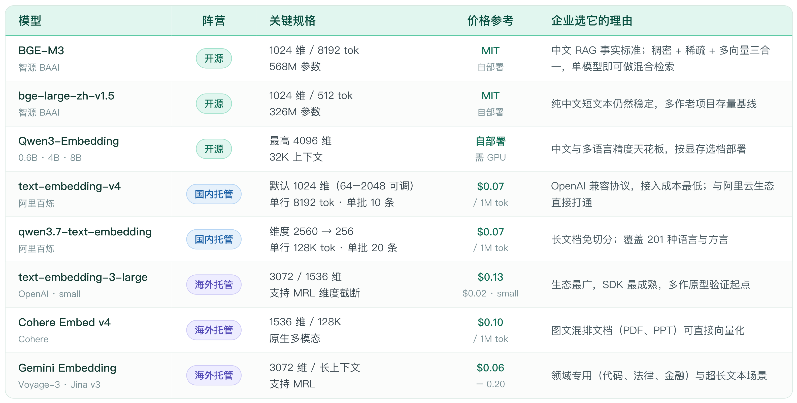

### 4. 按企业规模的部署路线建议

> 以下"月嵌入量"为**参考值，不是绝对值**。

<table>
<tr>
<td>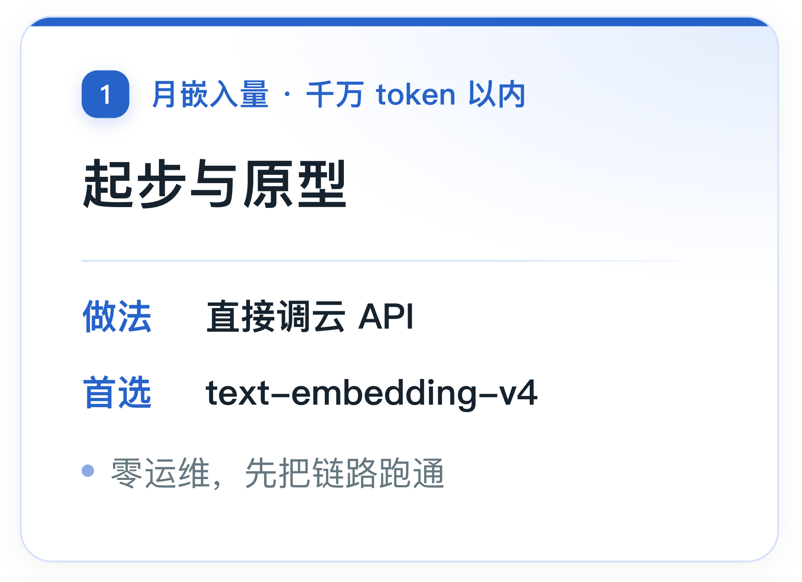</td>
<td>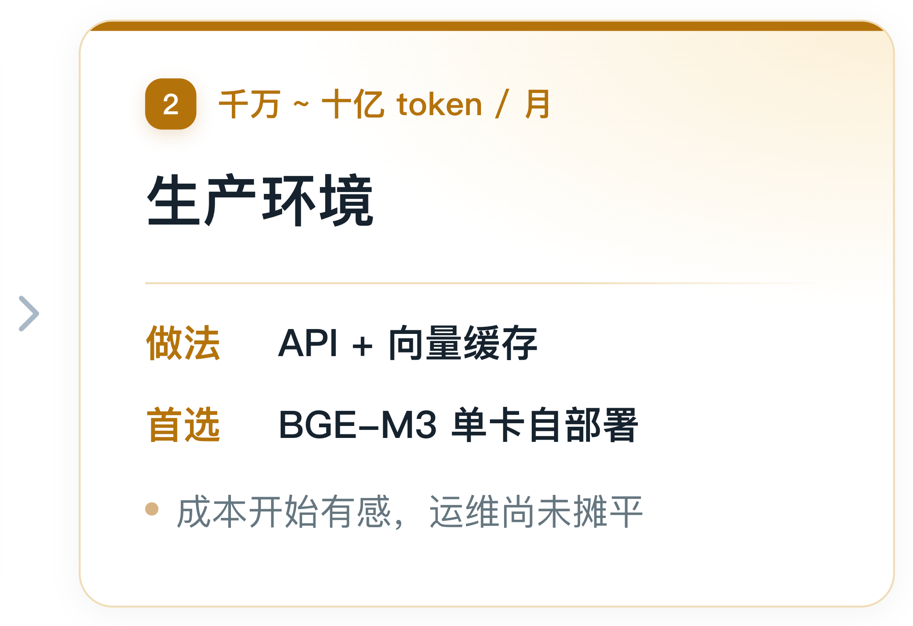</td>
<td>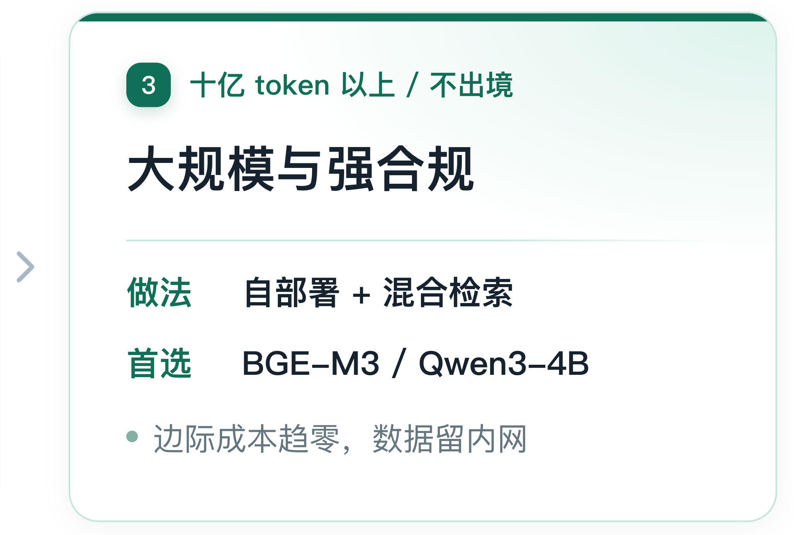</td>
</tr>
</table>

| 路线 | 月嵌入量（参考） | 做法 | 首选 | 说明 |
| --- | --- | --- | --- | --- |
| ① **起步与原型** | 千万 token 以内 | 直接调云 API | `text-embedding-v4` | 零运维，先把链路跑通 |
| ② **生产环境** | 千万 ~ 十亿 token / 月 | API + 向量缓存 | `BGE-M3` 单卡自部署 | 成本开始有感，运维尚未摊平 |
| ③ **大规模与强合规** | 十亿 token 以上 / 不出境 | 自部署 + 混合检索 | `BGE-M3` / `Qwen3-4B` | 边际成本趋零，数据留内网 |

### 5. 嵌入模型的 2 种使用方式

<table>
<tr>
<td>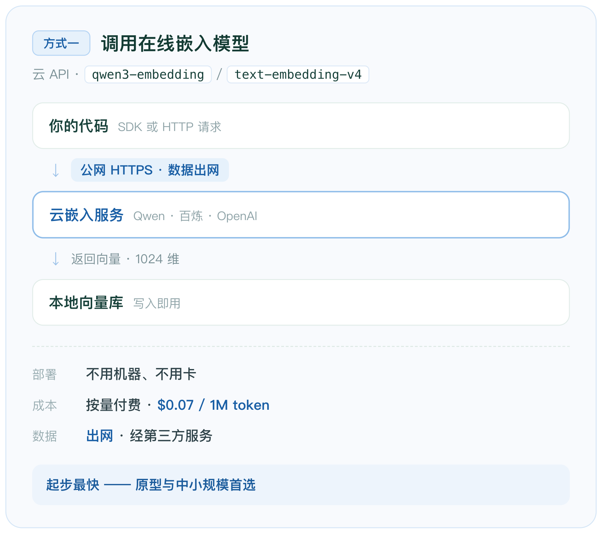</td>
<td>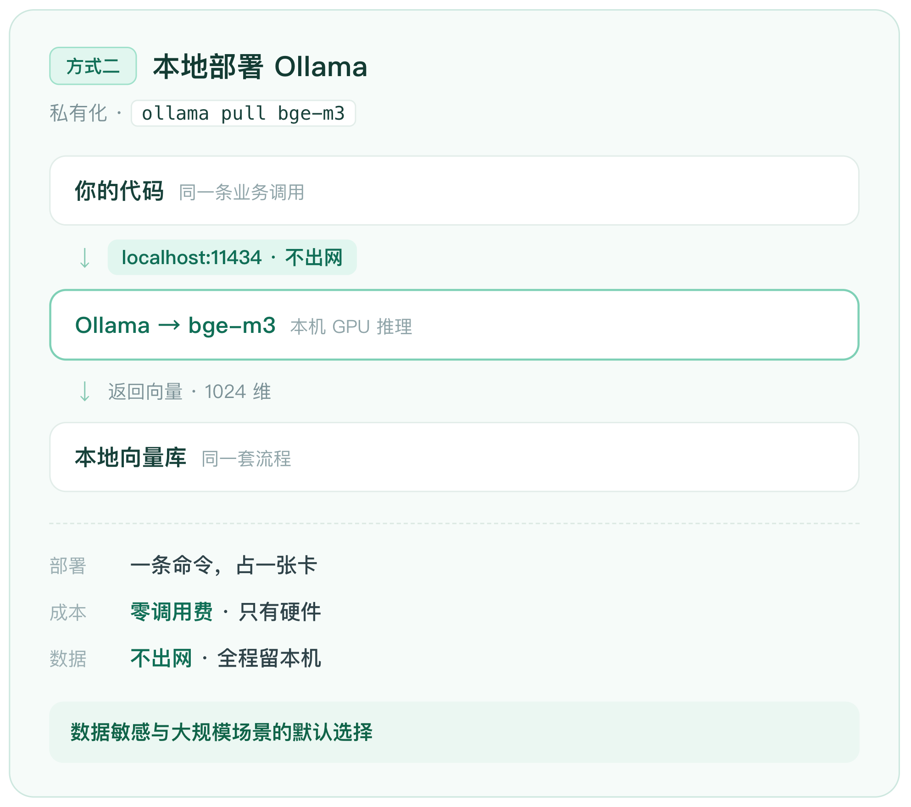</td>
</tr>
</table>

| | 方式一：调用在线嵌入模型 | 方式二：本地部署 Ollama |
| --- | --- | --- |
| **调用** | 云 API（`qwen3-embedding` / `text-embedding-v4`），走公网 HTTPS | `ollama pull bge-m3`，走 `localhost:11434`，不出网 |
| **部署** | 不用机器、不用卡 | 一条命令，占一张卡 |
| **成本** | 按量付费（$0.07 / 1M token） | 零调用费，只有硬件 |
| **数据** | 出网，经第三方服务 | 不出网，全程留本机 |
| **适合** | 起步最快，原型与中小规模首选 | 数据敏感与大规模场景的默认选择 |

> Ollama 官网： https://ollama.com/

### 6. 千问（qwen）嵌入模型对比

> 参考： https://docs.bailian.console.aliyun.com/zh/model-studio/text-embedding-synchronous-api

| 模型 | 向量维度 | 最大行数 | 单行最大 Token | 单价（元/千 token） | 适用场景 |
| --- | --- | --- | --- | --- | --- |
| **qwen3.7-text-embedding** | 2560 / 2048 / 1536 / 1024（默认）/ 768 / 512 / 256 | 20 | 128,000 | 0.0005 | 精度优先首选；RAG 主库、跨语言与代码检索 |
| **qwen3.7-text-embedding-flash** | 1024（默认）/ 768 / 512 / 256 | 20 | 128,000 | 0.000125 | 性价比首选；大规模入库、长文档场景 |
| **text-embedding-v4** | 2048 / 1536 / 1024（默认）/ 768 / 512 / 256 / 128 / 64 | 10 | 8,192 | 0.0005 | 存量项目延续；已建 v4 索引不必重建 |
| **text-embedding-v3** | 1024（默认）/ 768 / 512 / 256 / 128 / 64 | 10 | 8,192 | 0.0005 | 迁移过渡；仅 v3 索引迁移期使用 |
| **text-embedding-v2** | 1536（固定） | 25 | 2,048 | 0.0007 | 遗留系统兼容 |
| **text-embedding-v1** | 1536（固定） | 25 | 2,048 | 0.0007 | 遗留系统兼容，仅作兜底 |

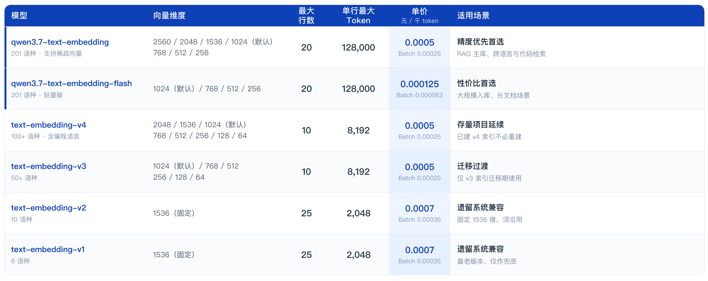

### 7. Ollama 本地部署嵌入模型 BGE-M3

- 下载 Ollama： https://ollama.com/download

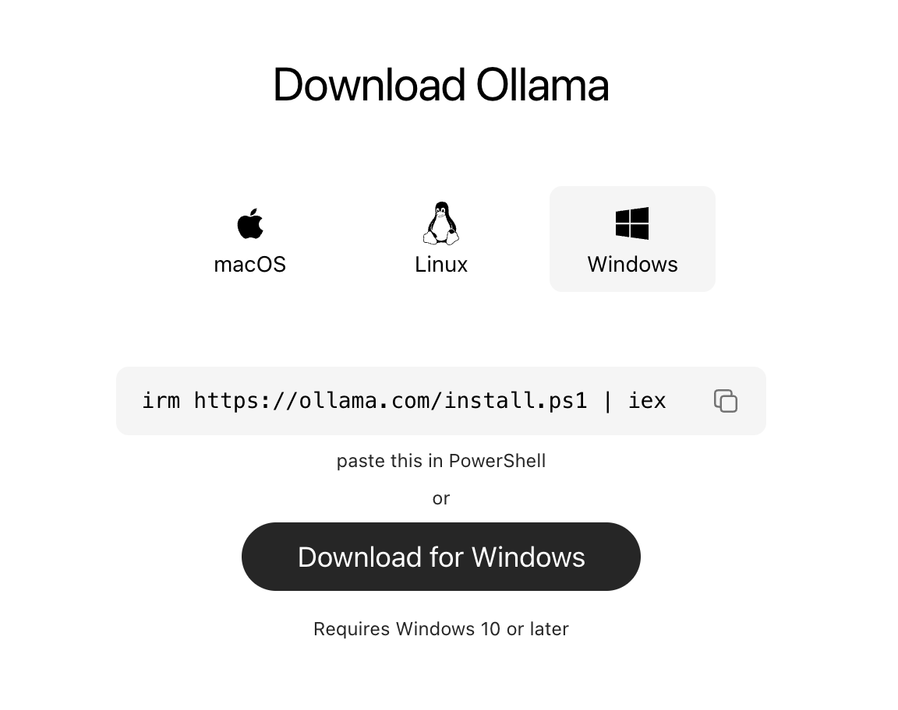

- 安装并验证 bge-m3：

```bash
ollama pull bge-m3
ollama list
```

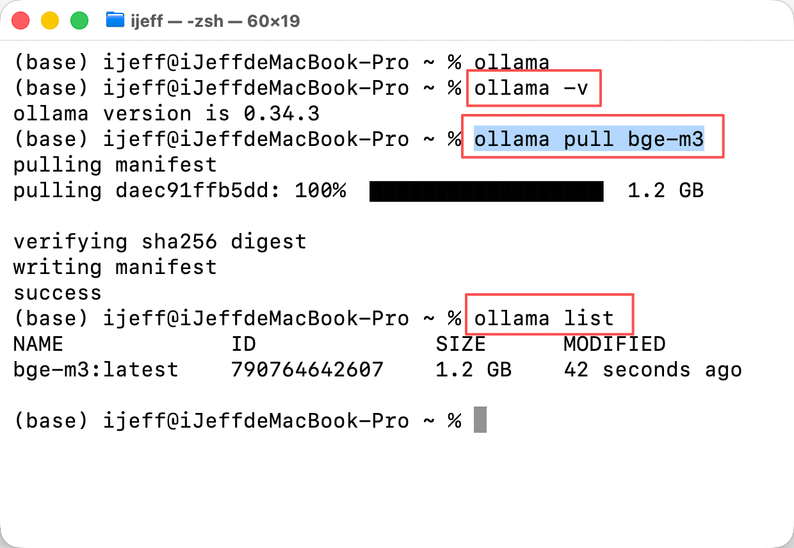

---

## 七、自测小问题

1. 大语言模型自身存在哪三个局限性？RAG 能解决其中哪些？
2. 什么是 RAG？它的本质是什么？
3. RAG 系统分为哪两个阶段？各自包含哪些步骤？
4. 为什么两个阶段必须使用同一个嵌入模型？
5. 文档解析的目标是什么？四类文档解析各有什么注意点？
6. 文档解析的两种实现方式各有什么优缺点？分别适合什么场景？
7. 文档分块的六种方法分为哪三档？性价比拐点在哪里？
8. 什么是向量、嵌入模型？为什么需要做文档向量化？
9. 企业常用嵌入模型有哪三大阵营？
10. 按企业规模，嵌入模型部署的三个路线分别是什么？
11. 嵌入模型的两种使用方式有什么区别？
12. 如何在本地用 Ollama 部署 BGE-M3？
