# L2-day02《Naive RAG 构建流程与应用实践-2》学习笔记

> 本笔记由课件《L2-day02_NaiveRAG构建流程与应用实践-2》整理，配套图片见 `images/` 文件夹。
> 本篇是 Naive RAG 的**下半篇**：前半部分（RAG 概述、文档解析、文档分块、嵌入模型与文档向量化）与 day01 一致，本篇在其基础上**新增"向量数据库与智能问答"及实战**。

---

## 一、本阶段课程安排

| 章节 | 章节名称 |
| --- | --- |
| 1 | Naive RAG 构建流程与应用实践 |
| 2 | LangChain V1.x 框架从入门到精通 |
| 3 | RAG 痛点分析与优化方案实践 / Advanced RAG |
| 4 | 掌握 RAG 应用评估技能和工具 |
| 5 | RAG 开源项目综合应用 |
| 6 | 实战项目：金融助手商业化实战 |

- **课程前置**：计算机通识、Python 语言基础知识、PyCharm 基本使用、L1 阶段学习内容等。
- ⚠️ 以上是**章节安排，不是课时安排**：一章若一次课没讲完会顺延，一次课也可能讲多个章节。

**这节课要学什么**：

- RAG —— 检索增强生成
- Naive RAG **文档解析 / 文档分块 / 嵌入模型与文档向量化**
- Naive RAG **向量数据库与智能问答**
- 实战：**Naive RAG 实现公司 HR 制度智能问答系统**

---

## 二、RAG —— 检索增强生成

### 1. 大语言模型本身存在的局限性

1. **时效性**：训练数据存在**时间截止点**，参数中的知识不会自动更新。
2. **知识覆盖度**：训练语料以**公开数据**为主，对**私有数据、垂直专业细节和长尾知识**覆盖不足。
3. **AI 幻觉**：模型在缺乏知识时仍流畅、自信地生成**看似合理但事实错误或无依据**的内容。

<table>
<tr>
<td>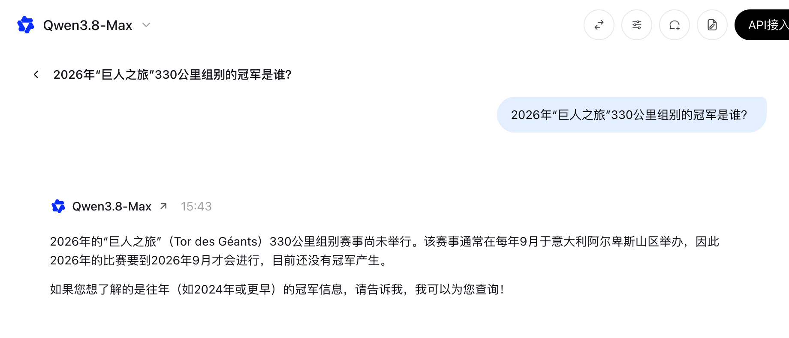</td>
<td>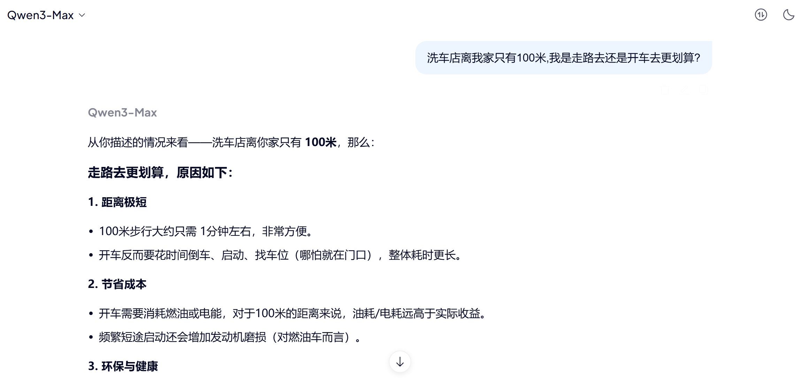</td>
</tr>
</table>

**解决方案：RAG（检索增强生成）**。

### 2. 什么是 RAG

- **RAG（Retrieval Augmented Generation / 检索增强生成）**：结合**检索**和**生成**两种方法，先检索相关文档，用检索信息**增强提示词**，再让大模型生成答案。
- **RAG 的本质：RAG = 大模型 + 外部数据**。

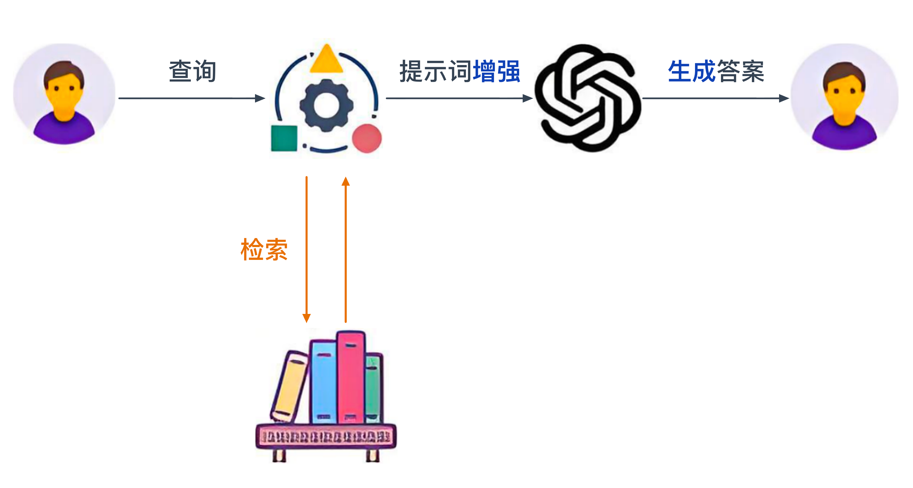

### 3. RAG 系统工作流程

- **阶段一 · 知识库构建（离线，入库时跑一次）**：`原始文档 → 文档解析 → 文档分块 → 向量化 → 向量数据库`
- **阶段二 · 检索生成（在线，每次提问跑一遍）**：`用户提问 → 问题向量化 → 检索文档块(Top-K) → 拼成提示词 → 大模型生成 → 最终答案`
- ⚠️ 两个阶段必须使用**同一个嵌入模型**。

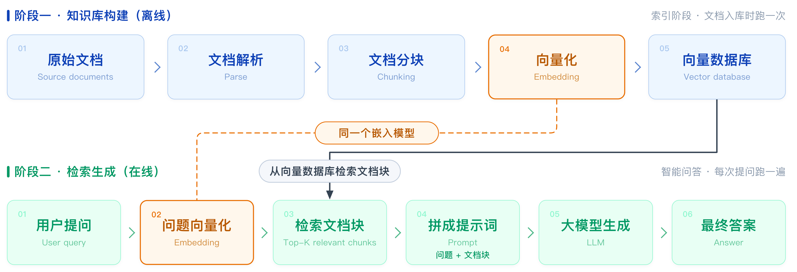

---

## 三、Naive RAG —— 文档解析

**文档解析**：把文档中的内容**准确提取出来**。流程：`接收文件 → 格式识别 → 分路解析 → 归一化 → 清洗输出`，分别处理四类文档：**txt/md、Word、PDF、Excel**。

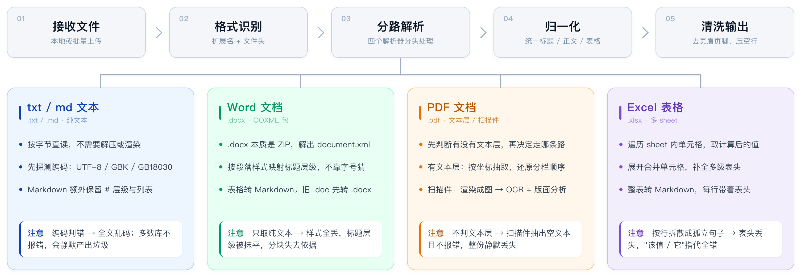

> **解析的目标不是把文件读成字符串，而是把版式还原成结构**（标题层级、表格行列、页码页眉 → 元数据）。四类里 **PDF 最不可控**（扫描件须先 OCR + 版面分析）；**Excel 必须整表保留**，拆成句子就废了。

### 解析的两种实现方式

| 方式一：写代码调用开源库 | 方式二：使用现成工具或服务 |
| --- | --- |
| 编写代码 → 调用解析库 → 自定义处理 → 输出结果 | 上传文档 → 自动解析 → 下载结果（Markdown/JSON） |
| **工具**：Unstructured、pdfplumber、PyMuPDF | **工具**：MinerU、PaddleOCR、Marker |
| **优势**：灵活可控、方便定制、易于系统集成 | **优势**：上手快、操作简单、适合快速验证 |
| **权衡**：需要开发能力，存在维护成本 | **权衡**：复杂文档仍需检查，注意费用和隐私 |
| **适合**：有开发资源、需要深度定制 | **适合**：快速验证、开发资源有限 |

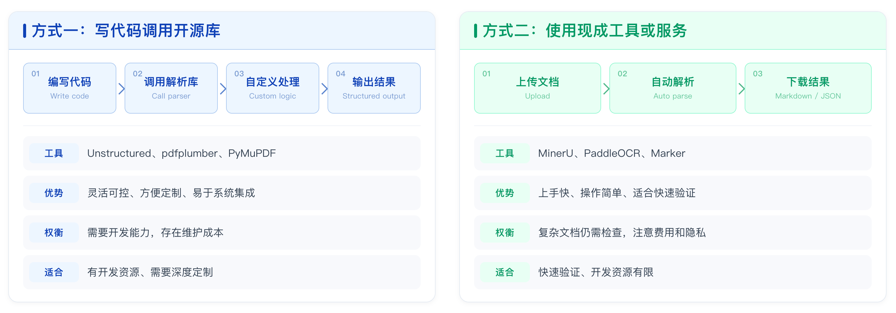

> **怎么选**：要**定制、要集成** → **方式一**；要**省力、要快速** → **方式二**。
> MinerU 官网： https://mineru.net/ ；配套代码：`doc_parse_project`。

### 文档解析工具对比

| 工具 / 产品 | 支持格式 | 核心能力 / 优势 | 是否开源 | 适合场景 |
| --- | --- | --- | --- | --- |
| **MinerU** | PDF、扫描图像等 | 高精度 PDF 转 Markdown/JSON，复杂排版还原及多模态元素提取（公式转 LaTeX、表格、图片） | ✅ | 学术论文、RAG 知识库构建、训练数据准备 |
| **PaddleOCR** | PDF、各类图片 | 超高精度 OCR，100+ 种语言，擅长复杂图表、公式、非结构化版面 | ✅ | 扫描件识别、版面分析、端侧部署 |
| **Marker** | PDF、IMG、PPTX、DOCX、XLSX | 快速转 Markdown/JSON/HTML，自动格式化公式表格、去页眉页脚，支持 90+ 语言 | ✅ | 批量转换、RAG 预处理、多语言文档 |
| **Unstructured** | PDF、HTML、MD、TXT | 多格式结构提取、拆 chunk | ✅ | 通用英文文档预处理，开源首选 |
| **pdfplumber / PyMuPDF** | PDF | 纯文本 PDF 提取、快速预览 | ✅ | 结构简单的报告、年报、论文 |

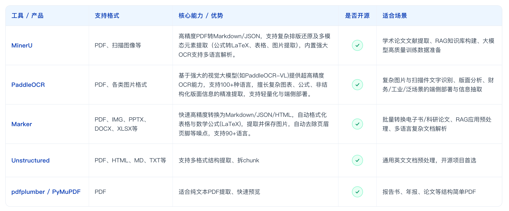

> **结论**：五款工具均开源；**PDF 是唯一被全部支持的格式** —— 选型先看**文档类型**，再看是否需要**端侧部署**。

---

## 四、Naive RAG —— 文档分块

六种方法分成三档 —— **规则档、结构档、语义档**：

| 档位 | 方法 | 切分依据 | 是否需要模型 |
| --- | --- | --- | --- |
| **规则档** RULE-BASED | 定长切分 | 固定长度 | 否 |
| | 分隔符切分 | 指定分隔符 | 否 |
| | 递归切分 | 分隔符优先级 + 长度上限 | 否 |
| **结构档** STRUCTURE | 结构切分 | 文档自身的层级结构 | 否（需解析器） |
| **语义档** SEMANTIC | 语义切分 | 相邻句向量的距离 | 是（embedding） |
| | 模型切分 | LLM 判定的边界或改写 | 是（LLM） |

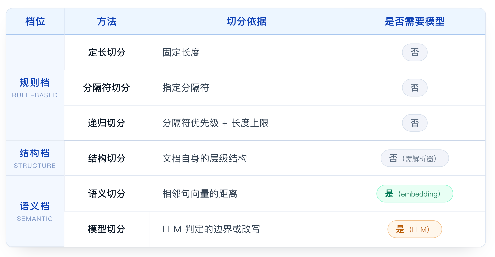

**成本与效果**：呈**同步连续增长**。越往**语义档**，切分质量越高，但**索引阶段的一次性成本涨得更快**；多数场景的**性价比拐点**落在**递归切分与结构切分之间**（**递归切分**常作默认起点）。

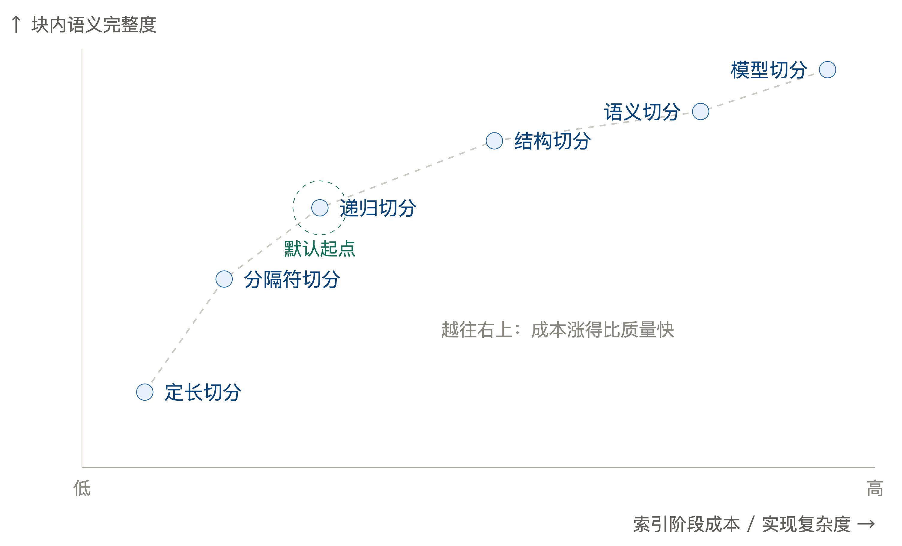

---

## 五、Naive RAG —— 嵌入模型与文档向量化

### 1. 向量与嵌入模型

- **向量**：文本的**数学表示**，每个文本块转化成一个对应向量。
- **向量模型 / 嵌入模型**：实现文本向量化，接收文本，输出表征其语义的**文本块向量（句向量）**。
- **为什么要向量化**：要通过计算**向量相似度**来对应**语义相关性** —— **向量越相似，语义越相关**。

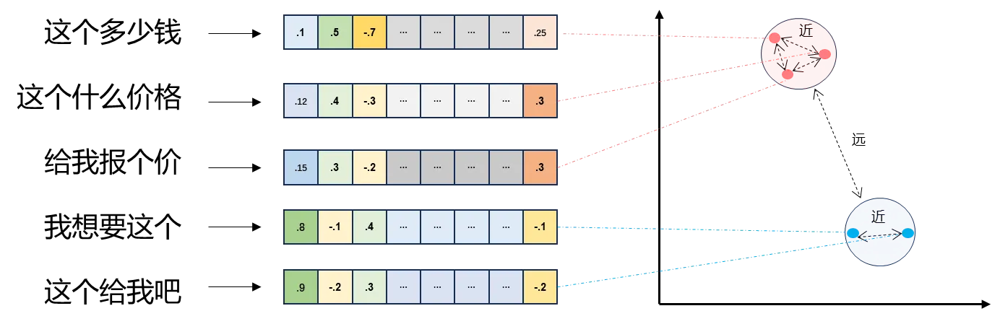

> ⚠️ **注意**：不同嵌入模型即使使用**相同文本**，得到的向量一般也不一样（语料或向量维度不同）。

### 2. 企业常用嵌入模型三大阵营

<table>
<tr>
<td>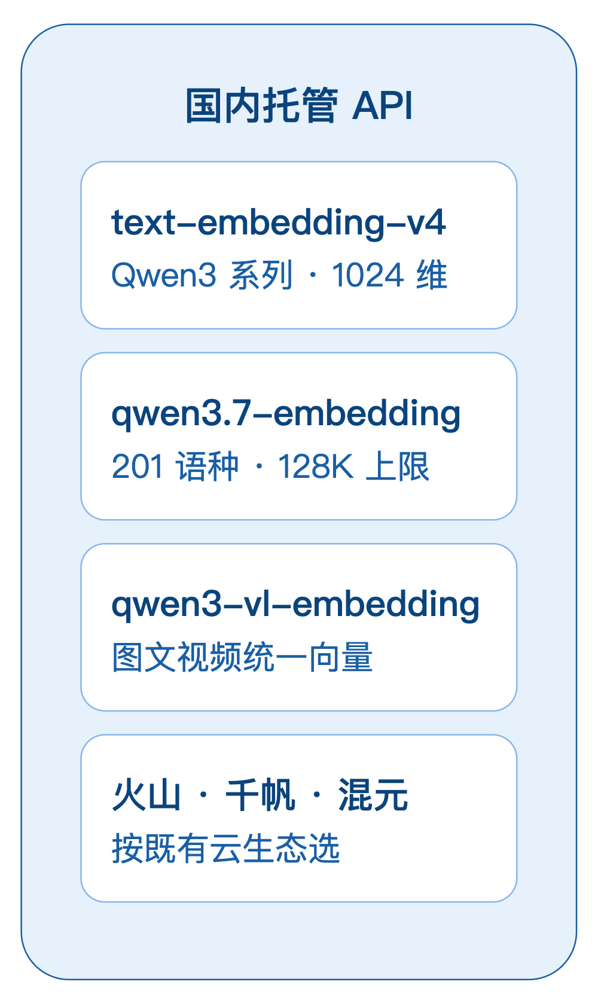</td>
<td>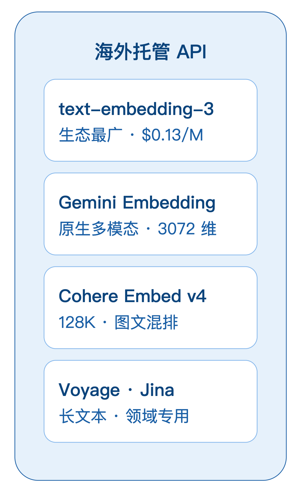</td>
<td>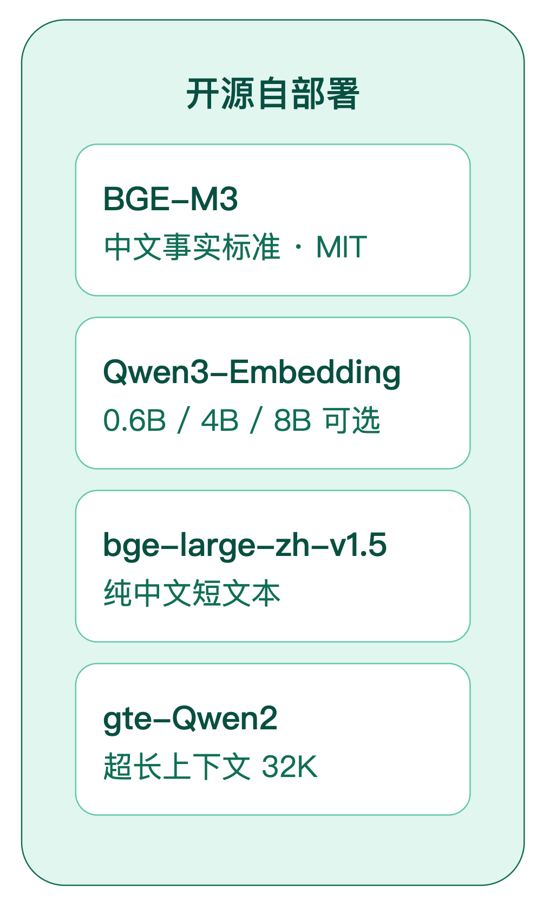</td>
</tr>
</table>

### 3. 企业常用嵌入模型对比

| 模型 | 阵营 | 关键规格 | 价格参考 | 企业选它的理由 |
| --- | --- | --- | --- | --- |
| **BGE-M3**（智源 BAAI） | 开源 | 1024 维 / 8192 tok，568M 参数 | MIT 自部署 | 中文 RAG 事实标准；稠密+稀疏+多向量三合一 |
| **bge-large-zh-v1.5**（智源 BAAI） | 开源 | 1024 维 / 512 tok，326M 参数 | MIT 自部署 | 纯中文短文本稳定，老项目存量基线 |
| **Qwen3-Embedding**（0.6B/4B/8B） | 开源 | 最高 4096 维，32K 上下文 | 自部署需 GPU | 中文与多语言精度天花板 |
| **text-embedding-v4**（阿里百炼） | 国内托管 | 默认 1024 维（64–2048 可调），单行 8192 tok | $0.07 / 1M tok | OpenAI 兼容协议，接入成本最低 |
| **qwen3.7-text-embedding**（阿里百炼） | 国内托管 | 维度 2560→256，单行 128K tok | $0.07 / 1M tok | 长文档免切分；覆盖 201 种语言与方言 |
| **text-embedding-3-large**（OpenAI） | 海外托管 | 3072 / 1536 维，支持 MRL | $0.13 / 1M tok | 生态最广、SDK 最成熟，原型验证起点 |
| **Cohere Embed v4** | 海外托管 | 1536 维 / 128K，原生多模态 | $0.10 / 1M tok | 图文混排文档可直接向量化 |
| **Gemini Embedding**（Voyage-3 · Jina v3） | 海外托管 | 3072 维 / 长上下文，支持 MRL | $0.06–0.20 | 领域专用与超长文本场景 |

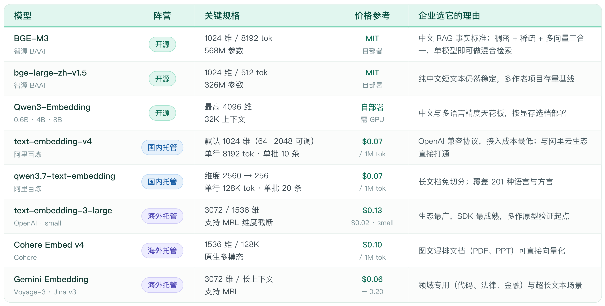

### 4. 按企业规模的部署路线建议

> "月嵌入量"为**参考值，不是绝对值**。

<table>
<tr>
<td>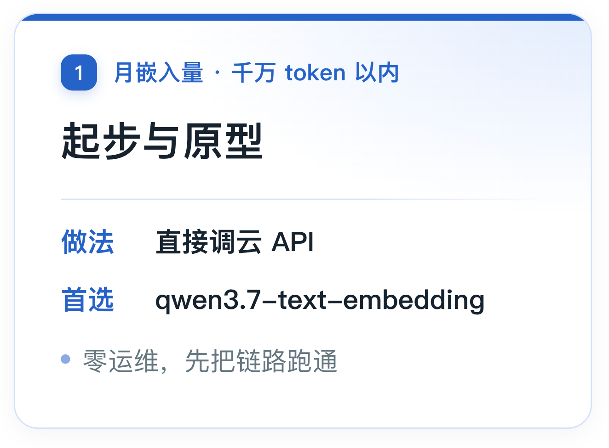</td>
<td>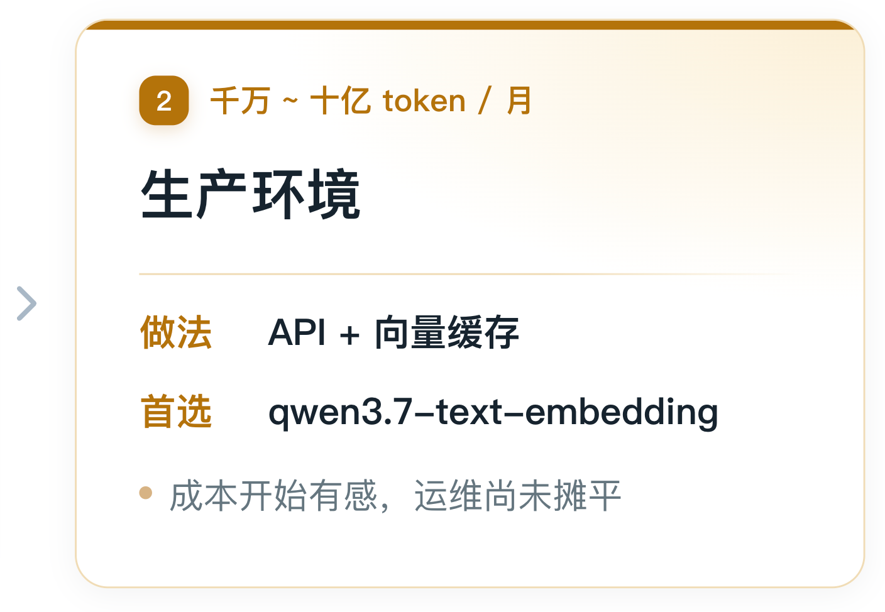</td>
<td>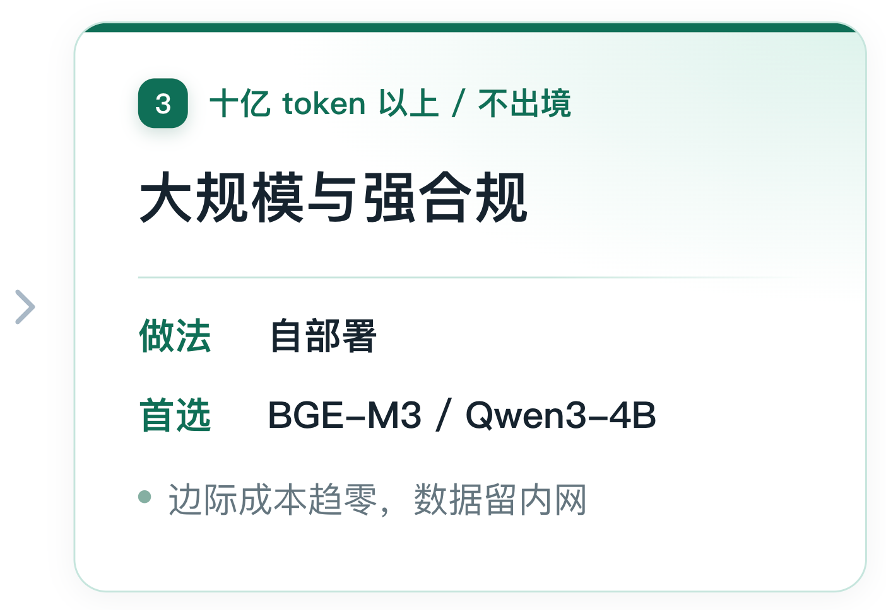</td>
</tr>
</table>

| 路线 | 月嵌入量（参考） | 做法 | 首选 | 说明 |
| --- | --- | --- | --- | --- |
| ① **起步与原型** | 千万 token 以内 | 直接调云 API | `qwen3.7-text-embedding` | 零运维，先把链路跑通 |
| ② **生产环境** | 千万 ~ 十亿 token / 月 | API + 向量缓存 | `qwen3.7-text-embedding` | 成本开始有感，运维尚未摊平 |
| ③ **大规模与强合规** | 十亿 token 以上 / 不出境 | 自部署 | `BGE-M3` / `Qwen3-4B` | 边际成本趋零，数据留内网 |

### 5. 嵌入模型的 2 种使用方式

<table>
<tr>
<td>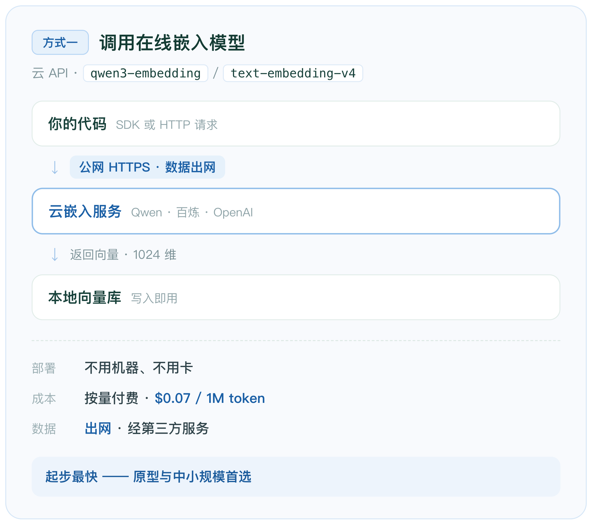</td>
<td>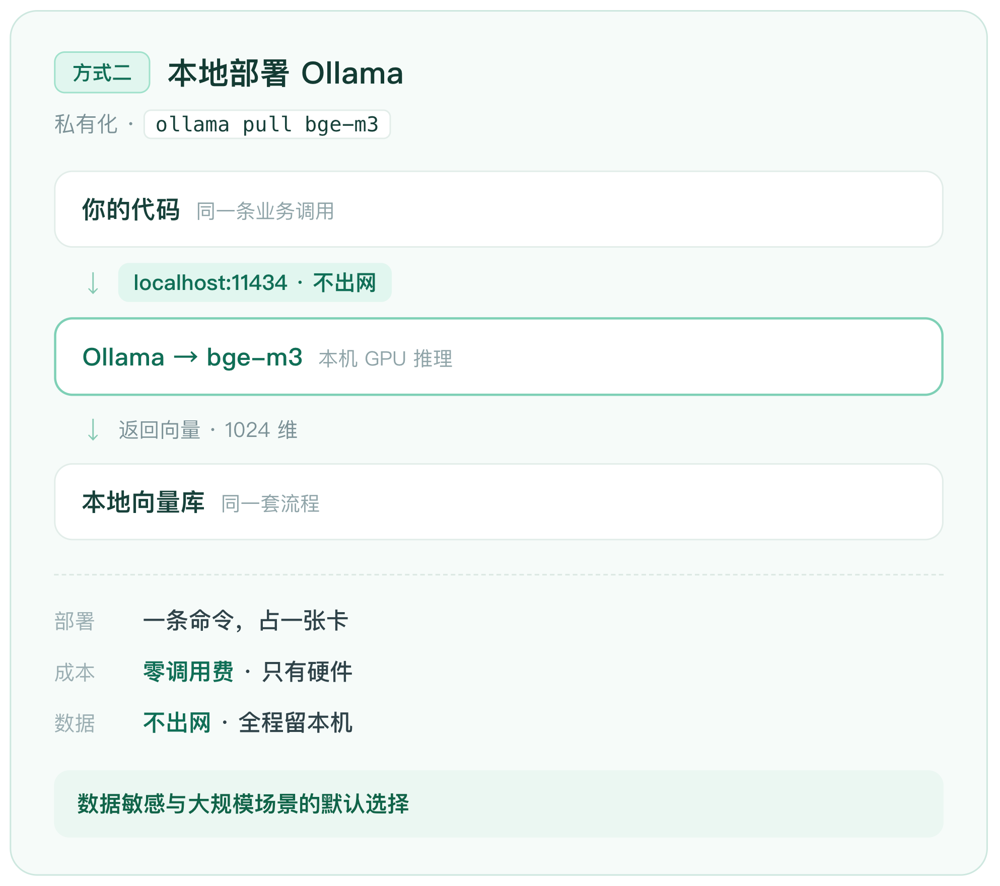</td>
</tr>
</table>

| | 方式一：调用在线嵌入模型 | 方式二：本地部署 Ollama |
| --- | --- | --- |
| **调用** | 云 API（`qwen3-embedding` / `text-embedding-v4`），公网 HTTPS | `ollama pull bge-m3`，走 `localhost:11434` |
| **部署** | 不用机器、不用卡 | 一条命令，占一张卡 |
| **成本** | 按量付费（$0.07 / 1M token） | 零调用费，只有硬件 |
| **数据** | 出网，经第三方服务 | 不出网，全程留本机 |
| **适合** | 起步最快，原型与中小规模首选 | 数据敏感与大规模场景的默认选择 |

> Ollama 官网： https://ollama.com/

### 6. 千问（qwen）嵌入模型对比

> 参考： https://docs.bailian.console.aliyun.com/zh/model-studio/text-embedding-synchronous-api

| 模型 | 向量维度 | 最大行数 | 单行最大 Token | 单价（元/千 token） | 适用场景 |
| --- | --- | --- | --- | --- | --- |
| **qwen3.7-text-embedding** | 2560 / 2048 / 1536 / 1024（默认）/ 768 / 512 / 256 | 20 | 128,000 | 0.0005 | 精度优先首选 |
| **qwen3.7-text-embedding-flash** | 1024（默认）/ 768 / 512 / 256 | 20 | 128,000 | 0.000125 | 性价比首选，大规模入库 |
| **text-embedding-v4** | 2048 / 1536 / 1024（默认）/ 768 / 512 / 256 / 128 / 64 | 10 | 8,192 | 0.0005 | 存量项目延续 |
| **text-embedding-v3** | 1024（默认）/ 768 / 512 / 256 / 128 / 64 | 10 | 8,192 | 0.0005 | 迁移过渡 |
| **text-embedding-v2** | 1536（固定） | 25 | 2,048 | 0.0007 | 遗留系统兼容 |
| **text-embedding-v1** | 1536（固定） | 25 | 2,048 | 0.0007 | 遗留系统兼容，仅作兜底 |

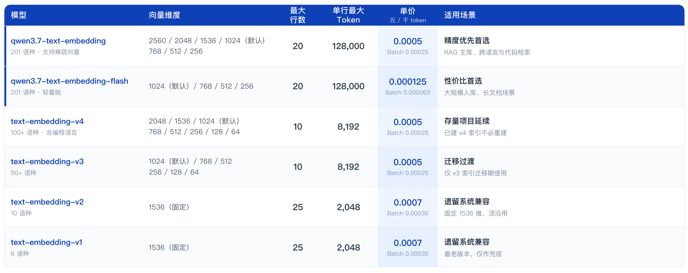

### 7. Ollama 本地部署嵌入模型 BGE-M3

下载 Ollama： https://ollama.com/download

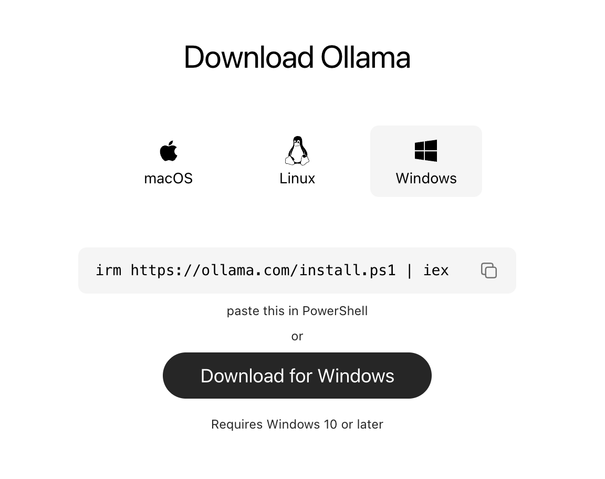

```bash
ollama pull bge-m3
ollama list
```

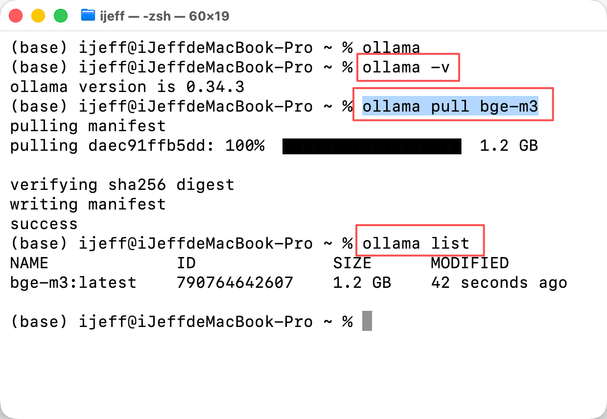

---

## 六、Naive RAG —— 向量数据库与智能问答

### 1. 向量数据库市场格局

向量数据库可分为 **专用向量数据库** 与 **支持向量检索的数据库**；又按 **开源**（Apache 2.0 / MIT）与 **商业**（或源码可见）区分：

- **专用向量数据库**：开源 —— chroma、marqo、vespa、qdrant、LanceDB、Milvus、MyScale；商业 —— Weaviate、Pinecone、腾讯云 VectorDB、阿里云 DashVector。
- **支持向量检索的数据库**：开源 —— OpenSearch、PostgreSQL；商业 —— elasticsearch、MongoDB Atlas、SingleStore。

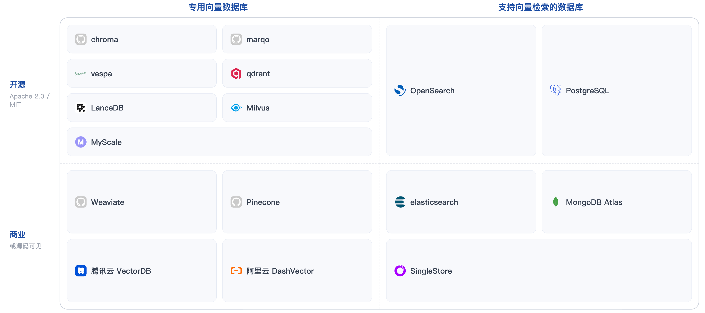

### 2. 主流向量数据库对比

| 档位 | 数据库 | 核心特点 | 典型场景 | 部署形态 |
| --- | --- | --- | --- | --- |
| **AI 原生档** | **Chroma** | 为 LLM 应用设计，API 简洁高效；内置持久化与元数据过滤；与 LangChain / LlamaIndex 深度集成 | RAG 系统、智能体记忆、LLM 应用向量存储 | 嵌入式 / 云服务 |
| **扩展档** | pgvector | 复用 PostgreSQL 生态与事务能力，支持 HNSW / IVFFlat 索引 | 已有 PG 的业务系统，千万级以内向量 | 数据库扩展 |
| | Elasticsearch | 全文检索 + 向量混合查询能力强，生态成熟 | 企业搜索、日志分析、混合检索平台 | 独立集群 |
| **分布式档** | Milvus | 云原生架构，支持十亿级向量，索引类型全面 | 大规模生产环境、高并发检索 | 独立集群 |
| **算法档** | FAISS | Meta 出品，向量检索性能标杆，索引算法最全 | 作为检索引擎的底层算法组件 | 算法库 |

> **本课选型：Chroma** —— AI 原生设计、开发效率高，从本地开发到云端部署平滑演进，是当前 LLM 应用生态的主流选择。

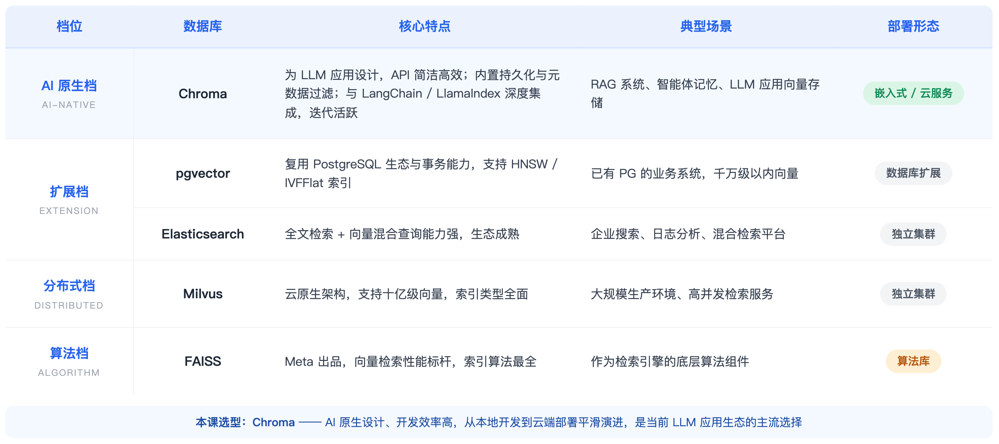

### 3. Chroma 向量数据库工作原理

- **① 入库流程**：`文档 → 分块 → 向量化 → 存储`（存储调用 `collection.add`）。

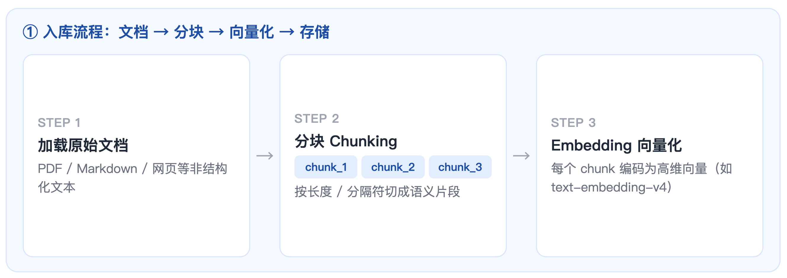

- **② 检索流程**：`提问 → 向量化 → 相似度计算 → 提示词增强 → 生成答案`（查询调用 `query`，返回 **Top-K 文档块**）。

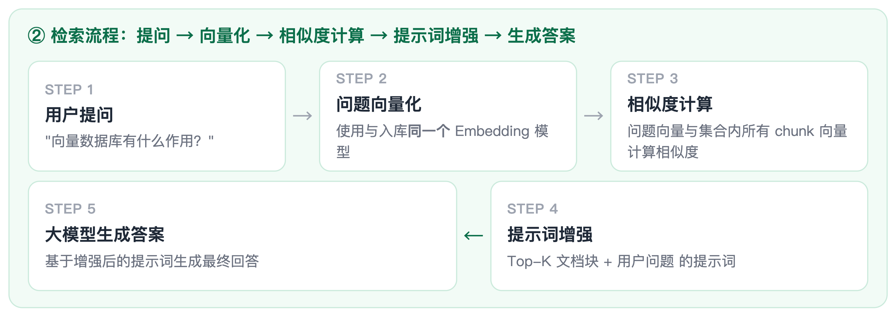

- **集合（Collection）结构**：一个**集合 = 向量 + 原文 + 元数据 + 距离度量**；一个数据库可包含**多个集合**（按项目/主题划分）。Embedding 模型与距离度量在**建集合时确定**；**检索与入库必须使用同一模型**。

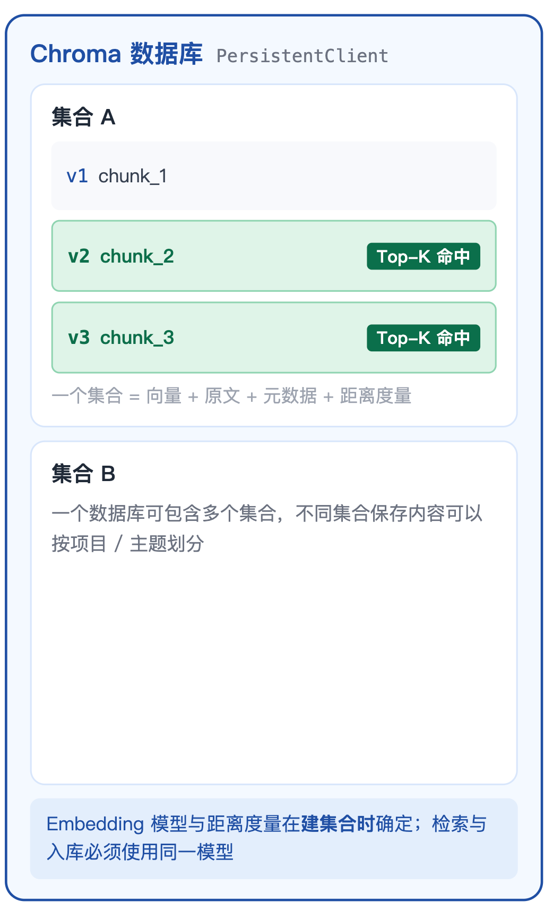

### 4. 常用的向量相似度计算方法

三种常用相似度度量的**几何含义**：

<table>
<tr>
<td>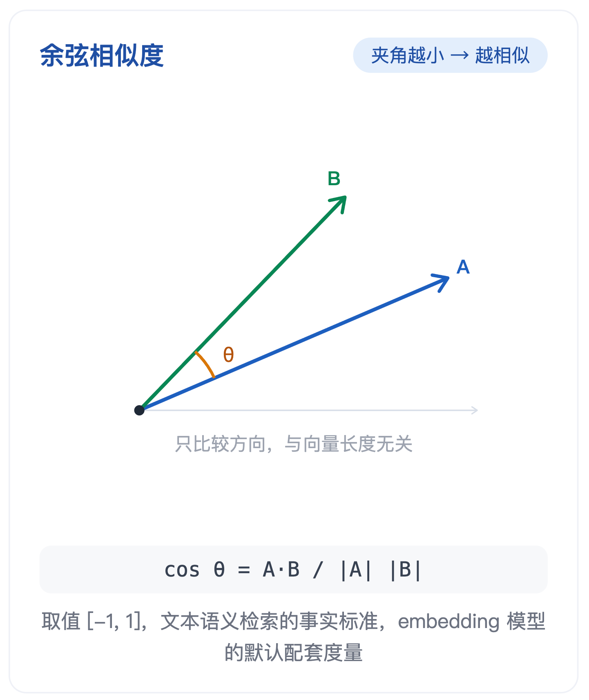</td>
<td>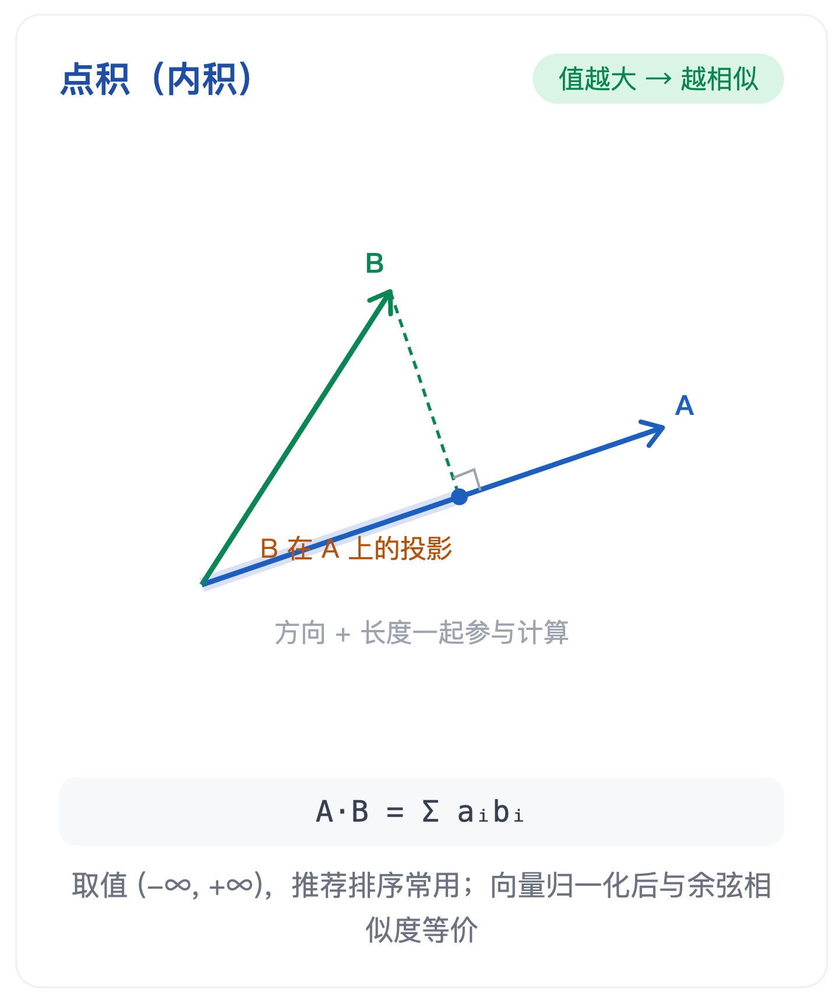</td>
<td>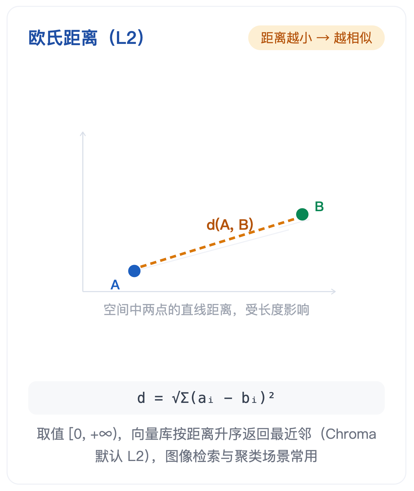</td>
</tr>
</table>

| 度量 | 几何含义 | 公式 | 取值范围 | 说明 |
| --- | --- | --- | --- | --- |
| **余弦相似度** | 只比较**方向**，与长度无关 | `cos θ = A·B / (\|A\| \|B\|)` | [-1, 1] | 越相似值越大；文本语义检索的事实标准，embedding 模型默认配套度量 |
| **点积（内积）** | 方向 + 长度一起参与（B 在 A 上的投影） | `A·B = Σ aᵢbᵢ` | (-∞, +∞) | 值越大越相似；推荐排序常用；向量归一化后与余弦相似度等价 |
| **欧氏距离（L2）** | 空间中两点的**直线距离**，受长度影响 | `d = √Σ(aᵢ - bᵢ)²` | [0, +∞) | 距离越小越相似；**Chroma 默认 L2**；图像检索与聚类常用 |

### 5. 余弦距离与余弦相似度的关系：距离 = 1 − cos θ

**两个定义**：余弦相似度 = `cos θ`；余弦距离 = `1 − cos θ`。距离越大 → 越不相似（同一枚硬币的两面）。

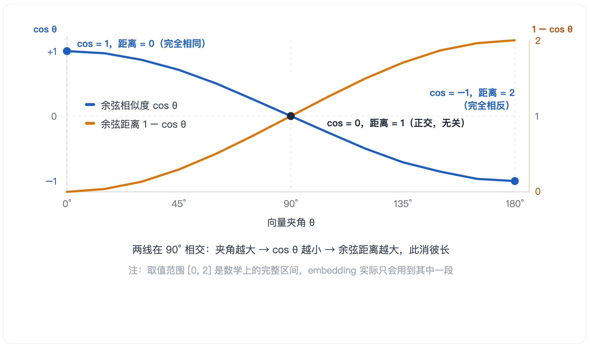

| 夹角 θ | cos θ | 余弦距离 | 含义 |
| --- | --- | --- | --- |
| 0° | 1 | 0 | 完全相同 |
| 90° | 0 | 1 | 正交无关 |
| 180° | −1 | 2 | 完全相反 |

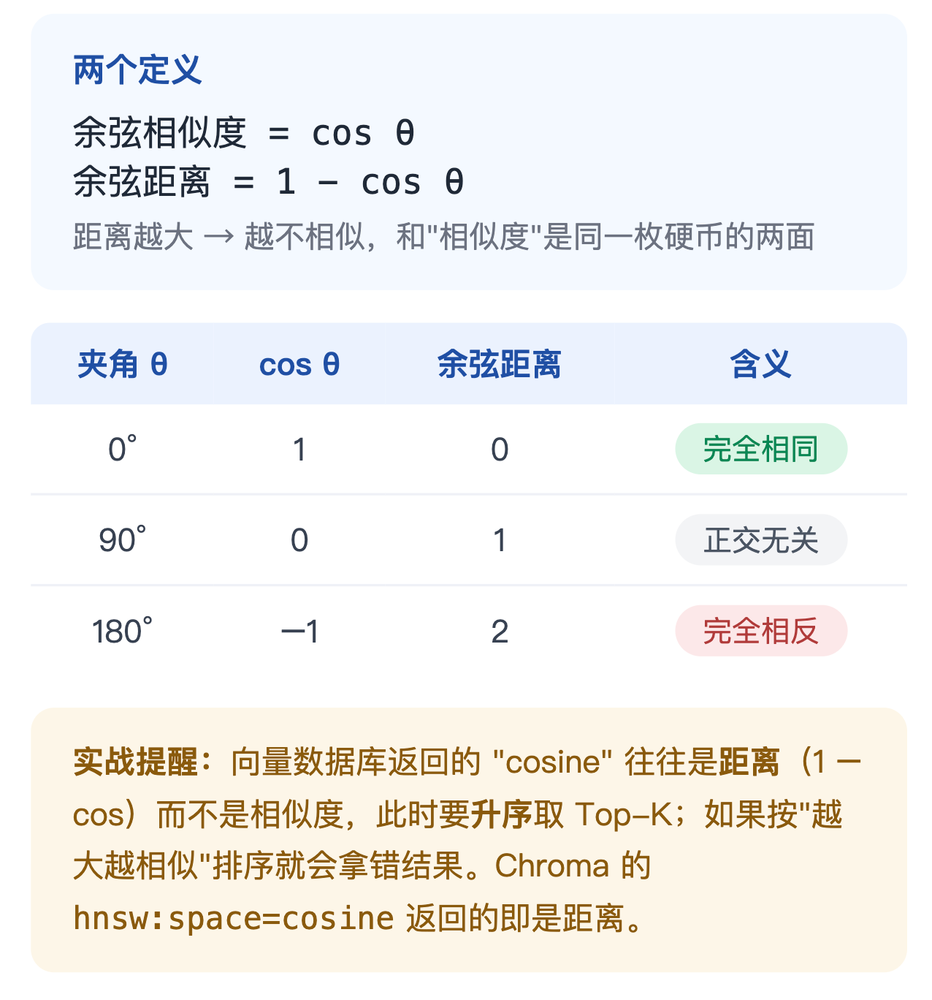

> ⚠️ **实战提醒**：向量数据库返回的 "cosine" **往往是距离（1 − cos）而不是相似度**，此时要**升序**取 Top-K；若按"越大越相似"排序就会拿错结果。Chroma 的 `hnsw:space=cosine` 返回的即是**距离**。
> **embedding 场景的实际区间**：语义向量通常非负，夹角只落在 0°–90°，即 `cos ∈ [0,1]`、`距离 ∈ [0,1]`，这也是相似度集中在 0.4–0.6 附近时排序依然可靠的原因。

---

## 七、实战：Naive RAG 实现公司 HR 制度智能问答系统

项目整体结构、界面和功能：左侧为**知识库管理 / 文档上传**，中间为**对话区**（可切换"当前知识库"），右侧为**会话历史**；支持上传 Word/PDF 自动解析入库，回答时还会附上**原始文档**出处。

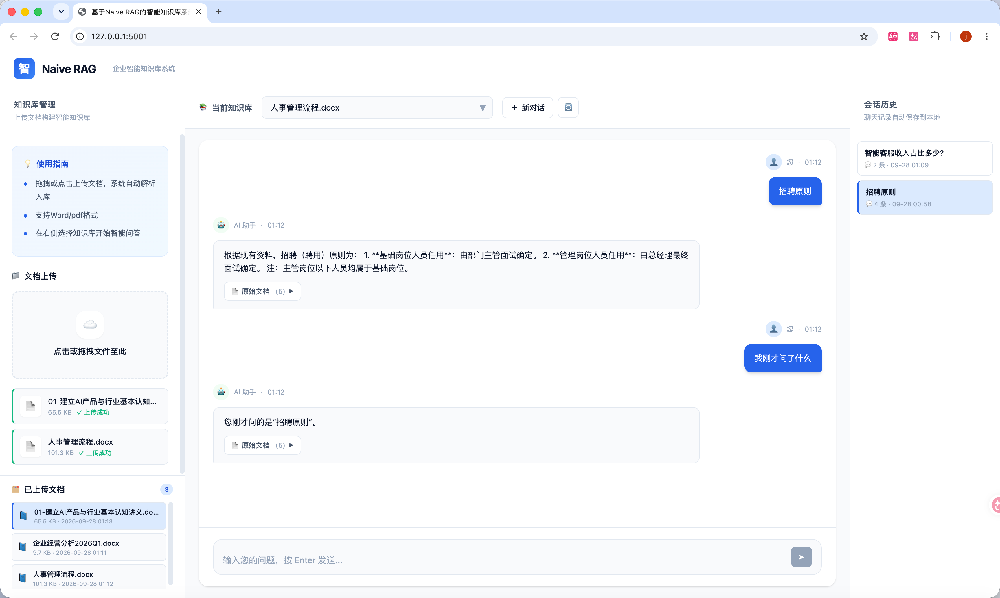

---

## 八、本章总结

1. 理解什么是 **RAG 技术**，能解决什么问题；
2. 掌握 **Naive RAG 技术的具体实现流程**；
3. 掌握如何使用**向量模型做向量化**；
4. 理解**向量数据库的作用**及基本使用；
5. 通过实战案例，学会如何使用 Naive RAG 实现**定制化大模型应用开发**。

---

## 九、自测小问题

1. RAG 系统分为哪两个阶段？各自包含哪些步骤？
2. 文档解析的两种实现方式分别适合什么场景？
3. 文档分块的六种方法分为哪三档？性价比拐点在哪里？
4. 为什么两个阶段必须使用同一个嵌入模型？
5. 向量数据库的市场格局中，"专用向量数据库"和"支持向量检索的数据库"各有哪些代表？
6. Chroma 的入库流程和检索流程分别是什么？
7. 一个 Chroma 集合包含哪些要素？一个数据库可以有多个集合吗？
8. 余弦相似度、点积、欧氏距离三者的几何含义和取值范围分别是什么？
9. 余弦距离与余弦相似度的关系是什么？向量库返回 "cosine" 时该如何排序？
10. 为什么 embedding 场景的余弦相似度常集中在 0.4–0.6 附近？
